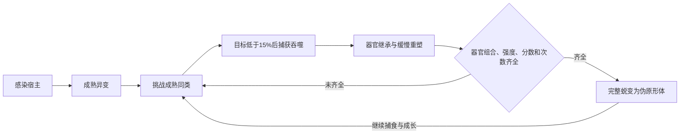

# 黑光同类吞噬、器官融合与伪原形体进化方案

版本：v0.2，结合二代本地资源的进化实施方案
日期：2026-10-24
状态：同类竞争、活体捕获、多器官继承、缓慢消化、外形聚合重塑与样本结算，以及一类人形进化者的蜕变、追击和战斗已接入。完整器官目录、美术及城市生态仍有后续项目。当前阶段仅做 NeoForge 1.21.1，Forge 1.20.1 暂不移植。

**2026-10-26 核对：** 下段保留 10 月 24 日的阶段决策记录，不能当成今天的运行状态。
本轮连续验收走真实六次捕获、器官整合与自动人形蜕变，新增功能器官可以承担对应的成熟结构角色；
实际运行器官为 12 种，目录中的 72 项不等于 72 项已制作。现状与待做项见 `INFECTION_COMPLETION_AUDIT_20261026_ZH.md`。

**2026-10-24 最新范围调整：** 用户要求先完成“吞掉另一个感染体后，身体重组为继承供体器官的聚合体”。这次改变头部、胸背和肢体的整体轮廓，连接组织与局部器官共同发育。人形蜕变留到集齐指定器官之后的后续阶段，当前仅保留资格数据，没有启用人形转换。下文涉及伪原形体、人形动作和完整蜕变的部分仍为设计目标，不能作为已实现功能宣传。

本版补全三条相连的成长线：**宿主持续发育、同类吞噬与器官融合、伪原形体蜕变后继续进化**。年龄决定自然发育，真实捕食提供养分，吞噬成熟同类取得新的器官和进阶经历。长期挂机不会凭空凑齐所有器官，也不会跳过同类吞噬成为伪原形体。

## 1. 已确认的方向

成熟的黑光感染体可以相互攻击。目标仍存活且生命低于最大生命的 15% 时，近身捕食者可以吞噬它，继承其武器和器官。继承会明显影响身体结构。

当一个感染体同时集齐指定的成熟强大器官、达到进化积累值、完成足够次数的同类吞噬后，成长为“伪原形体”。

这条进阶路线的条件全部来自同类吞噬与器官成长。动物来源的感染宿主也能参与，不额外要求吞噬村民、人类或其他人形生物，不另加拟态器官作为前置。

核心循环：

**感染宿主 → 成熟异变 → 同类竞争 → 吞噬与器官继承 → 消化重塑 → 条件齐全 → 伪原形体 → 继续吞噬进化。**



“伪原形体”暂作为本模组的进阶形态名称。本方案是玩法扩展，不把“器官组合解锁进阶”的规则表述为原作已有机制。

## 2. 现有系统与本次要补的内容

本版代码核对基线为主线合并提交 `996dffdf`。既有 `TissueEvolution` 的年龄、代数会继续推进；普通宿主的原生主导器官由稳定种子确定，为肌束、甲壳、颅颚、抓握或骨冠之一。现有 `TissueMetabolism` 猎食主要把非感染生物转成养分；本次新增 `TissueCompetition` 负责感染体之间的主动竞争、多器官继承与进阶资格记录。

现有 `TissueGrowth.MATURITY_TICKS=12000`，即正常 20 TPS 下累计模拟约十分钟后成熟；现有玩家样本品质另按 72000 / 240000 / 816000 生物年龄刻分为 1 / 2 / 3 级。**宿主成熟、强大器官、玩家三阶研究是三个不同概念。** 新玩法不能把普通成熟误写成已经拥有三阶强器官，也不能把玩家的三阶封顶带到感染体持续成长上。

本次保留出生时的原生特长，同时允许后天获得多个强大器官。需要区分以下几种数值：

| 数值 | 表达的内容 | 成长规则 |
| --- | --- | --- |
| 生物年龄、进化代数 | 生存与持续发展 | 延续现有无最终代数的设计 |
| 养分储备 | 尚未消化的食物 | 可以有储存容量，不决定最终进化上限 |
| 器官成熟度 | 新器官是否发育完成 | 到达成熟状态后，强度仍可继续提升 |
| 器官强度 | 每种器官自身的能力 | 持续成长、融合和分化，不沿用玩家研究三阶作为终点 |
| 同化积累值 | 已完成同类吞噬带来的进阶积累 | 持久保存，达到门槛后仍可累积 |
| 有效吞噬次数 | 亲自成功吞噬过多少合格同类 | 每个实际受害者仅结算一次 |

玩家目前的三阶器官研究与感染体成长是两套用途不同的数据。本方案不把它们混为一个等级。

### 2.1 二代资源能确认什么

本地资料为用户提供的 `E:/2` 三卷包，研究记录在 [二代资源核对](E:/Prototype2-Research-20261024/二代资源核对.md)。已提取 21 个 Evolved 系列包，基础 `evolved` 包声明 103 条动画；各包按名称去重为 114 个不同动画名，不能把重复名称直接相加成几千套独立动作。

| 直接读取到的资料 | 对本方案的作用 | 尚未据此证明的内容 |
| --- | --- | --- |
| `evolved_gray` 的完整人形身体、67 关节骨架 | 蜕变后采用完整人形主体，再展开能力部位 | 任意动物在原作中都能按器官组合成为 Evolved |
| `evolved_default` 的刀臂与肩部组件、40 关节骨架 | 武器从完整肩臂根部展开，按实际骨架连接 | 把该组件当作完整角色；把 40 个关节直接按序绑到另一套骨架 |
| `evolved_runner1` 的身体、刀臂和贴图 | 疾行刀臂方向的轮廓、比例与承力参考 | 所有伪原形体都穿同样的黑色守望制服 |
| 连招、闪避、后撤斩、跳斩、投掷及 transition 动画声明 | 建立动作与技能的候选清单 | 完整命中时刻、伤害、AI 优先级、中断与隐身能力 |

`ghost`、`tornado` 等包名保留为资源标识，不凭名称就承诺隐身、特殊免疫或完整新分支。`evolved_transition_1/2/3` 也要先核对曲线和状态树，不能只按命名断定它们正好构成我们设计的三段蜕变。

**还原目标**是二代 Evolved 的身体重构、武器收放、连招与回避表现；**扩展规则**是本稿的同类竞争、器官融合、四类组合与持续成长。两者在实现说明和玩家资料中分开写。

### 2.2 成长不再只有一个随机强器官

原生特长继续保留，后天通过吞噬取得其他器官类别。每一类均保存自己的成熟度、强度、来源特征和已掌握的结构；不是给原有主导器官随机换个名字。

原生特长影响整合效率、轮廓和选招倾向；当前主要战斗方式可以随器官组合改变。例如原生甲壳宿主吞噬强抓握体后可以发展成重甲捕食者，不必永远只会撞人。多个器官能同时达到主力程度。

每只生物的稳定种子控制具体刃型、甲片走向、触须根系与左右差异；只在成功融合或跨发育阶段时产生一次稳定变化并保存，不在每帧、每次受伤或读档时重新抽签。

## 3. 同类竞争与吞噬流程

### 3.1 竞争对象

“同类”按黑光感染阵营中的可进化宿主计算，可以跨原宿主物种。牛来源、蜘蛛来源和僵尸来源的成熟感染体能够发生竞争。

建议首期接现有持续器官进化的普通感染宿主。猎手、九头蛇、多部件巨型首领和母巢拥有各自的模型、AI 或生产职责，随后逐类接入继承适配，不能把普通宿主上线等同于它们都已完成。

首期互吞对象为符合条件的宿主 Mob，不把玩家自动并入 NPC 的 15% 处决目标；NPC 对玩家仍沿用现有战斗、死亡与死亡粘液流程。旁观者的镜头不因附近发生一次 NPC 吞噬而被强行接管。

建议成熟个体根据饥饿、受伤情况、附近猎物和对方威胁决定追击、试探或撤退。竞争采用有间隔的局部搜索；战斗中保持当前目标，避免全体反复改目标。幼体优先成长，避免新感染群体立刻全部互杀。

人工培养后成熟的个体，可以正常成为有效猎物，不另设隐藏的“自然生成限定”。

竞争偏好由当前需求决定：缺少某类器官时优先寻找带该类成熟器官的对手，饥饿时优先选择有胜算的食物，重伤时先脱离危险。匹配器官只增加选择权重，不保证每次出现需要的猎物，也不让弱小个体无条件冲向巨型强敌。

首轮默认每只活跃感染体间隔 20–40 tick、按 UUID 分散搜敌，在已加载的局部范围内查询；已进入战斗后保留目标，只有死亡、失去可达性、超出追击范围或明显的新威胁才重选。世界还要有共享搜索预算，不能每只生物各自无限查询。

普通感染者的敌对关系和现有玩家友伤/所有权设置继续生效。同类竞争不让它们默认与玩家结盟，也不因发现食物就忽视眼前正在攻击自己的敌人。

### 3.2 15% 规则

触发条件为 `0 < 当前生命 / 最大生命 < 0.15`。恰好 15% 暂不触发，符合“低于 15%”的描述。

还需实际近身或触须接触、路径可达，并由服务端取得该目标的吞噬占用。满足条件后优先转入吞噬流程，不再继续普通连砍。

临近门槛时 AI 改用压制或抓取，降低误杀猎物的概率，但不为“保留猎物”强制把本来致死的伤害钳成 1 点血。一击已正常杀死的目标，首轮按普通击杀处理；不把尸体重新变成活体补播吞噬，也不凭空增加一次同化。

本条 15% 规则先用于感染体之间。玩家对高阶宿主现有的虚弱与破甲门槛另行处理，不在实现 NPC 捕食时悄悄改掉。

### 3.3 动作流程

1. **捕获**：抓住或以触须缠住虚弱目标，双方身体做出对应姿态。
2. **覆盖**：组织沿目标真实模型扩散，包裹四肢、躯干和头部。
3. **同化**：目标逐渐溶解，组织回流到捕食者身体。
4. **结算**：确认目标真正被消耗后，结算一次器官、养分、积累值和次数。
5. **重塑**：在后续消化中逐步形成新器官与承力结构。

建议捕获至回收约 3–5 秒，之后局部重塑约 8–15 秒；具体时长以动作审片为准。进入这一段后不采用骑乘表现，不让猎物穿过墙体拖到捕食者身边。

捕获前可被重击打断；捕获后的打断强度需单独调试。捕食者死亡、猎物被其他来源杀死、双方卸载或跨维度、路径持续受阻时均释放占用，恢复正常行为。不能留下永久定身、无重力或无 AI。

### 3.4 吞噬与消化分开运行

| 状态 | 服务端条件与结果 | 取消或恢复 |
| --- | --- | --- |
| 观察 / 挑战 | 成熟且阵营允许攻击；使用现有视线、路径和威胁判断 | 不可达就放弃，不隔墙吸附 |
| 压制 / 捕获 | 活目标低于 15%，实际触及，取得全局唯一的吞噬占用 | 受害者被玩家或另一感染体先占用时失败 |
| 覆盖 / 回流 | 维持接触与占用，播放双方反应，持续确认双方存活与所在维度 | 重击达到打断条件、目标被治疗脱离虚弱、死亡或卸载时退出 |
| 接受死亡 / 结算 | 走可取消的死亡与吞噬结算流程，确认本次执行确实消耗目标 | 拒绝死亡、第三方改血或只因卸载而消失时不发收益 |
| 消化 / 重塑 | 把收益转入有限的待整合记录，局部器官逐步发育 | 消化不持续定身；读档恢复进度，不重播已经结算的处决 |

吞噬占用要与玩家抓取、玩家/粘液吸收及其他 NPC 捕食共用；不能每个系统各有一张互不知情的“独占表”。同一目标被多人争抢时，只有服务端接受的一次流程能结算。

首轮的打断规则采用可调的明确条件：捕获前普通控制照常生效；覆盖期间普通轻击只表现受击，单次有效伤害达到捕食者最大生命的 10%、强制死亡、跨维度或接触持续丢失则打断。10% 是起测参数，不是全程无敌。不能把其他模组的死亡取消、管理指令或世界移除都屏蔽掉。

## 4. 器官与武器如何继承

### 4.1 继承实际能力

继承目标实际已经拥有的器官、武器形态及其发育信息。吞掉融合体时，也可以取得它此前融合出的器官组合。

这里的武器先指生物自身长出的利爪、骨刃、重型前肢和抓握触手等。背包物品、第三方手持装备不自动变成生物器官；这类适配以后另列。

器官类别与武器结构分别保存：甲壳强度高不等于自动学会刀臂。猎物实际具有的爪、刃、重击肢或触须，才提供相应结构样本；同类器官可以承载不同的具体武器形态。继承的是有限的结构标识与形态参数，不把猎物完整网格、贴图、骨架和背包深拷贝到每只新生物。

### 4.2 同种器官融合

重复获得同种器官，提升该类器官的发育、强度与形态分化。低品质样本不能降低已经成熟的强器官，也不为每次吞噬额外挂一份相同模型。

可以表现为爪根与前臂增厚、刃面分叉、甲层重叠、触须根系完善或颅颚改变。每次吞噬都有可观察的局部结果，积累后再发生较大的轮廓变化。

### 4.3 不同器官共存

允许肌束、甲壳、颅颚、抓握、骨冠等多个方向同时成为强器官。原生特长保留；后天器官也能发展到主力程度。

器官之间需要有承力与空间关系：重爪带动肩胸重构，甲壳沿背部与肋侧生长，抓握触手从完整根系长出。身体比例、关节位置与动作要共同变化，避免只把部件拉长或一层层贴在皮肤外。

吞噬后的第一步是获得并整合器官信息，后续需要消化和发育。模型变化应连续，不能在结算一帧突然换成完全不同的怪物。

### 4.4 器官强度、融合与长期成长

每个器官类别保存 `present`、`maturity`（0–1）、`strength`（非负连续量）、稳定形态参数和正在整合的收益。初次感染只把原生主导类别登记为完整的可继承器官；现有外形上的小甲片、肌束或装饰不能自动算作已经集齐五类强器官。

原有生物年龄继续按已加载模拟刻增长，食物延续当前代谢加速；新增器官只能从真实吞噬所得的记录中取得。新器官首轮从约 20% 整合状态开始：有养分时累计约 180 秒活跃模拟完成成熟，缺少养分时约五倍用时。最初 8–15 秒做明显局部重塑，但不因此立即获得满强度攻击。

用于第一次平衡的继承公式：

```text
S = 捕食者这一类已整合强度
P = 猎物这一类强度 × 猎物这一类成熟度
新增强度 ΔS = 0.35 × P / (1 + S / max(P, 100))
```

`ΔS` 先放入待整合量，再随消化转成有效强度。新种类能够获得结构和发育空间，重复种类仍有收益；弱样本对强个体帮助较小，但不会把已拥有的器官降级，也没有“第 3 级之后一律不成长”的截断。

例：已有 200 强度甲壳，吞噬带 400 强度成熟甲壳和 300 强度成熟抓握器官的猎物。甲壳待整合约 +93.33，首次抓握待整合 +105；消化完成后分别约为 293.33 和 105。成功吞噬次数只 +1，不因为取得两类器官而 +2；这两个新数值也不是下一帧就全部生效。

原生器官继续随年龄发展，起测可用 `100 × log2(1 + age / 72000)` 作为自然强度刻度，用现有成熟度控制可用程度。旧数据迁移只生成一次原生器官记录，保存后由统一计算继续推进；不会每次读档重新叠加这条自然成长。具体数值要与现有 `TissueEvolution.combat` 联调，不能把同一份自然强度和旧年龄 modifier 重复加两遍。

用于界面说明的强度档位取 `floor(strength / 100)`；“第 3 级”仅指强度达到 300，之后继续有第 4、5 级等，不是三个固定终局形态。成熟度到 100% 后，年龄、强度、同化值和代数继续推进。

### 4.5 属性增长与形体增长

- 生命、伤害、抗性分别从年龄和已整合器官重新计算；原生基因决定基础偏好，继承器官补充新的功能。不能在每 tick 上把上一次结果再乘一遍。
- 后天新增强度先转换为 `log2(1 + acquiredStrength / 100)` 这类边际递减贡献，再按器官分配到生命、攻击、甲层耐久或抓握表现。首轮只对当前已有年龄成长叠加后天贡献，不顺带重做所有普通怪物数值。
- 自然属性贡献继续采用当前稳定、亚线性的年龄公式；各项永久贡献保持单调，外形噪声换代不让昨天更强的器官今天随机掉强度。
- 同一只生物的身体不只拉长：肩胸/骨盆增宽、支撑肢增粗、重心与步幅一起调整，头颅与主要器官相互协调。体型增长使用连续比例，并检查足底、关节空间及碰撞。
- 目标体型没有预设“最终代数”或一个全生物共享的最终外形；当前场地不够时先保留成长数据和待增长体型，离开狭小空间再兑现。不能靠扩大模型把自己卡进墙里。
- 巨大化后同步调整碰撞、攻击触及、步幅和转向惯性；奔跑与连招时钟仍受可辨识的动作节奏控制，不能把增长全部变成动画播放加速。
- 甲壳体现为可破坏的局部保护与承力，肌束支撑打击和运动，颅颚影响捕食整合，抓握提供实际触须接触与抓取，骨冠协调稳定与抗打断。更多器官必须带来实际行为，不能只有皮肤贴层。

“持续成长”与计算机数值安全分开处理。使用有限数、溢出保护和固定规模存档，不把 NaN、无穷数或保存无限历史当作无限进化。一次能展开和绘制多少部位受预算约束，收回的成熟器官及其强度仍保留，不会因为渲染预算被删掉。

### 4.6 继承与计数的边界

- 吞噬一次融合体，本体的有效吞噬次数只增加 **1**；不把猎物生前吞噬的次数整个相加。
- 猎物的器官组合可以继承；同化积累值按本次猎物的实际成熟度和器官品质计算，不直接复制其累计总分。
- 直接击杀、捡掉落物、重复回调、被取消的吞噬不获得器官继承或有效吞噬次数。
- 受害者同一时刻只被一个捕食者占有，结算之后不能由另一个个体重复领取。
- 成长属性由持久数据重新计算，保持受伤比例；不能通过读档、重进区块或重复更新叠加旧 modifier、自动满血。

## 5. 伪原形体的进阶条件

### 5.1 四项条件同时满足

1. **组合条件**：凑齐指定器官，每一种都已成熟并达到强度线。
2. **数值条件**：累计同化积累值达到要求。
3. **次数条件**：亲自成功吞噬的合格同类达到要求。
4. **器官份数条件**：实际吞噬取得至少 **6 份成熟来源器官**。同类重复取得也计入；这不是要求六种类别。吞噬融合体时按本次真正收到的成熟器官份数计数，不复制它的祖先计数。

四项全部满足后记录下一阶段资格；完整人形蜕变仍为后续功能。身体空间不足或正在战斗时，可以推迟后续蜕变的播放时机；已经达到的进阶资格保留。

### 5.2 建议的第一套组合

| 器官 | 在组合中的作用 |
| --- | --- |
| 极限肌束 | 支撑协调运动和武器展开 |
| 复层甲壳 | 提供重构身体的保护与承力 |
| 吞噬颅颚 | 支撑持续捕食、同化 |
| 抓握触手 | 支撑捕获、组织连接与收放 |

第一轮按“肌束、甲壳、颅颚、抓握”四类必需、骨冠可选的组合制作和调试；这是一套起测默认值，不是声称原作采用同样的进阶门槛。将组合列为配置数据，后续能新增其他路线，不把条件散落在多个 AI 类里。

### 5.3 起测数值，尚未定案

| 项目 | 建议起测值 | 调整目的 |
| --- | --- | --- |
| 每个必需器官的成熟度 | 100% | 有完整发育过程 |
| 每个必需器官的强度 | 至少 300，即独立强度刻度中的第 3 级 | 该体系可继续成长，与玩家研究三阶无关 |
| 有效成熟同类吞噬次数 | 至少 6 次 | 要有实际竞争经历 |
| 实际取得的成熟来源器官 | 至少 6 份 | 同类重复可累计；不按出生器官或猎物祖先次数充数 |
| 同化积累值 | 至少 1,000 | 高品质猎物能加快积累 |
| 普通成熟猎物的同化值 | 约 50–100 | 基础积累 |
| 强大成熟猎物的同化值 | 约 100–300 | 奖励高阶捕食 |
| 伪原形体猎物的同化值 | 约 300–600 | 奖励高级竞争 |

上述范围需要先定义器官强度换算，再用实机调整。不能把未经调试的起测值当成承诺。仅堆高普通生命或攻击，不直接替代器官组合与吞噬经历；第三方修改血量也不会自动解锁进阶。

器官强度、积累值和吞噬次数跨越门槛后继续保存；阶段名称不限制后续继续发展。

四类器官必须各自有真实的原生或吞噬取得记录。第三方直接调高生命值、模型尺寸、年龄或当前代数，都不能代替缺少的器官来源和成功吞噬次数。同化值按本次猎物的真实成熟器官评价，不按其历史累计同化总分、管理员修改后的最大生命或祖先战绩计算。

至少 6 次有效吞噬、6 份实际取得的成熟来源器官、1000 同化值和四类成熟器官各 300 强度同时成立时才取得资格。六份器官是硬门槛，不会替代强度、成熟度和积累值。资格满足后记录为稳定里程碑，不因随机种子再抽一个“是否成功”，也不因为寻找安全蜕变地点而丢失。

## 6. 蜕变、形态与战斗表现

### 6.1 从成熟感染体到伪原形体

建议蜕变包含：停止当前追击并收拢组织、外露器官回收、躯干与四肢重新排列、人形主体成形、展开继承的主要武器，再进入正常活动。若剧情式长动画被打断，保持可恢复的阶段状态，避免半变身卡死。

动物宿主同样可以通过全身重构完成这一步。完成后使用完整的人形身体与对应骨骼，原有器官转为体内结构或能展开的武器，不把兽头、兽身和人形零件简单拼在一起。

第一次蜕变按“退到可用空间 → 外露器官收回、形成组织包覆 → 肩胸/骨盆与支撑肢重构 → 完整人形从组织中形成 → 按已掌握结构展开武器 → 恢复活动”制作。首轮完整过程约 8–12 秒，受方原宿主仍有挣动和重心变化；这段时长是 Mod 的制作目标，不能声称来自三个 31 帧 transition 片段的简单拼接。

优先在同一宿主实体内切换阶段、身体资料、碰撞与 AI，保留 UUID、原宿主来源、器官、代数和成长记录。若确需换实体类型，必须有一次性转化记录与完整数据交接，不能直接删除旧生物再生成一个没有成长经历的“伪原形体”。

准备蜕变时先检查完整过程需要的空间。动画中断、卸载或保存时保留稳定阶段，恢复后回到最近合法形态继续；不让半个人形骨架套着旧四足碰撞长期活动。达到资格并不等于当帧强行变身。

建议保留原宿主与器官来源形成的外观特征，例如甲层分布、武器刃型、背部组织与展开顺序，使不同个体仍可辨认。

### 6.2 伪原形体能力

- 能收回外露器官，保持完整的人形轮廓；战斗时展开自己确实继承的武器。
- 按能力组合使用连击、压制、抓取、闪避与吞噬，动作需要身体重心和武器重量配合。
- “伪装成某个具体村民或其他身份、混入群体”作为后续 AI 扩展，不能成为本阶段额外的解锁条件。
- 继续吞噬同类，可以完善多个器官、发展新的武器变体或再次重构，不设置“成为伪原形体后停止进化”。

常态收敛为完整人形，战斗时按已经整合的结构展开武器和保护组织。一次主攻可以使用左右两臂与一个辅助器官，其他成熟器官保存在体内，按战局收放；这是当前动作/绘制预算，不是只能拥有这几个器官的成长上限。

首轮战斗根据主导倾向分化，而不是随机把所有招式轮播：

| 当前倾向 | 行为与外观 | 能力来源 |
| --- | --- | --- |
| 刀臂 / 利爪 | 跑动接近、短连击、后撤斩、可辨识的收招 | 已取得对应武器结构；二代刀臂比例与动作候选作参考 |
| 抓握 / 触须 | 侧向保持距离、接触抓取、压制虚弱目标、回收吞噬 | 成熟抓握器官及触须结构；非凭包名自动赠送 |
| 肌束 / 重击 | 更稳的肩胸与下肢承力、重拳或重肢打击、短距离突进 | 已继承的重击结构与肌束；不能只给刀臂整体放大 |
| 甲壳 / 骨冠 | 局部甲层保护、破甲后的弱点、抗打断与防守反击 | 已整合的保护器官；不是永久全身无敌 |

这些是会相互融合的战斗倾向，不是四条互斥职业线。体内拥有其他成熟器官时可以辅助使用；改变主攻方式需要有收回、转换、展开及冷却，不能每 tick 变形一次。首个可玩切片优先做好刀臂主攻与抓握吞噬的完整循环，再补重击结构和更复杂的分支。

### 6.3 按二代资料建立动作表

所有名称、帧数与帧率以 [Evolved 动画目录](E:/Prototype2-Research-20261024/Evolved-动画目录.csv) 为准。下表中的用途为制作候选，需进一步验证实际骨骼曲线和行为引用。

| 资料入口 | 已读声明 | 制作时的处理 |
| --- | --- | --- |
| `evolved_com_combo_4hit_from_run` / `6hit_from_run` | 都只有 13 帧、30 FPS | 仅是约 0.43 秒的短片段，不能当完整四连/六连；继续核对同组片段、FIG 引用和各次命中 |
| `evolved_com_dash_back_double_slash` | 86 帧、30 FPS | 核对后撤根运动、双斩与恢复，不按总时长均分两次伤害 |
| `evolved_com_dodge_left/right` | 各 24 帧、30 FPS | 左右回避、落脚与重心对齐；是否有无敌窗口是待核对/调试规则 |
| `evolved_com_special_jumpslash` | 67 帧、30 FPS | 起跳、接近、挥击和落地分段，不让主体插入地面 |
| `evolved_com_special_tornado` | 136 帧、30 FPS | 先确认动作与武器结构，再决定范围与打断；不是看到名字就直接加全屏伤害 |
| `evolved_loco_throw_car` | 62 帧、30 FPS | 可以参考大物体持握、抛出与回收；首轮不顺带承诺任意车辆适配 |
| `evolved_transition_1/2/3` | 各 31 帧、30 FPS | 核对是否为替代变体、哪些部位被驱动；不预设三者必定依序播放 |
| `alex_hunt_consume_evolved_front_gv/rcv` | 各 126 帧、30 FPS | 仅作为施受方吞噬配对线索；先确认角色、朝向和事件，不能直接认作感染体互吞或把施受方绑反 |

动作接入必须逐项记录来源包、动画名、使用者骨架、关节映射、根运动、有效片段、接触/命中/释放时刻和收招。由服务端时钟决定实际移动与伤害，客户端插值播放；不能让源根运动与物理速度重复推动角色。

完整曲线、蒙皮权重与行为状态机尚未从二代导出为可用 Mod 动作。静态 OBJ 导出和动画名称表只能通过“资料准备”阶段，不能据此把动作绑定标为完成。

### 6.4 模型与动作的一体性

MC 形态采用统一身体骨架与连续的肩胸、腰胯和肢体结构，武器根部要有真实的生长承力区。组织先沿身体蔓延、替换对应部位，再形成爪刃或触须；不靠在旧皮肤外悬挂许多互不相接的小方块表现成熟。

形态信息同时驱动原宿主身体、外生器官、关节活动范围与碰撞。前期保留各物种专属外形，后期显著改变肩胸、头颅和支撑肢；不能只是原身体套一层越来越厚的皮。

伪原形体仍保留个体差异：身体比例、甲层、刃面走向、原宿主结构特征与动作偏好来自其成长记录。二代 Runner 的制服属于具体人物造型参考，不能让所有动物进化后都自动穿上相同军装。

常态人形和展开战斗形态的尺寸必须分别与服务端碰撞一致；体型收敛通过实际结构重排表达，不把巨型碰撞藏在普通人模型后面。长期成长仍可体现在展开形体与器官强度上。

### 6.5 形体与性能要求

生物学成长继续推进，运行时采用有限的骨骼、材质遍数和绘制预算。更高阶通过重组、融合、分叉、收放与替换来表现；不逐代永久添加独立器官实体或保存无限模型历史。

近战接触、触手射程、可见身体与真实碰撞保持一致。增大体型前检查空间；不能客户端看着长大、服务端还是旧碰撞，也不能为了长大把身体推入墙内。

## 7. 主角的收益与战斗关系

玩家吞噬融合体时，器官研究应反映它实际拥有的多个有效器官。各类研究首次发现仍独立结算，不重复领取相同等级奖励。

现在 `AssimilationSystem.Yield` 只携带一个 `TissueCore` 和一个品质，后续要改成“一次基础收益 + 有限的多器官样本列表”。基础回血、生物质、EP 和吞噬次数每个受害者只算一份，不能因为获得四种器官就把四份基础收益一起发出。

原生样本先保持现有年龄品质规则；后天继承器官只有成熟后才作为对应样本交给玩家。其强度按起测刻度映射到玩家现有 1/2/3 档研究，同类样本取最高有效档位，已知品质不下降。玩家当前三阶研究不在这一步自动改成无限阶；永久药水被动也不与 NPC 的器官强度相加。

越成熟、组合越丰富的猎物可以有更高的单次奖励，但计算依据为可验证的器官和阶段，并受单次奖励预算约束。直接修改最大生命、重复加载受害者或吞噬携带许多祖先记录的融合体，都不能重复领取基础奖励或祖先战绩。

感染体的持续器官强度与主角已有进化点、药水被动和研究强化分开计算。是否开放伪原形体专属样本、武器变体或玩家新形态，另作下一阶段方案，不在本次顺带叠加永久被动。

同类捕食不使感染体与玩家结盟；它们仍可按已有敌对规则攻击玩家。成长信息主要显示在锁定详情与技能资料中，不在普通游玩时反复弹教程。

## 8. 服务端、存档与兼容约束

- 服务端决定竞争目标、15% 条件、占用、吞噬成功、器官继承、数值与蜕变资格。客户端只负责根据同步状态播放和绘制。
- 保存原生器官、各器官成熟度与强度、武器形态信息、同化值、亲自吞噬次数、稳定外观种子和进阶阶段。按器官类别保存汇总，不保存无限祖先列表或全部受害者模型。
- 成功结算标记与成长数据一致保存。卸载、重载与异常中断需要恢复稳定状态；未成功的吞噬不结算，也不能带着悬空占用继续控制目标。
- 保留现有受击、死亡和事件取消流程，确认目标实际消耗后再发奖励。兼容模组拒绝死亡或恢复目标时，不能同时拿到器官又留下活体。
- 搜敌使用分散时序的局部查询，不扫描整张地图、不强制加载区块。重塑与新模型只在阶段或数据变化时更新，不按帧重抽器官。
- 首期对象为普通持续进化宿主；其他 Mod 的感染模型、生物尺寸和已有控制状态通过通用适配逐步验收。

### 8.1 保存与结算的数据

新增成长记录至少包含：版本号、原宿主来源、原生特长、各类器官的存在/成熟度/已整合与待整合强度、武器结构参数、稳定形态种子、同化值、亲自成功吞噬次数、当前身体阶段、目标形体、蜕变资格与恢复点。

共用吞噬会话保存操作 ID、捕食者/受害者 UUID、占用者类型、阶段、服务端起始时间和收益接受版本。运行时只保存活跃会话及有限的恢复凭据，不为每只生物永久保存全部受害者模型和祖先 UUID 树。

结算按“取得占用 → 生成收益候选 → 最终条件复核 → 请求并确认本次消耗被接受 → 幂等写入成长结果 → 释放会话”推进。来源于第三方击杀、普通卸载、跨维度移除、死亡拒绝或失败回调的情况不进入成功分支。

单个服务器 tick 内的排他结算不等于多个 NBT/区块文件的原子落盘。重启恢复要结合操作 ID、已应用版本和受害者状态核对；对崩溃后的不确定会话先解除悬空控制，不能猜测成功再补发收益。正常保存重载和强制中断重启应分别验收，不能只测一次 NBT 编解码就宣称断电安全。

老存档只迁移原有原生器官和真实年龄，成功同类吞噬次数与同化值从实际新流程开始；旧的满血、高年龄、巨型尺寸或玩家研究三阶都不凭空换算成已经达到伪原形体资格。

### 8.2 性能与可调设置

拟新增配置分别控制同类竞争、器官继承、伪原形体进阶、搜敌频率、每区竞争/吞噬会话预算、融合效率、成熟时间和进阶门槛。这些是拟新增项，目前安装包没有这些新配置键。

关闭竞争时不清空已保存的器官；关闭进阶时暂停新蜕变，保留已经取得的资格和已有形态。关闭整个新增玩法时，感染、旧宿主成长、九头蛇维度连接等既有功能仍按原配置工作。

世界共享预算限制当前活动工作量，不截断某只生物的成长数据。模型缓存使用有限的形态档和有限容量，淘汰后可从种子及器官记录重建；客户端不维护所有祖先网格。进入新观察范围时发送完整状态，之后只同步阶段与版本变化，不能每 tick 广播整套骨架和器官历史。

服务器默认不会因这些 NPC 的普通连招就破坏玩家建筑。将来开放器官地形破坏时仍共用现有游戏规则和破坏开关，不因“进化很强”绕过保护事件。

## 9. 分阶段实施与验收

| 阶段 | 交付内容 | 过关标准 |
| --- | --- | --- |
| 0a：资料提取（已完成） | 本地二代分卷核对、Evolved 包、骨架/动画目录、静态网格与贴图对照 | 21 个相关包和 114 个不同动画名可追溯；不把静态导出称为动画已接入 |
| 0b：动作与骨架（待做） | 核对曲线、武器与主体蒙皮、动作实际引用、施受方与根运动 | 完整人形、刀臂展开、一个移动循环及一组攻击/恢复能正确对齐；命中时序有明确依据 |
| A：同类竞争 | 成熟目标选择、攻击、低血转抓取、独占与释放 | 两只成熟体能自然交战；15% 边界准确；死亡、取消、卸载后无残留控制 |
| B：器官继承 | 多器官持久数据、重复器官融合、积累与计数 | 吞噬只结算一次；组合继承正确；吞融合体仅 +1 次；读档不重复加属性 |
| C：消化重塑 | 包裹与回流、慢速局部变化、身体结构调整 | 至少展示牛、蜘蛛、双足三类的吞噬前后、行走与攻击；变化明显且不堆成一团 |
| D：进阶门槛 | 指定组合、强度、积累值、次数共同判定 | 单项不足都不能进阶；满足后稳定获得资格；动物宿主也可完成，无人形吞噬前置 |
| E：伪原形体 | 完整身体、蜕变、继承武器展开和基本战斗 | 完整播放蜕变；无骨骼断裂和地面平移；继承武器有实际攻击；之后能继续成长 |
| F：联机与交付 | 多观察者、抢食、卸载恢复、配置和预览包 | 双方及旁观者状态一致；无双重继承、永久定身、读档刷奖励；通过独立服务端与实机验收 |

本阶段仅推进 NeoForge 1.21.1，暂不安排 Forge 1.20.1 移植。本稿不代表任何版本已经获得新增玩法。普通生物、多个器官组合、相近与悬殊体型都需覆盖，不能只用固定种子的单只展示代替系统验收。

### 首轮可玩闭环

完整后续路线的验收链为：**感染出宿主 → 前期专属外形 → 养分和年龄推进成熟 → 同类实际交战 → 低于 15% 捕获吞噬 → 多器官缓慢整合且保存 → 四类成熟强器官、6 次有效吞噬、至少 6 份实际来源器官、1000 同化值共同达标 → 完整蜕变 → 人形刀臂/抓握战斗 → 再次吞噬继续成长。** 当前阶段按最新范围只验收聚合体重塑、六次真实吞噬和资格记录；后面的人形蜕变与战斗不计为已经完成。

资料解析与 A/B 的服务端逻辑可以分别推进，但阶段 E 的“完成”必须有真实骨架、连续动作和攻击。0b 尚未通过时不拿一代的动作或通用人形摆动冒充已经完成二代复刻。

### 验收重点

1. 牛、蜘蛛、双足宿主各至少一条成长与吞噬样例；不同种子能辨认差异，身高、宽度、承力与头部变化协调。
2. 14.99% / 15% / 15.01% 的门槛、同时抢食、受害者被治疗或第三方击杀、死亡事件拒绝与跨维度中断。
3. 多器官继承、重复低品质样本、吞噬融合体、每个受害者只 +1 次、永久数据与尚未消化数据的重载。
4. 四器官中缺一类、某类未成熟、强度不足、次数不足或分数不足时都不能进阶；单纯等到高年龄也不能绕过。
5. 满足资格后在窄洞等待、到开阔地蜕变、中途重载、受击中断；完成后仍能捕食、继续增长和实际战斗。
6. 两个真实玩家及旁观者看到同一个捕获、覆盖、器官变化和阶段；专用服务端不依赖客户端模型类。
7. 多个成熟体共同活动时的搜索/会话预算、稳定 tick 用时、模型缓存容量和长时间存档增长；不能只用单只个体的帧率代表整个感染区性能。

以上是后续实现的验收要求，本次文档修订没有执行这些游戏测试，也没有修改游戏行为或安装包。v0.1 原稿保留在 `E:/Prototype2-Research-20261024/plan-history/EVOLVED_CANNIBALISM_PLAN_v0.1_20261023.md`。
