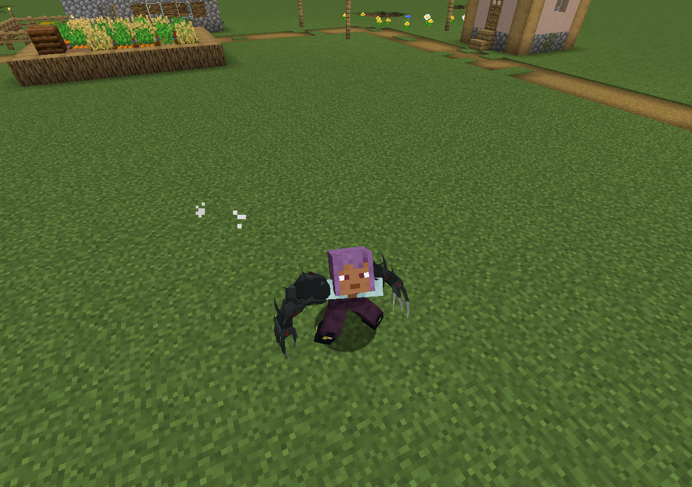
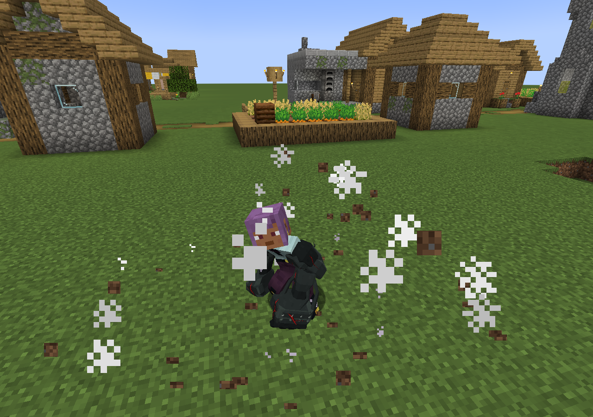

# MC 风格武器接入记录（dev.20）

适用：Minecraft 1.21.1 / NeoForge，模组 0.3.0-standalone-dev.20。

## 模型

- 利爪：确认过的 V4 轮廓与粗细红色血管，左右手分别绑定。
- 刀锋：最后确认的 V6 精修模型，连续刃面、根部镂空、弯曲倒刺。
- 锤拳、鞭拳、肌肉形态：确认过的 V4 同风格模型。
- 使用原先导出的前臂绑定校准，保留骨骼绕轴方向；上臂沿同一方向校准。
- 取消 dev.19 按长度分段加宽的非等比缩放，各骨骼段改为等比调整，保留拳体、钩刃、血管的原始比例。锤拳恢复厚度，鞭拳加大整体体量。
- 取消 dev.19 刀锋额外的 55 度绕轴和 12 度倾斜；连续刀身随前臂绑定。
- 已确认的 1.2 倍方块战甲、动作文件和战斗数值沿用原状。

## 渲染和动作配合

模型使用像素材质；红色血管单独自发光，夜间不会随环境变黑。不额外承诺未开启光影时有屏幕泛光。
血管与外壳使用同一变形时钟、手腕变换、锤拳缩放和鞭拳收拢边界。
挥刀拖尾、抓取/吸收手部接触点读取新模型锚点；鞭拳飞出的钩刃也使用同一套新造型。
预览中错误标到上臂的前臂、手掌部件已在导出时纠正。鞭拳跨肘护层分段绑定。

## 可重复生成

运行 `tools/integrate_mc_weapons.py`，需要 Python、NumPy。输入为仓库中的
`art/weapons-mc-v4/layout.json` 和 `art/blade-mc-v6/layout.json`。
输出包括五套运行时模型、飞行鞭尖、像素/自发光贴图，以及
`art/weapons-mc-runtime/integration.json` 来源校验记录。无需解包文件或私人目录。

## 验证

17 项 Java 针对性测试通过：第一人称模型边界、液态变形、变形时序、面片/法线/发光 UV、鞭尖一致性，以及 8 段动作中后向刀尖与肩关节的距离。
另有 2 项 Python 比例回归检查，通过比较建模稿和运行时网格的顶点间距离，确认锤拳拳体、手指、鞭拳钩刃及根部仅等比变化，未被压扁。运行 `python tools/test_mc_weapon_geometry.py`。
编译及打包通过，224 个捆绑动作/配置资源校验通过。

额外执行的旧 `WeaponContentTest` 仍缺 `dev_groundspike.json` 对应路径；该路径在本次工作开始的提交中同样不存在，未在此模型任务中改动技能资源。
上述针对性验证不能代替所有动作、F8 自定义比例及第三方光影组合的人工试玩。

本地画面检查可使用 `-PweaponModelPreview=<输出目录>`：仅在显式启用时载入测试源码，使用游戏实际玩家渲染器循环展示五种武器并截图，随后交回自由操作。正常 JAR 不包含该测试类。

## 实机记录

以下为 dev.20 单人世界实际截图，包含游戏姿态与粒子效果。

