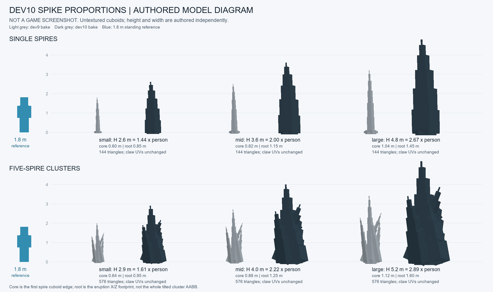

# DEV10 地刺尺寸与比例依据

## 本次调整

用户的第三人称实机图中，地刺主体表现为细长针。旧模型的 overall AABB 被扁平 `eruption` 根盘和簇的分叉位置撑大，不能代表主刺截面：旧单根 small/mid/large 第一节的真实边长只有 **0.1555 / 0.2160 / 0.2765 blocks**。

本次沿用项目自己制作的 `ground_spike.geo.json` 方块骨架和立方体，分别控制竖向高度、每根 spire 的本地横截面、eruption 根盘占地。不是横竖同比放大：单根高度增加约 1.44–1.50 倍，主根边长增加约 3.76–3.86 倍。最高单根保持 4.8 blocks，最高簇保持 5.2 blocks，保留逐节收尖和方块轮廓，不恢复以前的有机高塔造型。

图只绘制公开的项目自制 cuboid 网格，灰色为旧 bake、深色为新 bake、蓝色为 1.8m 站立参照符号；未显示游戏材质、湿亮 shader 或源游戏人物/地刺网格。原爪子贴图未改。

## 新资产的实测尺寸

`height` 是最终 mesh 的 `maxY`（地面为 Y=0）；`coreWidth` 是主刺第一节的实际旋转后边长，已在导出顶点上测量；`rootFootprint` 是三个 eruption cuboid 合并后的最大 X/Z 跨度。它们不是整个倾斜单根/五根簇的 overall AABB 宽度。

| variant | 旧高度 | 新高度 | 新高 / 1.8m站姿 | 旧主根边长 | 新主根边长 | 新根盘宽 | 新 overall X×Z | triangles |
|---|---:|---:|---:|---:|---:|---:|---:|---:|
| groundspike_small | 1.8 | 2.6 | 1.44× | 0.1555 | 0.60 | 0.85 | 0.8318×0.8500 | 144 |
| groundspike_mid | 2.5 | 3.6 | 2.00× | 0.2160 | 0.82 | 1.15 | 1.1254×1.1500 | 144 |
| groundspike_large | 3.2 | 4.8 | 2.67× | 0.2765 | 1.04 | 1.45 | 1.4189×1.4500 | 144 |
| groundspike_cluster_small | 2.0 | 2.9 | 1.61× | 0.1728 | 0.64 | 0.95 | 1.3201×2.1908 | 576 |
| groundspike_cluster_mid | 2.7 | 4.0 | 2.22× | 0.2333 | 0.88 | 1.25 | 1.8187×3.0208 | 576 |
| groundspike_cluster_large | 3.4 | 5.2 | 2.89× | 0.2938 | 1.12 | 1.60 | 2.3456×3.9180 | 576 |

单位是资产的 Minecraft block 坐标，本次示意按 1 block = 1m 记数。1.8m 是当前 Minecraft 站立角色的比较基准，不是蹲伏技能姿态高度，也不是精确量过的源 Alex 蒙皮高度。蹲伏人物更低，因此后续实机图必须同时比较站姿与技能姿态。

整体 AABB 的 `minY` 仍在地面以下：六档依次为 -0.0812、-0.1124、-0.1500、-0.1238、-0.1703、-0.2167。`maxY-minY` 会比表中的露地几何上界更大，不能把这个 span 当露地高度。

## 本地解包参考的尺寸事实

只读测量来源：`D:/Blacklight-Standalone/motion-profile-dev9/devastator-fx.data`；已有私有审计在 `D:/Blacklight-Standalone/dev7-source-research/FX-private/`。这些私有文件不会被生成工具读取、复制到仓库或放进 JAR。本说明只保留 bounds、单位换算和比较结果。

解包 positions/bounds 是 **raw source Y-up**，未乘声明的 `worldScale=0.8176232450746027`。该系数来自已核对的腿部重定向 `0.8721314614 × render scale 0.9375`；目标骨架各部位有自己的 rest 长度，因此它不是对整个原版 Alex 蒙皮的统一缩放标定。

| 源网格 | raw maxY | raw span X×Y×Z | 换算 maxY | 换算 span X×Y×Z | 换算 maxY / 当前1.8m站姿 |
|---|---:|---:|---:|---:|---:|
| single small | 3.577304 | 0.425657×3.656443×0.448627 | 2.924887 | 0.348027×2.989592×0.366808 | 1.62× |
| single mid | 5.092223 | 0.608893×5.205429×0.592557 | 4.163520 | 0.497845×4.256080×0.484488 | 2.31× |
| single large | 8.547223 | 0.916758×8.735803×1.001614 | 6.988408 | 0.749563×7.142596×0.818943 | 3.88× |
| cluster small | 4.036572 | 2.595209×4.185355×2.385997 | 3.300395 | 2.121903×3.422044×1.950847 | 1.83× |
| cluster mid | 7.875412 | 5.652326×8.153158×5.826727 | 6.439120 | 4.621473×6.666212×4.764068 | 3.58× |
| cluster large | 9.492167 | 6.618761×9.789047×6.089951 | 7.761017 | 5.411653×8.003753×4.979285 | 4.31× |

这说明源地刺建模并非仅和人同高，较大档网格上界可以超过当前站立角色数倍。新方案按此参考提高高度，同时把主根加宽得更明显；为了 Minecraft 场景可读性，新最高单根/簇低于上述换算网格上界。

**比较的边界：**源 Alex bind 头关节约 1.68029 source units，脚踝约 0.113037，两腿段长度和约 0.8593；“源人物约1.8”只是加上头部/脚部余量的估计，未测完整源蒙皮 extent，不能写成精确的原版人物比值。源 `NativeGroundSpikeShardBehaviour` 的 small 驱动 height=3、mid/large=5.5、`minEmergeOffset=-0.5` 也不等于这些 bind mesh 上界。未取得源游戏中驱动结束的可见顶点范围，因此本表不宣称原版最终露地高度或原版实机姿态。

## 几何、贴图和运行时约束

- 修改只发生于离线资产 bake。每个 spire 围绕自己的 anchor 加宽 X/Z，簇 anchor 和 cuboid 的竖向分段保持原构造；eruption 根盘使用独立横向系数。
- 在 cuboid 旋转之前加宽，保留每个面的平面性、硬法线与三角 winding。宽度影响旋转后上界时，生成器离线求解竖向 scale，最终高度与指定值一致。
- 原几何仍为单根 12 cubes / 144 triangles、五根簇 48 cubes / 576 triangles；full/LOD 使用相同低面数轮廓。
- `claw_biomass.png`、原 cube UV nets、indices、colors 均未改。测试保存了 DEV9 bake 的 UV/indices/colors SHA256，六档全部一致。
- 尖端最后一节的边长仍只有第一节的约 6%，保留 taper。没有按 Y 逐顶点扭曲方块，也没有复制原版拓扑或纹理。
- 未修改 renderer、增长/回收时钟、镜头或存档。资产是完整形体，生产 effect 的平移生长/平移下沉流程由原实现使用；本次未伪造进度或实机截图。

## 验证与尚待实机验证

生成命令：`C:/Python314/python.exe tools/author_devastator_spikes.py`。

资产检查命令：`C:/Python314/python.exe -m unittest discover -s tools/tests -p test_block_spike_proportions.py -v`；**5 tests passed**。覆盖实测高度/主根宽/根盘宽、收尖、单独增高不会同步加宽、旧 UV/拓扑/颜色不变、有限坐标与单位外向法线、平面 cuboid 面、可重复生成和 LOD 轮廓。

本轮没有启动游戏或 Gradle，没有操作运行中的未保存世界。仍需 root 用真正第三人称站姿、技能蹲伏、地刺全面展开和整形回收截图复验，检查角色遮挡、地面连接和材质读取；本图和尺寸测试不代替实机视觉验收。
