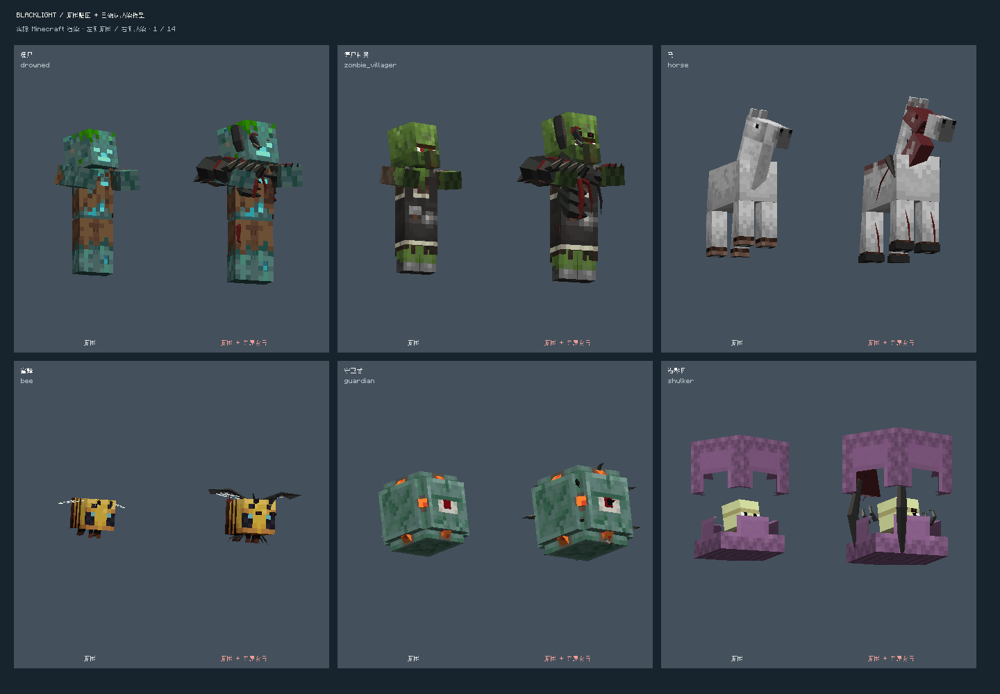
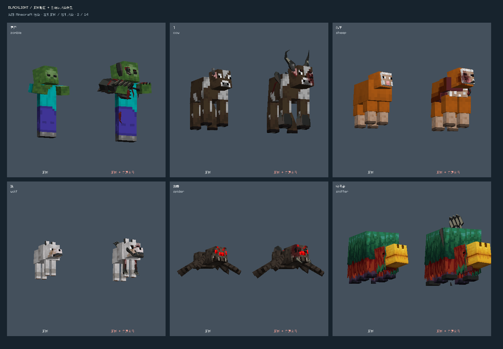
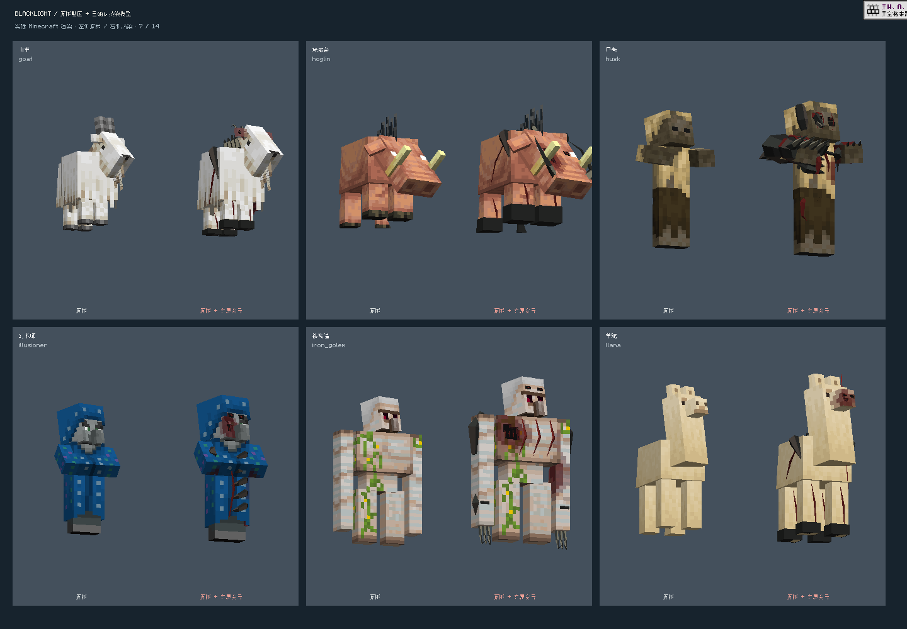

# Standalone dev.6 — native skins with approved infection geometry

Integrated into dev.7 with liquid weapon morphs and the checked-in complete
runtime profile. Normal builds now use `art/motion-profile/` without an override.

Based on `origin/main` at `d43aa4b` (standalone dev.5). This change restores the
approved species mutations without replacing the native bodies with solid-color
copies. Player motion, camera profiles and the standalone combat engine are kept.

## Rendering

- `infection_parts/manifest.json` covers 80 Minecraft species. Each entry records
  the SHA-256 of its approved editable geometry source. The exporter reads that
  library and never changes it.
- Structural mesh faces preserve the authored bites and missing chunks. Surfaces
  use the actual native cube UVs and the current resource-pack/variant texture;
  exposed cut walls and infection growth keep their authored tissue/bone colors.
- Local pixel wounds darken skin around the missing faces. Transparent pixels and
  distant native pixels remain unchanged. Wound textures are cached and released
  on resource reload; preparation uses linear distance-transform passes.
- Growth follows the native model's actual posed matrices. Shared native model
  parts are not changed. This preserves native walking, flying and swimming poses
  and the existing victim-pose/fracture integration.
- Sheep retain dyed wool on ripped fleece islands. Slime's translucent outer
  layer is also opened. Drowned/stray/bogged copied skins reveal the same wounds.
- Bee face growth attaches to its body; llama head/neck mutations use separate
  native cubes; magma mutations fit its complete eight-slice body. Shulker
  appearance saves its peek/attachment state and advances its opening animation.
- Growing and mature colossal encounters keep their dedicated boss meshes.
  Unknown/modded species continue using the existing generic morphology fallback.

## Validation and limits

The opt-in `standaloneInfected` client harness renders every one of the 80 species
beside its native counterpart. It writes 14 screenshots and a binding report.
It requires a copied world whose path contains `Blacklight Standalone QA`; it
does not spawn the specimens into a user's world. Its classes are excluded from
installable JARs.

Compile, standalone dependency-boundary, resource tests and package checks are
required for this candidate. The screenshot run establishes resource coverage,
model bindings and actual renderer compatibility. It does not establish a full
gameplay regression of every native AI, growth stage or absorption sequence.

Re-export with:

```powershell
python -X utf8 tools/export_infection_parts.py --source <approved-model-library>
```

Build the installable candidate with the latest standalone motion directory:

```powershell
./gradlew.bat assemble verifyStandaloneBoundary test --tests '*MvpResourceTest' '-PbundleMotionDirectory=<motion-profile>'
```

Both Minecraft and mod versions remain in the artifact names.

## Actual client comparisons

Each pair shows the native species at left and its infected host at right.
These are Minecraft framebuffer screenshots from the 80-species renderer run.




