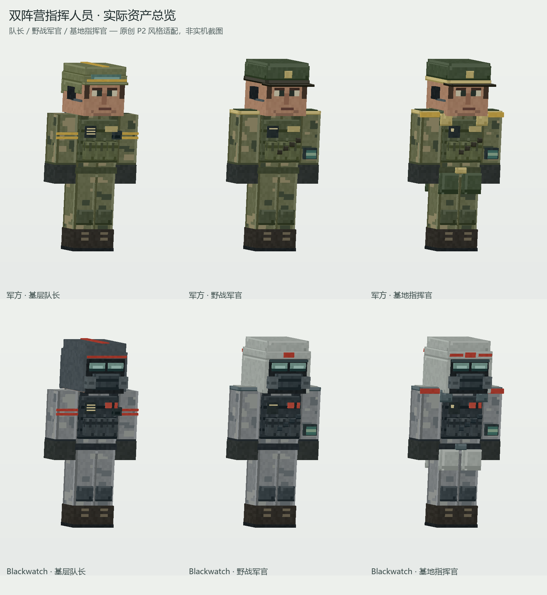

# Military.3 军官、队长与指挥官原生美术交付

日期：2026-10-24，Asia/Shanghai。最终静态检查：NeoForge 07:36:44；Forge 07:39:01。范围为军官美术和可视状态映射，不包括运行时实体/编制逻辑或最终构建结果。

## 生产范围与设计边界

遵循已确认的 `docs/superpowers/specs/2026-10-24-military-officers-design.md`。两方各有基层队长、野战军官与基地指挥官三种可辨识装束；这是本项目原创的 P2 风格适配，没有提取原作模型/贴图，不宣称复刻原作军官帽型、颜色或真实装备型号。

仅修改两端 `BlackwatchModel.java`、分层纹理和 `art/military2/` 作者/检查/预览工具；Renderer 沿用各端既有 API，重新生成内容未改变。新增 `docs/previews/military3-officers*` 与本报告。没有修改实体、注册、军衔枚举、语言文件、版本、基地、武器服务端或构建设置，没有启动 Gradle/Minecraft、提交、推送或修改 PCL。military.1 / military.2 已交付包及原 military.2 预览均未覆盖。

生产代码通过 `MilitarySoldier.commandRole()` 获取 TROOPER、TEAM_LEADER、OFFICER、COMMANDER；真实 `rank().ordinal()` 仍独立决定八级军衔标记。外观不根据实体名字固定，管理员变更身份后可由同步的真实状态更新；运行时状态与保存由相应实体实现负责。

## 六种身份外观

| 身份 | 军方 | Blackwatch |
| --- | --- | --- |
| 基层队长 | 头盔顶部/前后黄色识别条、双臂双识别条、额外耳部通信组件、胸前通信面板、背部电台与长天线 | 原深色防护兜帽与呼吸器保留，改用红色头部/双臂识别条与相同用途的独立通信组件 |
| 野战军官 | 开放脸部、军绿色檐帽、帽徽、通信耳机/话筒、扁平肩章、指挥携行背包、侧地图袋、腕式终端与斜向携行带 | 灰白色指挥兜帽/硬帽外壳、红色识别、肩章与指挥携行；保留双镜片、密封面部底层、呼吸器与两侧滤罐 |
| 基地指挥官 | 更明显金色帽带、肩部识别边、加高肩领、前后短式指挥外套、腰扣与背部指挥识别 | 在灰白指挥防护外壳基础上增加红色前额分段识别、肩部识别边、肩领、前后外套与背部指挥识别，继续完整呼吸防护 |

六种默认示例军衔按设计分别为中士 / 少尉 / 少校，即 SERGEANT / LIEUTENANT / MAJOR；项目现行中文语言文件使用这些称呼。帽具与角色识别不代替实际军衔，所有八级仍可独立显示。

## 层次、兼容与实物映射

- 保留原 110 块几何及其 UV 原位，追加 132 块角色几何，总计 242 个独立 UV 岛。仍是两方独立 512×512 RGBA 纹理、256×256 UV 单位，占用高度 200/256；没有重排旧 UV。
- 每个标准身体节点新增 `role_team_leader`、`role_officer`、`role_commander` 子节点。每帧根据真实角色和 `equipped()` 重置全部角色可见性。
- 军方军官/指挥官替换原头盔与头部装具；BW 只替换原兜帽外壳，面罩与镜片仍显示。军官/指挥官替换原巡逻背包/电台/天线，也兼顾管理员将重装改为指挥身份时隐藏旧供弹背包，避免同位置叠包。
- 脱装同时隐藏常规护具、全部角色装具、帽具、军衔和枪械，仍保留完整的 10 块基础制服/人脸/手掌/靴。没有透明或全黑的人体替代。
- 枪械仍必须是全装状态下的真实主手 `FirearmItem`，沿用四类枪族映射。空手不显示枪；军官/指挥官的卡宾枪使用现有步枪族外壳，没有把预览中的枪冒充额外授予物品。
- 保留 Humanoid 标准部件、枢轴、碰撞和抓取关系。模型使用 Java 17 可用的 enum switch、数组和现行 ModelPart API，两端模型源码完全一致。

两端最终模型 SHA-256：`d5e2fe99f0a428c3531b5839ce0a0e36b450917956949f785e97019959470d28`。

## 实际资产预览

全部图像来自各端生产 Java 中的实际 `piece(...)` 几何与生产 PNG 的逐面纹理采样，并使用三角形深度缓冲。不是 AI 概念图、旧预览的平面材质色，也不是 Minecraft 客户端截图。

| 文件 | 内容 |
| --- | --- |
| `military3-officers-overview.png` | 1680×1830，两方各队长/野战军官/基地指挥官同框 |
| `military3-officers-military-team_leader.png` | 军方队长正面、侧面、背面、脱装与持枪 |
| `military3-officers-military-officer.png` | 军方野战军官五视图 |
| `military3-officers-military-commander.png` | 军方基地指挥官五视图 |
| `military3-officers-blackwatch-team_leader.png` | BW 队长五视图 |
| `military3-officers-blackwatch-officer.png` | BW 野战军官五视图 |
| `military3-officers-blackwatch-commander.png` | BW 基地指挥官五视图 |
| `military3-officers-viewer.html` | 完全离线可旋转查看器，六身份、全装/制服切换、空手/四类枪、低位持枪/瞄准/换弹，内嵌真实几何/贴图和所有大图 |
| `military3-officers-manifest.json` | 对应端生产 Java / PNG 路径、SHA-256、242 块几何、默认角色/军衔示例 |

六张五视图均为 2800×930。以上文件在两端各自的 `docs/previews/`。两端分别从自己的生产目录渲染，来源清单的 `staged` 均为 false。

## 实际检查与兼容证据

1. `view_image` 实际查看了总览和六种身份的完整五视图，检查帽具边缘、开放脸部/BW 呼吸器、肩领、前后携行、完整制服与持枪接触。初稿指挥官与军官的肩领差别偏弱，增加了明显肩部识别边、领片、背部肩带和 BW 前额分段识别；再次查看军方/BW 指挥官五视图后收口。
2. 在安装 military.3 之前，对原 military.2 生产资产与候选做比较：原 110 块几何和 UV 全部相同；原纹理占用区逐像素相同；原两方制服基础层、军方普通/重装、BW 普通/重装六种外观在相同姿态下逐像素相同。证据保存在 `art/military2/military2-compatibility.json`，旧模型 SHA 为 `aff76ad77296d660ec87b0df3abe0826601353056779930e46f6d152160bae83`。
3. 两端分别运行 `inspect_officers.py`：242 个 UV 岛不重叠；两 PNG 独立、尺寸均为 512×512；全部立方体每面九点采样不透明；六身份 × 八军衔共 48 种组合，军衔选择正确、脱装保持 10 块完整制服、空手隐藏全部枪模、BW 呼吸防护持续存在。结果见各端 `art/military2/officers-inspection.json`。这是静态资产检查，不是实体实机测试。
4. 从离线 HTML 提取 JavaScript，`node --check` 通过；临时检查 JS 已删除。没有宣称启动浏览器或 GL 客户端完成交互验收。
5. 原始可编辑几何/材质入口为 `art/military2/build_soldiers.py` 的 `command_geometry()`；PNG、Java 草稿和 `material-map.json` 一并保留。`preview_officers.py`、`inspect_officers.py` 可重现预览和静态核查。原有作者脚本可按平台独立写入生产。

## 保留限制与唯一下一步

帽具、肩章、领片、通信组件、地图袋和腕部终端均是本项目游戏化美术；地图袋/终端没有新增独立交互功能。仍是原生立方体 Humanoid，没有完整肘关节/手指 IK 或布料模拟。指挥外套下摆与抓取、奔跑、硬直、极端俯仰角的动态穿插仍需客户端复核，静态预览不能证明所有姿态均无穿模。

唯一下一步：主代理统一完成两端军官运行时回归、最终构建和打包后，在客户端检查六身份的全装/制服、真实军衔切换、空手/四枪族、抓取与硬直，并将实际截图另行标为实机。生产美术已冻结，不启动并行构建。
