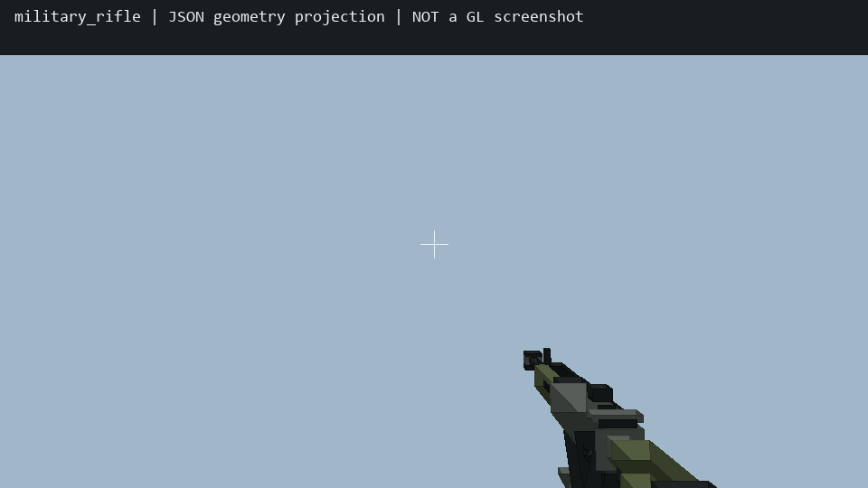
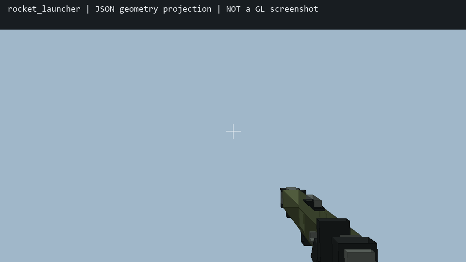

# military.4 第一人称枪械与开火反馈

证据日期：2026-10-24，初次记录约 01:40 UTC；双手互换边界补验更新于 02:13 UTC（北京时间 10:13）。

适用：NeoForge 1.21.1 与 Forge 1.20.1。沿用 `feat/neoforge-1.21.1-blackwatch-squads` / `feat/forge-1.20.1-blackwatch-squads`，原 military.1/.2/.3 未提交源文件均保留。本文是此子任务的记录；完整构建、驻军、方块破坏与发行由主任务记录负责。

## 现场与原因

- 用户提供的静止持枪截图中枪体占右下方较大区域；开火截图中枪消失，近处有大粒子及红色矩形。截图保留为原始失败证据。仅凭截图不能确认红色矩形究竟来自皮肤袖子还是其他手臂渲染。
- 原 `FirearmItem.use` 客户端返回原版 `success`，会产生使用挥手；服务端修改 `Magazine` / `WeaponReadyAt` 后物品数据改变，也可能触发原版装备下沉。这不是有效开火反馈的可靠依据。
- `StandalonePlayerRendering.hand` 在生物武器、护甲等状态下取消持物并画原型双臂，因此单纯修改物品 JSON 不能保证枪始终出现。当前输入入口虽已对真实枪械放行，但渲染入口仍有独立替换行为。
- 原八枪枪管沿模型 `+X`。第一人称右手 yaw 为 `-90°`，会把枪管转向摄像机附近 `+Z`，产生近大远小的粗重轮廓。现改为 `+90°`，枪管朝前方 `-Z`。
- 原枪口 `FLAME` 在 `getEyePosition().add(0,-.18,0)` 处生成，`CRIT` 从距射线起点 `.5` 格开始；这两个纯视觉位置都过近。

## 修改范围与决定

两端各新增 `firearms/FirearmViewEvents.java`、`FirearmViewState.java` 与对应 `src/test/.../FirearmViewStateTest.java`，修改八枪物品 JSON 及 `FirearmsCombat.java` 视觉音效区域。没有修改 `FirearmItem`、共享输入类、武器数值、八枪七弹注册、弹匣、库存、配方或原有冷却规则；没有新增 payload、依赖、纹理或声音文件。

独立客户端事件只接管实际 `FirearmItem` 的第一人称那一只手，用原生 `ItemInHandRenderer.renderItem` 和已有 `NativeHandRendererAccess` 画物品。它忽略原版 use-swing 与因弹药数据变化产生的 equip 下沉。主手、副手各自记录，物理左右手按玩家主手设置换算；其他物品与第三人称渲染入口保持既有路径。

接管优先级为 HIGHEST，避免普通生物手臂入口替换持枪。伪装、活动生物质形态、吞噬持有动作、瞄准镜、死亡及旁观沿用既有隐藏/控制路径，不抢占。模型第三人称 display 保留原值。

反馈只观察服务端同步数据：同一枪/同一手槽 `Magazine` 减少且 `WeaponReadyAt` 前进才产生一次 SHOT；增加且装填截止时间有效才产生 RELOAD。初次观察、换槽、换枪、换世界/玩家、时间倒退、打开菜单、切离第一人称均清空或建立基线，不回放旧动作。相同快照不重复反馈，空仓和未成功装填不产生反馈。

SHOT 容许截止时间过去至多 4 tick 的小幅网络延迟，避免短冷却枪的有效动作被吞掉；更老的延迟快照被忽略。这是表现取舍，不改变服务端开火。后坐 8 tick 内平方衰减至零，位移最多 `.065` 格、物品俯仰 `4.5°`；连续开火重新触发而不累积。装填按现有服务端截止时间形成正弦回落，下降最多 `.11` 格、俯仰 `8°`、侧倾 `7°`，截止归零。均不修改镜头、玩家朝向和弹道。

纯视觉枪口移到原起点沿方向前 `.95` 格，使用一粒 `SMALL_FLAME`；前方有墙则不发该枪口粒子。命中射线/弹丸发射起点仍为原眼下 `.18` 格。曳迹 `CRIT` 从 `2.5` 格开始，间隔由 `1.25` 改为 `2.5` 格。音效只组合原版声音：枪弹使用较短的弩机械声及低音量爆裂层，发射器使用火箭发射声。

用户参考 `blackwatch_two_hand_sneak.bbmodel` 的双手支撑与 `Two Hand Carry` 短促上扬后归零曲线，射击动画时长 `.5s`。没有导入其 5365 个 cube、纹理或骨骼，没有替换现有军人模型或分层军衔。

## 八枪资源

| ID | cube 数 | 第一人称等比 scale |
|---|---:|---:|
| military_rifle | 34 | .68 |
| military_carbine | 32 | .68 |
| military_machine_gun | 36 | .68 |
| grenade_launcher | 25 | .64 |
| rocket_launcher | 20 | .57 |
| missile_launcher | 22 | .57 |
| thermobaric_launcher | 22 | .57 |
| infection_launcher | 22 | .57 |

八枪合计 213 个 cube，沿用原生 palette；新增细分枪托、机匣、护木、机械细节及枪口环，机枪保留弹箱与折叠脚架，发射器保留类别色带。右手 display 为 `[0,90,-3]`，左手对应 `[0,-90,3]`；第三人称、GUI、ground、fixed display 保留。

两端八个 JSON 字节一致，全部元素坐标、合法旋转、UV、texture 引用及对应 PNG 路径检查通过。八枪 × 左右物理手 × 静止/后坐峰值/装填峰值共 48 组离线变换检查，所有顶点均在摄像机 `z=-.05` 近平面之前的可绘制一侧；这只排除计算上的穿过摄像机，不代替画面验收。逐资源 SHA-256、cube 数与投影数据见 [resource-validation.json](military4-firearm-view/resource-validation.json)。

以下是读取最终 JSON 的几何计算图，使用简化颜色/光照，**不是游戏截图，不证明 GL 或实机通过**。示例采用 960×540、垂直 FOV 70°、默认右手、静止视图，不模拟视角摇摆和实际材质过滤。步枪计算视图 z 范围 `[-1.3113,-.4808]`，枪管朝前；下部枪托/握把可超出画面下边。

## 实际验证

1. 先写纯反馈测试并运行新接口无反馈基线：14 项中 4 项按预期失败，分别捕获开火缺反馈、装填缺反馈、连续开火缺反馈和手间反馈隔离。证据：[初始 RED](military4-firearm-view/neo-feedback-initial-red.txt)。该 RED 在 Neo 工作目录运行；两端纯反馈源码相同，未把它伪称为两次独立 RED。
2. 增加延迟边界：`smallNetworkDelayStillShowsAnAuthoritativeShotOnce` 在 `readyAt=104`、`now=106` 时预期 SHOT，原规则返回 NONE，实际 RED 1 项失败。证据：[延迟 RED](military4-firearm-view/neo-network-delay-red.txt)。修复后两端通过。
3. 首轮两端分别使用本地 Java 21 / Java 17、缓存 JUnit 5.11.4，独立 javac 编译并运行：反馈 15 项 + 原弹药规则 1 项，均 **16/16 PASS**。原弹药规则内部 11 检查继续通过。证据：[首轮本端 GREEN](military4-firearm-view/rules-green.txt)。测试覆盖首次观察、真实开火、去重、空仓、库存数据修改、失效旧快照、小幅延迟、成功/失败装填、切槽、换枪、菜单、重连、世界时间倒退、连续反馈有界及双手状态隔离。
4. 独立客户端类和 `FirearmsCombat` 使用两端实际缓存 MC/Forge API 与现有编译类分别 javac 编译，最终均 exit 0。Neo `--release 21`；Forge `--release 17`。此项是 API 编译检查，不是全量 Gradle 构建。未运行 Gradle，避免与主任务串行构建冲突。
5. 资源静态检查八枪全部 PASS，两端 byte equal。离线投影已实际查看，不将其记为实机验收。
6. 审阅发现同型号双枪换手可能产生假 SHOT：主手 `30/readyAt0`、副手 `10/readyAt104`，在 tick101 交换后，旧逐手逻辑把换入低弹枪误判为开火。真实 RED 为 22 项中此项失败，期望 NONE、实际 SHOT；其余 21 项通过，见 [换手 RED（Neo 运行）](military4-firearm-view/neo-hand-swap-red.txt)。修复后两端分别 **22/22 PASS**（反馈 21 + 原弹药 1），见 [换手后本端 GREEN](military4-firearm-view/hand-swap-green.txt)。本轮新增 6 项覆盖完整换手、主手/副手单独真实射击、换手后的真实射击、两手相同快照、菜单及空手重置。
7. 换手修复后仅重新编译本轮拥有的 `FirearmViewEvents` / `FirearmViewState`，两端实际缓存 MC API javac 均 exit 0，见 [本轮 API 检查记录](military4-firearm-view/hand-swap-api-compile.txt)。本轮没有改动或单独重新编译主代理拥有的 `FirearmsCombat`，没有运行 Gradle。

客户端源快照 SHA 见 [client-source-sha256.json](military4-firearm-view/client-source-sha256.json)，已按本轮新客户端源、测试及只读的主代理当前 `FirearmsCombat` 刷新。后者已包含主代理的唯一方块命中 hook；其完整 MC 编译与方块破坏验收以主任务记录为准。

编译过程中曾因 Forge classpath 文件逐行格式被误作一条、PowerShell 未加引号的 `-J-Dfile.encoding` 被拆分、以及新保护中 `DisguiseSystem` 命名空间误写而失败。已分别改为逐行 `;` 连接、完整引号参数、真实 `com.codex.blacklight.disguise` 包后两端编译通过，没有留下失败状态或临时生产 stub。

## 同型号双枪换手的有限识别

每个 tick 先采集主、副手完整快照，再一次调用纯规则的 `observeHands`。在更新任一手之前，比较当前主手是否完整等于上一轮副手、当前副手是否完整等于上一轮主手；比较 `weapon id`、`Magazine`、`WeaponReadyAt`，忽略必然改变的手槽。只有双向完整互换且快照确实有差异时，同时清空两手反馈并建立新基线。

只改变一手、即使其新状态恰好等于另一手旧状态，也不会被当作交换，因此真实射击仍由原同步弹匣/截止时间规则触发。没有读取或接管原始 F 输入，没有新 UUID、payload 或永久物品标识。两手快照完全相同时无法观测交换，但本来就没有新弹量/时间变化，不会新增反馈。

有限边界：若同步把换手拆到不同观察 tick，某一中间快照与真实单手开火完全等价，仅凭现有数据不能无歧义区分，仍可能出现一次短反馈；快照与射击等其他操作在两次观察之间交错、恰好形成相同数据时也存在此信息边界。本次没有为此扩大输入系统或引入永久身份，未宣称解决所有网络时序。

## 当前交接

客户端类、纯反馈规则测试及八枪模型再次冻结，客户端文件所有权交回主代理。`FirearmsCombat` 一直由主代理拥有，本轮未写入或覆盖；已只读确认其中存在 `if(hit==null&&wall.getType()==HitResult.Type.BLOCK)FirearmBlockDamage.bullet(owner,definition,wall);`，并把当前值纳入 SHA 清单。下一步由主任务按冻结源统一 MC 回归、刷新制作资料和交付。

全量 JUnit、GameTest、普通服、发行包与 QA 排除由主任务统一执行；本文不以旧 military.3 PASS 代替本次结果。没有启动用户游戏、改 PCL、修改用户存档或提交推送。实际 GL 仍待核验，重点是右手/左手主手设置、真实副手枪与双枪、空仓/冷却连续按键、菜单/切槽/重连、原型能力状态和第三人称。网络延迟超过表现窗口时可能省略一次后坐，弹药和伤害仍由服务端决定。

接续：从本记录核对 22 项 GREEN 与当前 sourceSHA，再由 [项目仓库](https://github.com/mengyuyuan/blacklight-evolution) 的主任务统一回归与交付；共享约定见 [AI-Engineering-Lab](https://github.com/yfcyy889-ops/AI-Engineering-Lab)。
