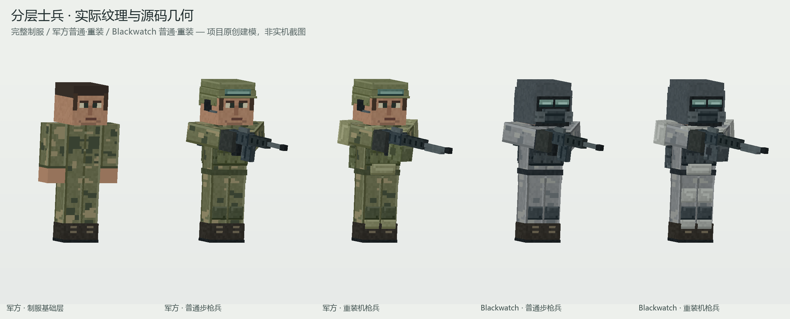

# Military.2 分层士兵原生美术交付与静态核查

日期：2026-10-24，Asia/Shanghai。生产资产最后静态核查：NeoForge 05:28:39；Forge 05:30:10。本报告仅覆盖本轮兵模、纹理、可视装备映射和离线预览，不把其他代理的武器/城市测试改写为本代理实测。

## 范围与来源边界

按已确认设计 `docs/superpowers/specs/2026-10-24-city-military-visual-upgrade-design.md` 实装，参考边界沿用 `docs/research/PROTOTYPE2_VISUAL_CITY_REFERENCE_20261024_ZH.md`。这是《虐杀原形 2》方向的本项目原创建模与像素纹理。没有下载、提取、分发原作模型或贴图；具体迷彩、颜色、护具型号未从官方成品画面逐项确认，不能称为严格复刻。

改动仅位于两端 `client/model/BlackwatchModel.java`、`client/renderer/BlackwatchRenderer.java`，两张新增实体纹理、`art/military2/` 工作文件、本报告与 `docs/previews/military2-soldiers*`。没有改实体、军衔数据、碰撞、组织、城市、枪械服务端、注册入口、抓取代码或 military.1 交付包。没有提交、推送、修改 PCL 实例或启动 Gradle / Minecraft 进程。

## 已接入生产的外观

| 层次 | 实际实现 |
| --- | --- |
| 制服基础层 | 完整头部与脸、独立两方制服迷彩、衣襟/胸袋/袖口、手掌、裤腿、靴与鞋底。脱装后军方和 BW 都保留 10 块完整基础部件 |
| 常规军方 | 双级紧凑头盔、额前收纳护目镜、开放脸部、单侧通信耳机/话筒、前后背心片、肩带、三联弹袋、腰带、工具袋、巡逻包/电台与护膝 |
| Blackwatch | 灰白制服、深色兜帽分片、独立双镜片、密封面部底层、呼吸器与左右滤罐。轮廓与军方开放脸部有明确差别 |
| 重装差异 | 前胸/腹部硬板、紧凑肩甲、前臂板、胫部护板、大供弹/补给包；BW 重装另有颈圈与大腿护板。没有整体放大人形来代替装备差异 |
| 军衔 | 八级项目军衔独立子节点，跟随真实 `rank().ordinal()`；仅 `equipped()` 为真时可见，不宣称复刻真实军队或原作军衔章 |
| 枪械 | 主手必须为真实 `FirearmItem` 且处于全装状态。步枪/卡宾枪共用步枪族；机枪有更长枪管、供弹盒；榴弹有粗管与鼓形供弹；肩扛发射器有长管、前后环与侧瞄具。空手隐藏所有枪族 |
| 动作 | 沿用 Humanoid 骨架，提供低位持枪、瞄准、射击轻后坐与简化换弹，取实体 `phase()`；没有额外动画协议 |

装备成组由 `MilitarySoldier.equipped()` 控制；没有永久焊在基础身体上，也没有使用透明/全黑的基础贴图模拟脱装。当前是整套护具状态，没有新增每件护甲独立穿戴物品。肩扛的多种弹药武器共用一类外壳，并未声称各型号已各自建模。

## UV、原生代码与兼容

- 两张全新 512×512 RGBA 贴图：`military_soldier_layered.png` 与 `blackwatch_soldier_layered.png`。模型采用 256×256 UV 单位，实际每 UV 单位有 2×2 像素。
- 总共 110 个声明立方体/独立 UV 岛，基础身体、各护具、枪族和军衔都有独立 UV 区域；两方分别绘制，没有复用旧 64×64 纹理或用运行时全身染色区分阵营。
- 保留 `head`、`hat`、`body`、四肢标准节点及 vanilla Humanoid 枢轴。装备各归属对应身体部件的 `equipment` 子节点；抓取和移动继续使用原来的身体关系，没有修改实体碰撞与抓取入口。
- 每帧重置装备、军衔、枪族可见性与手臂附加转角，避免共用渲染模型在不同实体之间留下上一个人的装备状态。
- 两端模型源码一致；Renderer 仅按平台使用 `ResourceLocation.fromNamespaceAndPath` 或构造函数。取消旧阵营染色的 `renderToBuffer` 覆盖，直接使用各平台 Humanoid 基类实现，避免不同版本的颜色参数签名混用。
- 原 64×64 `blackwatch_soldier.png` 保留，未删除其他调用可能依赖的旧资源。

两端生产 `BlackwatchModel.java` 的 SHA-256：`aff76ad77296d660ec87b0df3abe0826601353056779930e46f6d152160bae83`。完整来源指纹分别见各端 `docs/previews/military2-soldiers-manifest.json`。

## 真实资产展示

PNG 由预览脚本读取**生产 Java 的实际 `piece(...)` 几何调用与生产 PNG**，逐面采样纹理，并进行正交三角形深度缓冲。不是旧预览按 UV 坐标猜测材质的平面假颜色，也不是 AI 概念图。以下均为**离线原生资产预览，非实机截图**。

| 文件 | 内容 |
| --- | --- |
| `military2-soldiers-overview.png` | 2400×970，基础制服、军方普通/重装、BW 普通/重装五类同框 |
| `military2-soldiers-uniform-military.png` | 2560×930，军方脱装正面、侧面、背面、三分之四视角 |
| `military2-soldiers-uniform-blackwatch.png` | 2560×930，BW 脱装四视角，完整脸部与灰色制服 |
| `military2-soldiers-military-regular.png` | 2560×930，军方普通正/侧/背与瞄准 |
| `military2-soldiers-military-heavy.png` | 2560×930，军方重装正/侧/背与瞄准 |
| `military2-soldiers-blackwatch-regular.png` | 2560×930，BW 普通正/侧/背与瞄准 |
| `military2-soldiers-blackwatch-heavy.png` | 2560×930，BW 重装正/侧/背与瞄准 |
| `military2-soldiers-weapon-families.png` | 2560×930，四种实际物品类别映射的枪械持握轮廓 |
| `military2-soldiers-viewer.html` | 约 1 MiB，完全离线查看器：拖动旋转、角度滑块、六套组合、四类枪与空手、低位持枪/瞄准/换弹，带实际 PNG 展示与所有大图 |

文件均在各端 `docs/previews/`。HTML 内嵌真实几何与 PNG，不依赖 CDN、登录、网络请求或原作资产。两端分别从各自生产目录重新生成，来源清单没有把 NeoForge 路径误写成 Forge 验证。

可复现和编辑入口为 `art/military2/README.md`、`build_soldiers.py`、`preview_soldiers.py` 与 `material-map.json`；两张可编辑 PNG 与 Java 草稿也在该目录。生成器可按 `--platform neoforge` / `--platform forge` 只写指定平台，避免并行构建中间态。

## 实际检查与修正

1. 执行原生资产生成与两端独立的离线渲染，成功输出八张 PNG、来源清单和离线 HTML。
2. 用 `view_image` 实际查看了总览、军方普通/重装、BW 重装、BW 脱装和四类枪图；发现并修正手套末端与基础手掌共面产生的皮肤条纹、缩窄顶盖导致的头顶露发、重装胸板遮挡军衔，以及小数 UV 面边缘未完全填色的问题。修正后再次查看总览和脱装大图，手套、头部、脸部与制服均正常。
3. 两端运行 `inspect_soldiers.py`：110 个 UV 岛互不重叠；两方 PNG 不同且尺寸均 512×512；各立方体各面 9 点纹理采样全不透明；两种脱装都只保留完整 10 块 `uniform_` 部件；空手隐藏全部四种枪族。结果见各端 `art/military2/inspection.json`。
4. 从 HTML 提取 JavaScript 并运行 `node --check`，退出码为 0。临时检查 JS 已移除，没有宣称亲自启动浏览器验证了每个控件。
5. NeoForge 美术先在武器首轮编译结束后接入；Forge 美术在武器 8/8 服务端场景结束并释放构建后接入。本代理没有并行启动构建。接入之后的最终两端编译与整体验收由主代理统一记录，以其构建日志为准。

## 保留限制与唯一下一步

当前仍是 Minecraft 立方体的原生 Humanoid 风格；没有独立肘关节、完整手指 IK、真实弹匣拆卸或武器骨骼动画。握持、肩扛与换弹有可识别的简化姿态，不能据离线图推断所有抓取、硬直、远近视角均无穿插。实际客户端的光照、实体阴影、受伤闪烁、抓取与四方向枪口姿态仍需实机检查。

唯一下一步：主代理统一执行两端最终构建/回归后，在客户端检查六种外观的穿脱、空手、四种持枪、军衔、抓取和硬直；把客户端截图与构建证据补入现有验收记录。不要把本报告的离线预览标为实机。
