# M6：载具、车库与当前军事资料

本卡从双端本次生产文件导出；生成资料不代表测试、GL试玩或最终交付通过。最终实现与验收状态以[根实施记录](../verification/MILITARY6_VEHICLES_20261026_ZH.md)及[玩家指南](../MILITARY6_PLAYER_TEST_ZH.md)为准。旧 M5 文档与原图片保留原意。

生成时间：2026-10-28T20:47:05+08:00。本次车辆 authoring SHA-256：`4ccafec7230accdac6d2d84c7ffbd043f2ece8d2b2848e9fe9eb98aa13523a21`。此哈希只对应该资产源文件，源码快照与机器数据对应本次导出时点；后续生产改动仍须在根最终冻结后刷新并核对，不能据此认定已完成游戏验收。旧 `7c3c0604…` / `5d…` 是历史制作阶段。

| 内容 | 入口 |
| --- | --- |
| 易懂实际测试流程 | [M6玩家指南](../MILITARY6_PLAYER_TEST_ZH.md) |
| 当前全10兵种数值与默认装备 | [兵种数据](M6/data/soldiers.json)、本页下方10外观卡 |
| 军衔、岗位、编制 | [当前源码提取](M6/data/organization.json)、本页下方实际表格 |
| 当前9建筑×双端尺寸、箱与嵌入实体 | [建筑数据](M6/data/structures.json)、[完整NBT解析](M6/data/nbt/) |
| 旧7建筑外观/布局 | 本页下方保留的旧NBT图；未冒充M6重绘 |
| 新车库外观 | 本页下方真实NBT离线预览 |
| 新载具与带乘员外观 | 本页下方8个实际ModelPart CPU场景 |
| 完整机器数据 | [catalog.json](M6/data/catalog.json) |
| 原文、资源、可编辑模型 | [来源哈希索引](M6/data/source-manifest.json)，快照在M6/sources/ |

## 当前全部10兵种与军衔/编制

数值直接提取本次生产。岗位/军衔列描述注册构造默认，枪弹列描述正常新生时确定性的一次性初始化，不承诺任意自定义NBT或旧档会补发这些物品。下面人物图保留M5实际ModelPart CPU捕获及原manifest；没有为M6重绘，不是游戏截图，乘车姿态以M6车辆图为补充，GL仍需确认。

| 实体 | 名称 | 耐久 | 护甲 | NPC子弹伤害 | 移动速 | 岗位 | 直接新生默认军衔 | 直接新生默认枪/弹匣+备弹 |
| --- | --- | --- | --- | --- | --- | --- | --- | --- |
| blacklight:military_soldier | 军方步兵 | 20.0 | 2.0 | 1.4 | 0.29 | trooper | private | military_rifle / 30+90 |
| blacklight:military_heavy | 军方重装兵 | 48.0 | 6.0 | 2.0 | 0.24 | trooper | private | military_machine_gun / 60+180 |
| blacklight:military_team_leader | 军方队长 | 20.0 | 2.0 | 1.4 | 0.29 | team_leader | sergeant | military_rifle / 30+90 |
| blacklight:military_officer | 军方野战军官 | 20.0 | 2.0 | 1.4 | 0.29 | officer | lieutenant | military_carbine / 24+72 |
| blacklight:military_commander | 军方基地指挥官 | 20.0 | 2.0 | 1.4 | 0.29 | commander | major | military_carbine / 24+72 |
| blacklight:blackwatch_soldier | 黑色守望步兵 | 24.0 | 4.0 | 1.6 | 0.29 | trooper | private | military_rifle / 30+90 |
| blacklight:blackwatch_heavy | 黑色守望重装兵 | 60.0 | 10.0 | 2.2 | 0.24 | trooper | private | military_machine_gun / 60+180 |
| blacklight:blackwatch_team_leader | 黑色守望队长 | 24.0 | 4.0 | 1.6 | 0.29 | team_leader | sergeant | military_rifle / 30+90 |
| blacklight:blackwatch_officer | 黑色守望野战军官 | 24.0 | 4.0 | 1.6 | 0.29 | officer | lieutenant | military_carbine / 24+72 |
| blacklight:blackwatch_commander | 黑色守望基地指挥官 | 24.0 | 4.0 | 1.6 | 0.29 | commander | major | military_carbine / 24+72 |

军方/BW军官的注册构造默认均为 `officer` / `lieutenant`。`fleet create` 要求车内真实军官岗位为 `officer` 或 `commander`，且军衔至少 `lieutenant`，不会根据实体名称补身份。`MilitaryAutomaticJoin:0b` 本身也是Military存档字段，会进入已有/半旧Military数据读取逻辑，不能用它证明纯新生默认枪弹；带该字段的命令乘员应显式注明岗位/军衔，并只读检查实际值。真正无附加NBT的普通 `/summon` 保留构造身份和有限默认枪弹；历史Neo定向20/20日志保存在[实际日志](M6/sources/neoforge/.superpowers/military6-qa/neo-resume-summon-green.log)与[进程回执](M6/sources/neoforge/.superpowers/military6-qa/neo-resume-summon-green.result.json)。最终双端完整验证应读取[根记录](../verification/MILITARY6_VEHICLES_20261026_ZH.md)，本生成器不据历史定向结果推断全量通过。旧空兵、半旧/损坏存档继续不补枪、不免费填弹，已有实物 `HandItems` 不得复制。

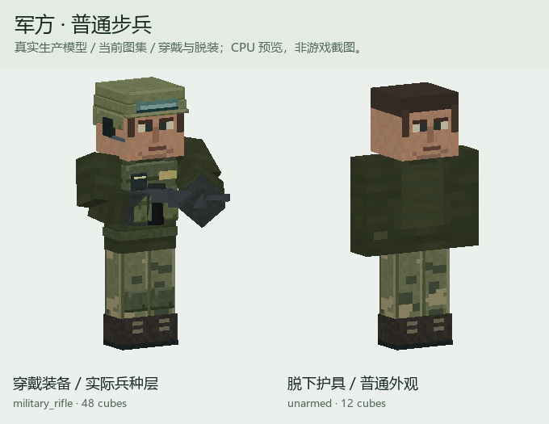

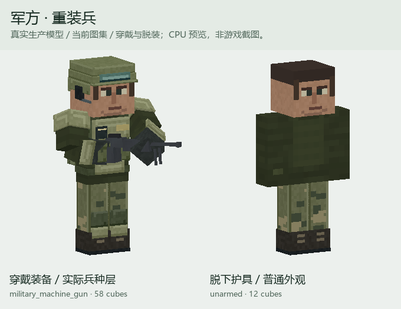

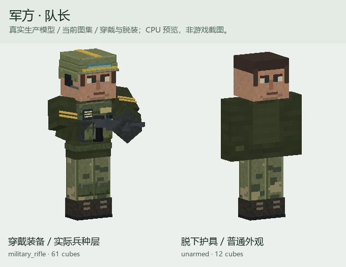

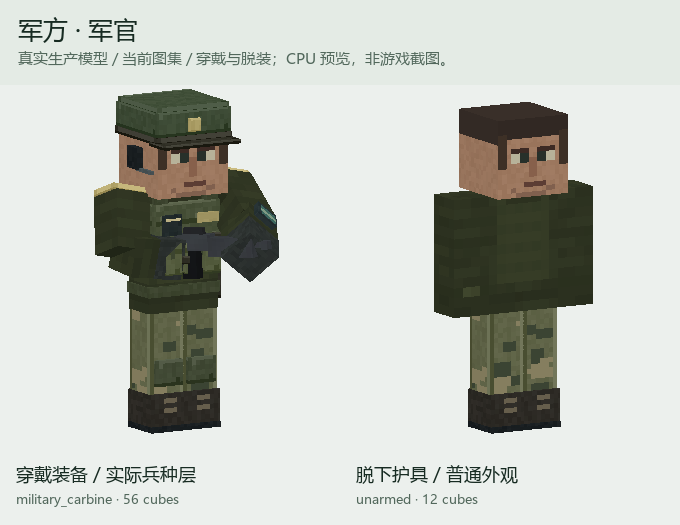

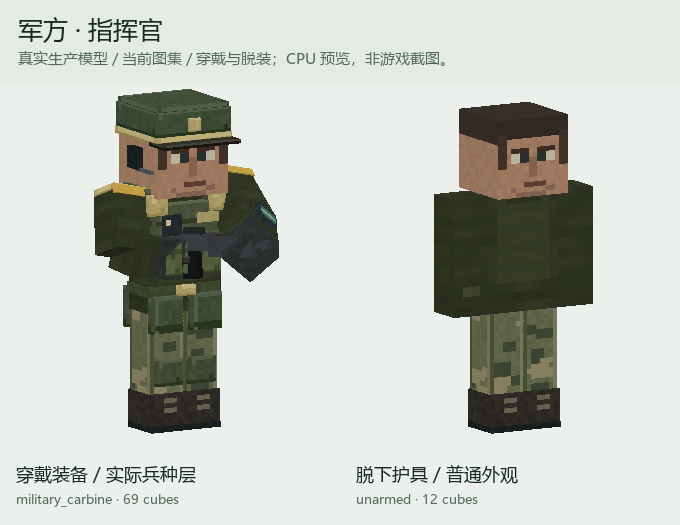

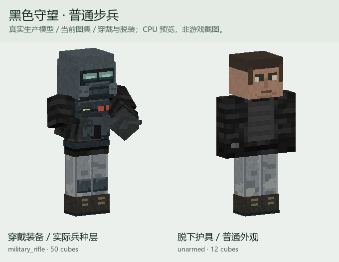

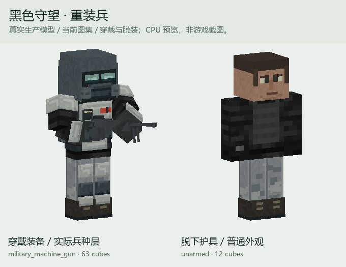

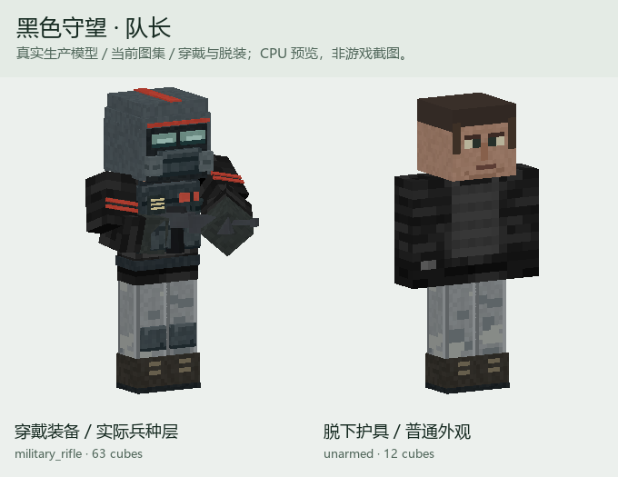

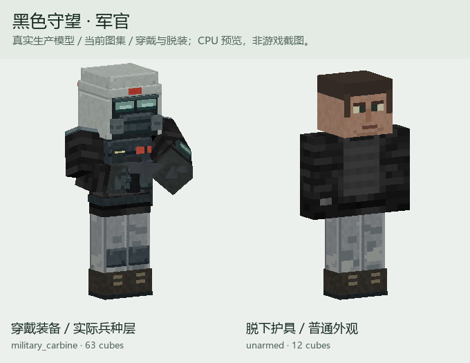

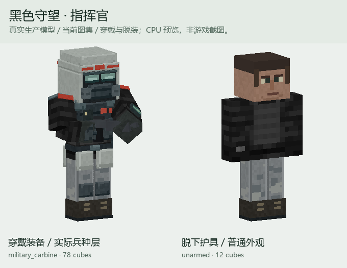

| 军衔ID | 显示名称 | 序号 |
| --- | --- | --- |
| private | 列兵 | 0 |
| corporal | 下士 | 1 |
| sergeant | 中士 | 2 |
| lieutenant | 少尉 | 3 |
| captain | 上尉 | 4 |
| major | 少校 | 5 |
| colonel | 上校 | 6 |
| general | 将军 | 7 |

| 岗位 | 默认军衔 |
| --- | --- |
| trooper | private |
| team_leader | sergeant |
| officer | lieutenant |
| commander | major |

| 编制 | 层级 | 军方默认人数 | BW默认人数 |
| --- | --- | --- | --- |
| tactical_squad | 0 | 8 | 8 |
| section | 0 | 8 | 8 |
| platoon | 1 | 24 | 24 |
| company | 2 | 72 | 72 |
| squadron | 1 | 24 | 24 |
| battalion | 3 | 216 | 72 |

## 当前全部9种建筑模板

下表来自当前真实NBT，不以外观替代功能登记。大基地16/20为一次性原生人员槽；车库槽另算。已嵌入的实体NBT与运行时派发入口分开保存，箱的完整Items/LootTable在structures.json与完整NBT解析里。

| 模板 | 尺寸X×Y×Z | 非空气方块 | 箱数 | 嵌入实体 | 原生人员槽 |
| --- | --- | --- | --- | --- | --- |
| blackwatch_checkpoint | 17×9×17 | 572 | 2 | 3 | 无大基地名额 |
| blackwatch_outpost | 25×9×25 | 1375 | 3 | 5 | 无大基地名额 |
| frozen_research_station | 23×21×23 | 2821 | 2 | 2 | 无大基地名额 |
| large_blackwatch_base | 65×18×81 | 13667 | 14 | 0 | 20 |
| large_military_base | 65×18×65 | 10163 | 13 | 0 | 16 |
| military_camp | 21×9×21 | 976 | 2 | 8 | 无大基地名额 |
| military_checkpoint | 17×9×17 | 583 | 2 | 4 | 无大基地名额 |
| vehicle_garage_blackwatch | 31×10×27 | 2438 | 3 | 0 | 无大基地名额 |
| vehicle_garage_military | 31×10×27 | 2438 | 3 | 0 | 无大基地名额 |

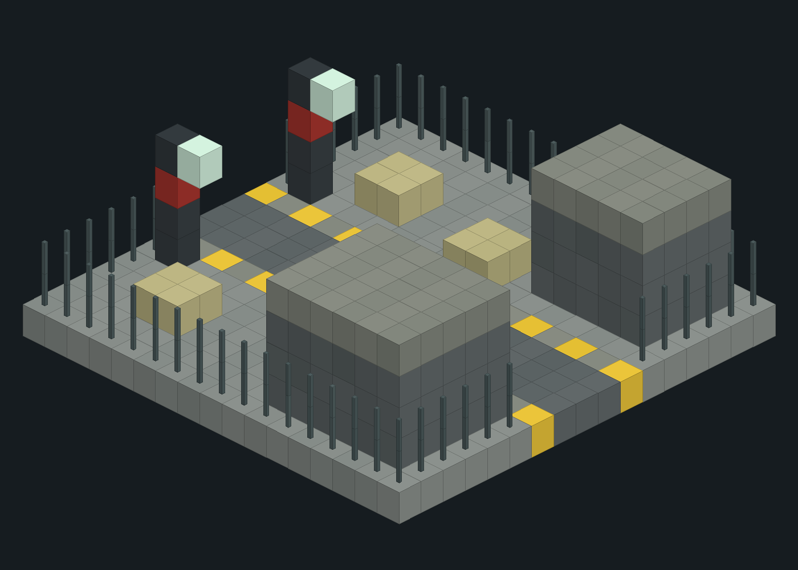

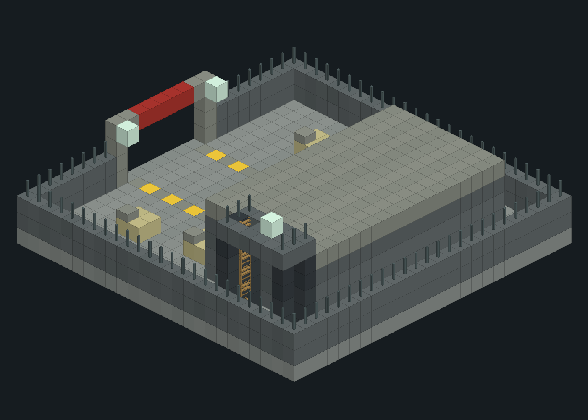

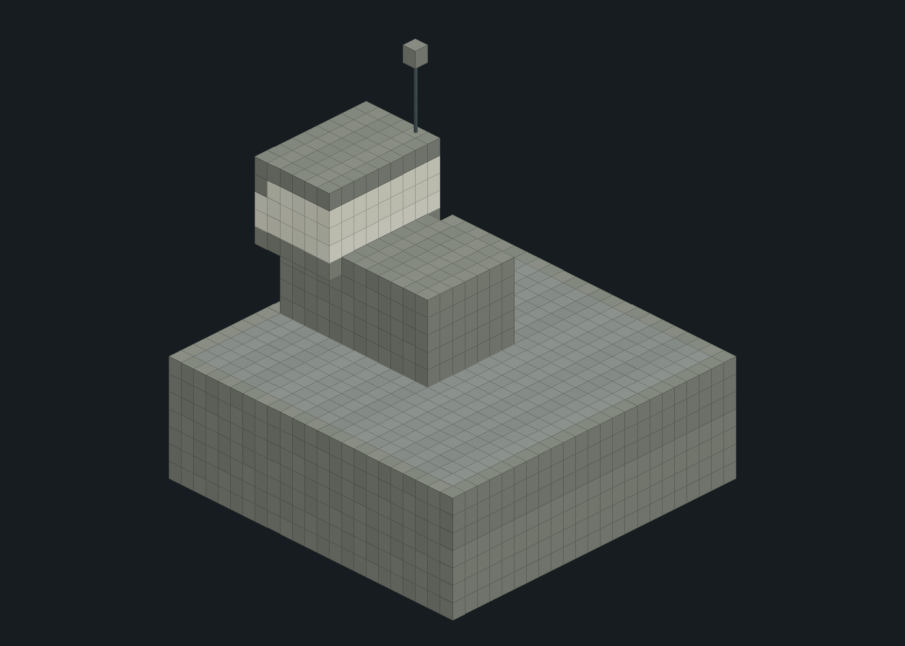

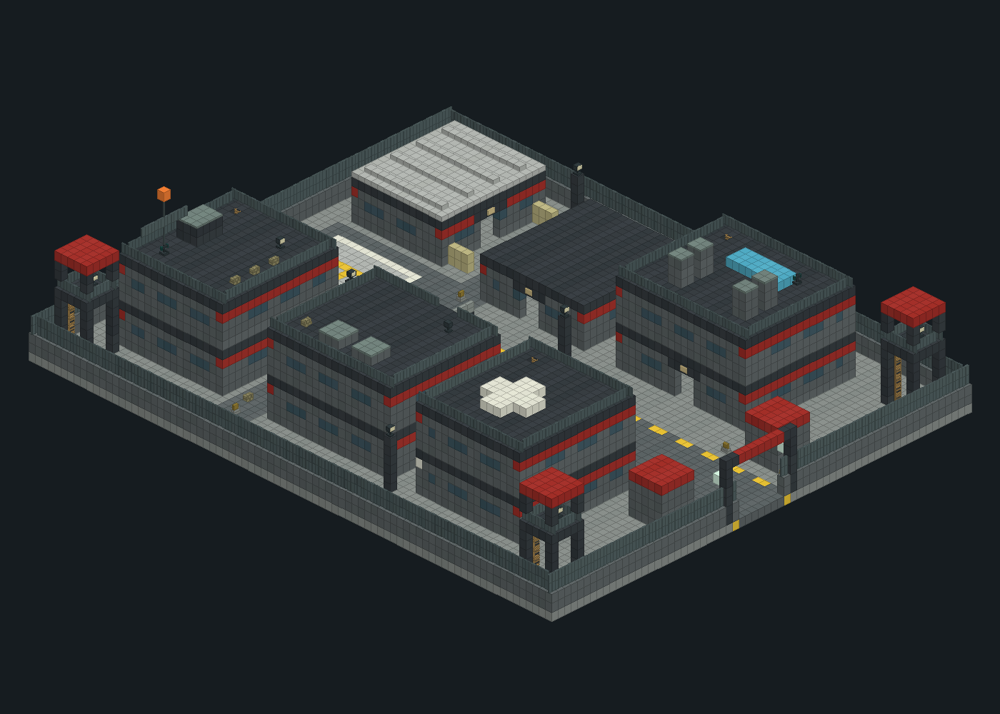


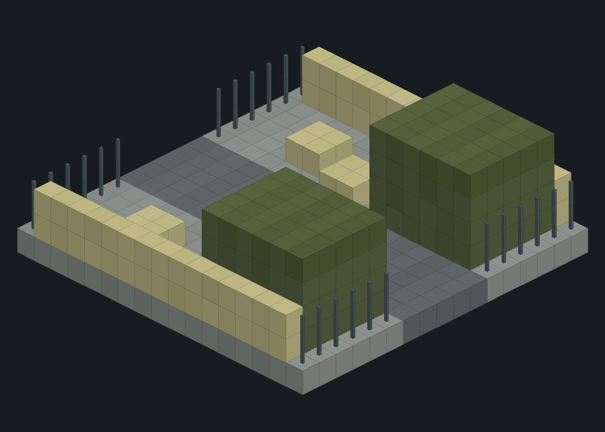
## 三底盘、两涂装

宽×长×高从本次同源authoring生成的实际配置读取，炮管额外进入碰撞/命中包围；速度单位格/tick（20tick约1秒）。驾驶无需燃油，行驶、转向及受阻均不消耗旧FuelTicks。六底盘放置均满HP、无乘员、零弹；普通新车 `/summon` 不领取初始弹药。燃料注册、模型、贴图、磁盘配方、有限API和NBT保留为inactive，正常创造栏及配方隐藏，旧燃料罐不接受补给。已有或残缺存档继续严格校验，不重置损伤或库存。自然车库仅首次派发给一次初始弹药，之后消耗真实补给。

| 底盘 | 实体/底盘物品前缀 | 宽×长×高 | 耐久 | 最高速 | 燃油玩法 | 席位 | 弹种上限 |
| --- | --- | --- | --- | --- | --- | --- | --- |
| 运输卡车 | military / blackwatch：truck | 2.9×7.5×3.7 | 100 | 0.28 | 无需燃油 | driver, officer, passenger_1, passenger_2, passenger_3, passenger_4, passenger_5, passenger_6 | {} |
| 装甲战斗车 | military / blackwatch：apc | 3.3×7.0×3.3 | 240 | 0.2 | 无需燃油 | driver, gunner, passenger_1, passenger_2, passenger_3, passenger_4, passenger_5, passenger_6 | {"autocannon_round":120,"rocket_round":4} |
| 坦克 | military / blackwatch：tank | 4.0×8.0×3.4 | 420 | 0.16 | 无需燃油 | driver, gunner, commander | {"tank_he_shell":12,"tank_ap_shell":8,"machine_gun_round":240} |

保留的inactive配置（不是行驶时长）：

| 底盘 | maxFuelTicks（保留） |
| --- | --- |
| truck | 12000 |
| apc | 9000 |
| tank | 7200 |

实体ID为 `blacklight:military_truck/apc/tank` 与 `blacklight:blackwatch_truck/apc/tank` 的逐项组合；物品在各实体ID末尾加 `_chassis`。为免误复制，六个实际ID如下。

| 实体 | 完整车辆放置物品（保留_chassis ID） |
| --- | --- |
| blacklight:military_truck | blacklight:military_truck_chassis |
| blacklight:blackwatch_truck | blacklight:blackwatch_truck_chassis |
| blacklight:military_apc | blacklight:military_apc_chassis |
| blacklight:blackwatch_apc | blacklight:blackwatch_apc_chassis |
| blacklight:military_tank | blacklight:military_tank_chassis |
| blacklight:blackwatch_tank | blacklight:blackwatch_tank_chassis |

## 五种车载武器

所有伤害、尺寸、半径、数量和配方均为本模组玩法值，不是原作或现实军事统计。HE/AP共用主炮装填冷却，不能换弹种绕过。

| ID | 真实弹药 | 伤害 | 间隔tick | 距离格 | 效果半径格 | 伤害类别 |
| --- | --- | --- | --- | --- | --- | --- |
| autocannon | autocannon_round | 8.0 | 6 | 96.0 | 1.2 | AUTOCANNON |
| vehicle_rocket | rocket_round | 20.0 | 30 | 96.0 | 4.0 | EXPLOSIVE |
| tank_he | tank_he_shell | 24.0 | 80 | 96.0 | 4.0 | EXPLOSIVE |
| tank_ap | tank_ap_shell | 36.0 | 80 | 96.0 | 1.0 | AP |
| coaxial_machine_gun | machine_gun_round | 4.0 | 4 | 80.0 | 0.0 | BULLET |

装甲倍率以 `VehicleWeaponDefinition.mechanicalDamage` 为准：普通子弹轻/装甲/重装1/.25/.10，自动炮1/.70/.30，HE/火箭1/.75/.50，AP均1。适用物理重击的单独倍率见源码伤害桥，不能把火器倍率当成所有能力倍率。

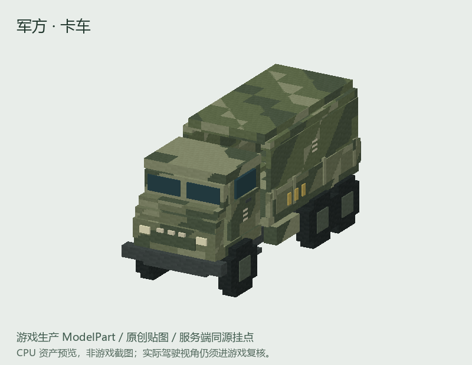

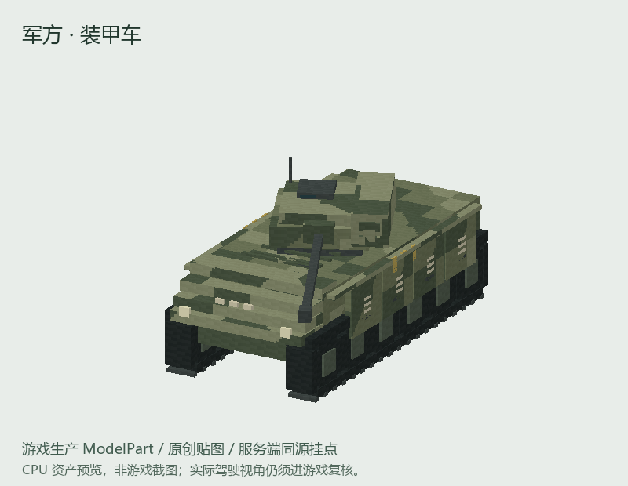

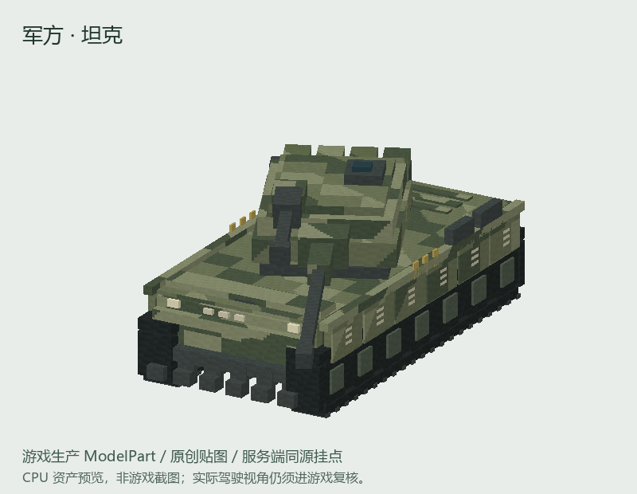

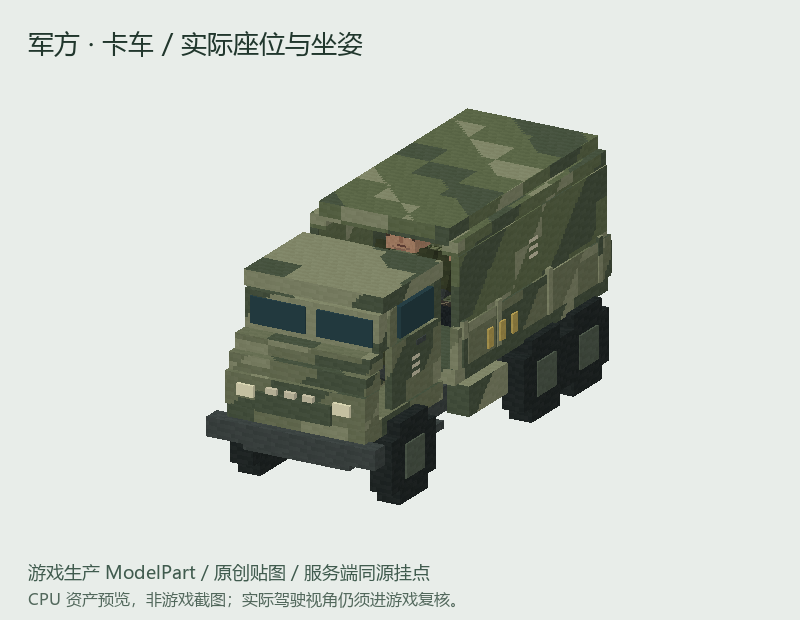

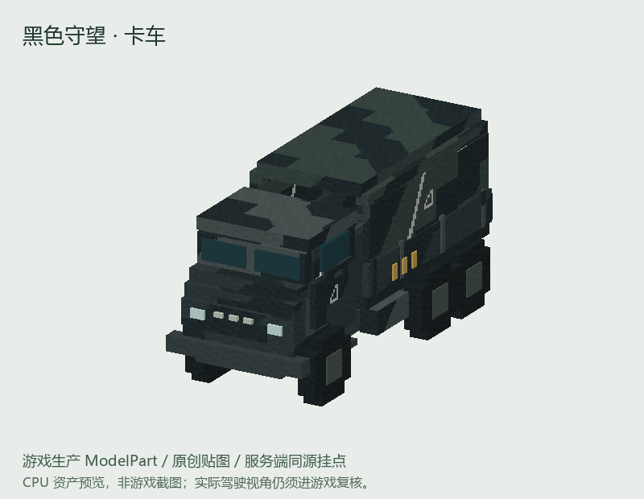

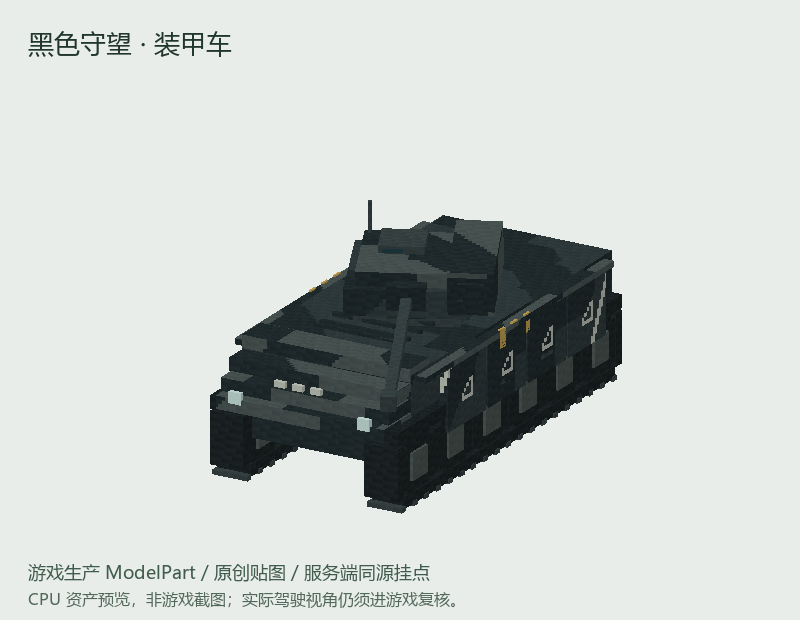

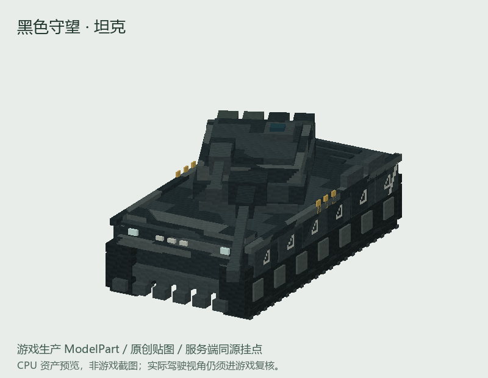

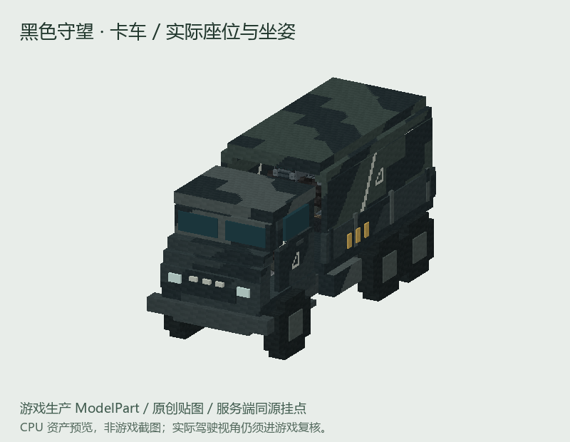

本目录[主manifest](M6/assets/vehicles/manifest.json)保留8场景、9张canonical主图的实际CPU捕获来源；最终源冻结后须重新捕获与核对。CPU预览不能代替OpenGL截图、真人驾驶或双客户端炮手验收。旧visual-seat-sync/visual-seating回执只作历史，不证明本轮新尺寸和真实Player已通过。

当前挂点由同一authoring导出：seat是乘员Entity脚点/基础位置，camera是单独的观察点。NPC和真实Player姿态、原型体皮肤及Mercer外观的源和测试快照已加入本轮来源索引；真实GL须读取独立run-military6-client-*的完整报告及root实际开图后的复核，任意YSM替代骨架兼容性仍不作推断。

| 底盘 | 挂点 | frame | position |
| --- | --- | --- | --- |
| truck | seat_driver | body | [-0.51555556,0.89,2.05645161] |
| truck | seat_officer | body | [0.51555556,0.89,2.05645161] |
| truck | seat_passenger_1 | body | [-0.53703704,1.053125,-0.72580645] |
| truck | seat_passenger_2 | body | [0.53703704,1.053125,-0.72580645] |
| truck | seat_passenger_3 | body | [-0.53703704,1.053125,-1.69354839] |
| truck | seat_passenger_4 | body | [0.53703704,1.053125,-1.69354839] |
| truck | seat_passenger_5 | body | [-0.53703704,1.053125,-2.66129032] |
| truck | seat_passenger_6 | body | [0.53703704,1.053125,-2.66129032] |
| truck | camera_driver | body | [-0.51555556,2.51,2.05645161] |
| truck | camera_officer | body | [0.51555556,2.51,2.05645161] |
| truck | camera_passenger_1 | body | [-0.53703704,2.673125,-0.72580645] |
| truck | camera_passenger_2 | body | [0.53703704,2.673125,-0.72580645] |
| truck | camera_passenger_3 | body | [-0.53703704,2.673125,-1.69354839] |
| truck | camera_passenger_4 | body | [0.53703704,2.673125,-1.69354839] |
| truck | camera_passenger_5 | body | [-0.53703704,2.673125,-2.66129032] |
| truck | camera_passenger_6 | body | [0.53703704,2.673125,-2.66129032] |
| apc | seat_driver | body | [-0.69193548,0.23571429,2.11206897] |
| apc | seat_gunner | body | [0.26612903,0.53035714,0.18103448] |
| apc | seat_passenger_1 | body | [-0.74516129,0.23571429,-0.84482759] |
| apc | seat_passenger_2 | body | [0.74516129,0.23571429,-0.84482759] |
| apc | seat_passenger_3 | body | [-0.74516129,0.23571429,-1.75] |
| apc | seat_passenger_4 | body | [0.74516129,0.23571429,-1.75] |
| apc | seat_passenger_5 | body | [-0.74516129,0.23571429,-2.65517241] |
| apc | camera_driver | body | [-0.69193548,2.15,1.91] |
| apc | camera_gunner | turret_yaw | [0.0,2.88,0.17] |
| apc | camera_passenger_1 | body | [-1.45,1.85571429,-0.84482759] |
| apc | camera_passenger_2 | body | [1.45,1.85571429,-0.84482759] |
| apc | camera_passenger_3 | body | [-1.45,1.85571429,-1.75] |
| apc | camera_passenger_4 | body | [1.45,1.85571429,-1.75] |
| apc | camera_passenger_5 | body | [-1.45,1.85571429,-2.65517241] |
| apc | camera_passenger_6 | body | [1.45,1.85571429,-2.65517241] |
| apc | seat_passenger_6 | body | [0.74516129,0.23571429,-2.65517241] |
| tank | seat_driver | body | [0.0,0.06071429,2.03076923] |
| tank | seat_gunner | body | [-0.52941176,0.54642857,0.12307692] |
| tank | seat_commander | body | [0.58823529,0.72857143,-0.55384615] |
| tank | camera_driver | body | [0.0,1.98,3.29] |
| tank | camera_gunner | turret_yaw | [0.55294118,3.35142857,-0.22] |
| tank | camera_commander | turret_yaw | [0.55294118,3.35142857,-0.22] |
额外诊断剖视：[军方车内](../../art/military-vehicles/previews/production/diagnostics/truck-crew-interior-military.png)、[BW车内](../../art/military-vehicles/previews/production/diagnostics/truck-crew-interior-blackwatch.png)。这2张只供查看实际乘员顶点，不计入主manifest的9图或资料主图总数30张。

## 玩家交互与目标规则

默认W/S前进/倒车、A/D转向、空格刹车、Shift原版下车，读取Minecraft当前移动/跳跃/潜行绑定。普通空手右键上车；“黑光：地面载具”中的切换座位、切换主炮弹种默认未绑定，须自行设无冲突键。司机只在炮手席空时兼任武器操作员；有炮手则由炮手鼠标瞄准、攻击键主武器/使用键副武器，普通乘客和指挥席不获驾驶或火力控制。每发消耗本车实际对应弹药，空弹/冷却/炮口遮挡拒射，HE/AP共享主炮冷却。

现有键位修复已接入：乘车时原型体抓取/技能/徒手攻击处理让出输入；空手Shift对车使用时也不抢走该次交互。炮手占席后司机不再发送无权火力/选弹动作，乘车移动输入可独立继续；攻击/使用仍尊重当前Minecraft绑定。实现依据见[客户端控制](M6/sources/neoforge/src/main/java/com/codex/blacklight/client/VehicleControls.java)及[原型体输入处理](M6/sources/neoforge/src/main/java/com/codex/blacklight/client/ClientClawEvents.java)。完整运行与真人改键验收以根回执为准。

抢夺需原型体玩家下车、主手空手、Shift右键发起，再松Shift并保持空手和司机座接触点约3.5格内无遮挡满30tick。原AI乘员须全部为有效真实军人；真人占任何席位拒抢，退远/隔墙/乘员变化/无安全出口取消或拒绝。成功驱逐同UUID存活NPC并接管同一车，损伤、油弹和冷却保留，不自动吞噬、杀人或发奖励；发起时沿用原敌对接触和伪装识破规则。

军方与BW保留两个独立阵营、默认同盟，平民沿用原规则。车载AI只主动选合法感染目标，保留创造/旁观、伪装和友军保护，不增设平民阵营或平民清剿目标；真人车内保护和PvP限制继续生效。`CLEAR_AREA` 已实现多车接敌横向展开：以领车接敌点为基准，按朝敌方向左右交替分配车位，相邻目标车位间距14格，各车使用原有加载区块寻路预算依次就位并停车后，真实普通兵乘客才下车作战；单车直接使用下车流程。路线/转向受阻累积失败后记 `BLOCKED` 并安全停，不缩小间距穿障或瞬移展开。源码见[车队实现](M6/sources/neoforge/src/main/java/com/codex/blacklight/military/vehicle/VehicleFleetSystem.java)，完整运行统计参见[根实施记录](../verification/MILITARY6_VEHICLES_20261026_ZH.md)和[玩家指南](../MILITARY6_PLAYER_TEST_ZH.md)。

## 步兵真实多武器与有限弹药

原10种注册身份、军衔、组织与归宿不因换武器变化。直接新生默认入口仍是步枪/重机枪/军官卡宾；新原生基地槽按真实UUID+任务只初始化一次新配装。备弹按弹种保存；枪的弹匣/冷却在各自真实物品上。旧档不会因为掉枪、换装、重登或换副枪免费重发。

| 职责 | 主枪 | 主弹匣+备弹 | 副枪 | 副弹匣+备弹 |
| --- | --- | --- | --- | --- |
| RIFLE | military_rifle | 30+90 | 无 | 无 |
| CARBINE | military_carbine | 24+72 | 无 | 无 |
| MACHINE_GUN | military_machine_gun | 60+180 | 无 | 无 |
| GRENADIER | grenade_launcher | 6+12 | 无 | 无 |
| ANTI_ARMOR | military_carbine | 24+48 | rocket_launcher | 1+2 |

一次性原生权重：

| 阵营 | 步枪 | 卡宾 | 机枪 | 榴弹 | 反装甲 |
| --- | --- | --- | --- | --- | --- |
| military | 65 | 15 | 10 | 6 | 4 |
| blackwatch | 60 | 18 | 12 | 6 | 4 |

8人策略：1卡宾、5步枪、1机枪、1榴弹；明确机械威胁时最后1人换反装甲。12人策略：1卡宾、8步枪、1机枪、1榴弹、1反装甲。这是现有策略工厂，不能据此声称当前会自然生成8/12人车队。导弹、温压、感染枪不进普通随机池。

## 10个active配方与保留的燃料文件

下表列六种完整车辆放置物品与自动炮弹、HE/AP、维修件共10项配方；两个加载器各自JSON原文存于recipes.json及sources。放置物品可逐级合成，不收纳有库存/乘员的已放置车辆。机枪弹、火箭弹及其余步兵弹药配方见[当前玩家指南](../MILITARY6_PLAYER_TEST_ZH.md)。

| 产物 | 数量 | 实际原料 |
| --- | --- | --- |
| blacklight:military_truck_chassis | 1 | {"minecraft:iron_block":6,"minecraft:copper_block":2,"minecraft:furnace":1} |
| blacklight:military_apc_chassis | 1 | {"minecraft:iron_block":6,"minecraft:redstone_block":1,"blacklight:military_truck_chassis":1,"minecraft:observer":1} |
| blacklight:military_tank_chassis | 1 | {"minecraft:iron_block":6,"minecraft:redstone_block":1,"blacklight:military_apc_chassis":1,"minecraft:dispenser":1} |
| blacklight:blackwatch_truck_chassis | 1 | {"blacklight:military_truck_chassis":1,"minecraft:black_dye":1} |
| blacklight:blackwatch_apc_chassis | 1 | {"blacklight:military_apc_chassis":1,"minecraft:black_dye":1} |
| blacklight:blackwatch_tank_chassis | 1 | {"blacklight:military_tank_chassis":1,"minecraft:black_dye":1} |
| blacklight:autocannon_round | 8 | {"minecraft:iron_ingot":2,"minecraft:copper_ingot":1,"minecraft:gunpowder":1} |
| blacklight:tank_he_shell | 1 | {"minecraft:iron_ingot":2,"minecraft:gunpowder":2,"minecraft:copper_ingot":1} |
| blacklight:tank_ap_shell | 1 | {"minecraft:iron_ingot":3,"minecraft:gunpowder":1,"minecraft:copper_ingot":1} |
| blacklight:vehicle_repair_parts | 1 | {"minecraft:iron_ingot":2,"minecraft:redstone":1} |

`military_fuel_can.json`保留在磁盘和源码快照，标记inactive，不进入游戏JAR；这不是缺失资源。

| 物品ID | 状态 | 原始图标 |
| --- | --- | --- |
| autocannon_round | active |  |
| blackwatch_apc_chassis | active |  |
| blackwatch_tank_chassis | active |  |
| blackwatch_truck_chassis | active |  |
| machine_gun_round | active |  |
| military_apc_chassis | active |  |
| military_fuel_can | inactive（保留） |  |
| military_tank_chassis | active |  |
| military_truck_chassis | active | 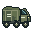 |
| rocket_round | active |  |
| tank_ap_shell | active |  |
| tank_he_shell | active |  |
| vehicle_repair_parts | active |  |

玩家手动补给须停稳、下车、主手持匹配弹药或维修件近距离右键车体；按实际接收数量扣除，错弹和满额拒收，创造模式也消耗实物。旧燃料罐不消耗、不补给，驾驶无需燃油。

野外维修已接入三类车：每次成功消耗1个 `blacklight:vehicle_repair_parts`，最多恢复20HP且不超过本车上限，缺口不足20HP仍扣1件。满血、超距、仍在移动、已毁/移除车拒收且不扣件；不能复活死车。玩家手动维修不要求车库，不会远程读取箱子。车库自动维修另有完整维修位和真实箱库存条件，两种入口都不产生免费资源。

## 两方真实车库

尺寸均31×10×27，模板地面在局部Y=0、车辆脚点Y=1。三条车道/车位按同一元数据登记；车库不是随便摆一个箱子。新生成基地可在独立地块合规时附加；旧基地仅发现已有记录，不自动翻新。

### vehicle_garage_military

| 车位 | 中心 | 完整维修范围min/max | 真实箱 | 门范围 |
| --- | --- | --- | --- | --- |
| truck | [5.5,1,12.5] | [1,1,6,10,8,20] | [5,1,2] | [2,1,26,9,8,27] |
| tank | [15.5,1,12.5] | [10,1,6,21,8,20] | [15,1,2] | [12,1,26,19,8,27] |
| apc | [25.5,1,12.5] | [21,1,6,30,8,20] | [25,1,2] | [22,1,26,29,8,27] |

初始箱内实际物品（不会打开刷新）：

| 箱位置 | 车位 | 物品数量 |
| --- | --- | --- |
| [5,1,2] | truck | {"blacklight:vehicle_repair_parts":4} |
| [15,1,2] | tank | {"blacklight:machine_gun_round":240,"blacklight:tank_ap_shell":8,"blacklight:tank_he_shell":12,"blacklight:vehicle_repair_parts":4} |
| [25,1,2] | apc | {"blacklight:rocket_round":4,"blacklight:autocannon_round":120,"blacklight:vehicle_repair_parts":4} |

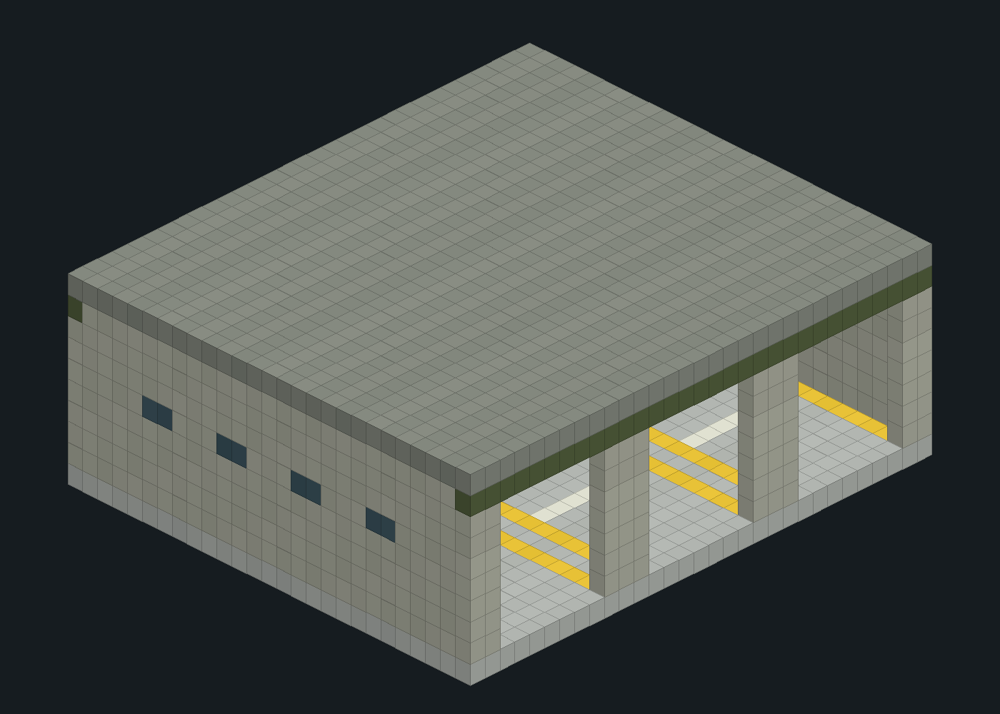

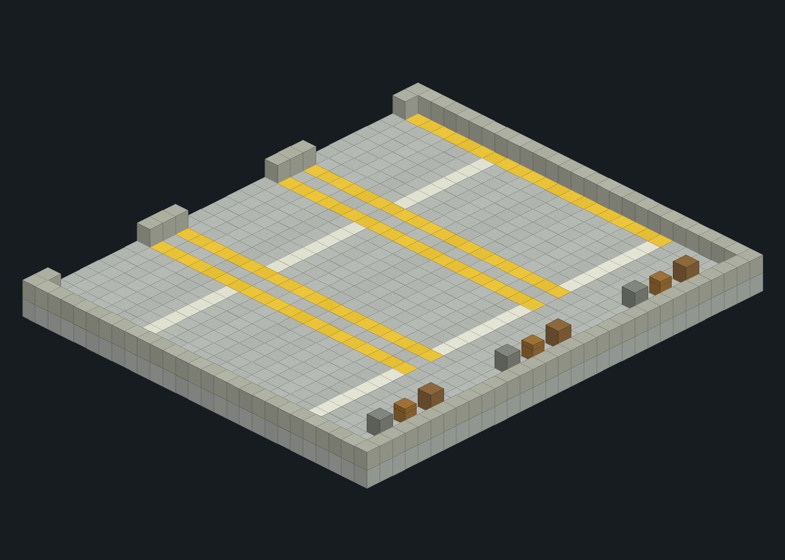

### vehicle_garage_blackwatch

| 车位 | 中心 | 完整维修范围min/max | 真实箱 | 门范围 |
| --- | --- | --- | --- | --- |
| truck | [5.5,1,12.5] | [1,1,6,10,8,20] | [5,1,2] | [2,1,26,9,8,27] |
| tank | [15.5,1,12.5] | [10,1,6,21,8,20] | [15,1,2] | [12,1,26,19,8,27] |
| apc | [25.5,1,12.5] | [21,1,6,30,8,20] | [25,1,2] | [22,1,26,29,8,27] |

初始箱内实际物品（不会打开刷新）：

| 箱位置 | 车位 | 物品数量 |
| --- | --- | --- |
| [5,1,2] | truck | {"blacklight:vehicle_repair_parts":4} |
| [15,1,2] | tank | {"blacklight:machine_gun_round":240,"blacklight:tank_ap_shell":8,"blacklight:tank_he_shell":12,"blacklight:vehicle_repair_parts":4} |
| [25,1,2] | apc | {"blacklight:rocket_round":4,"blacklight:autocannon_round":120,"blacklight:vehicle_repair_parts":4} |

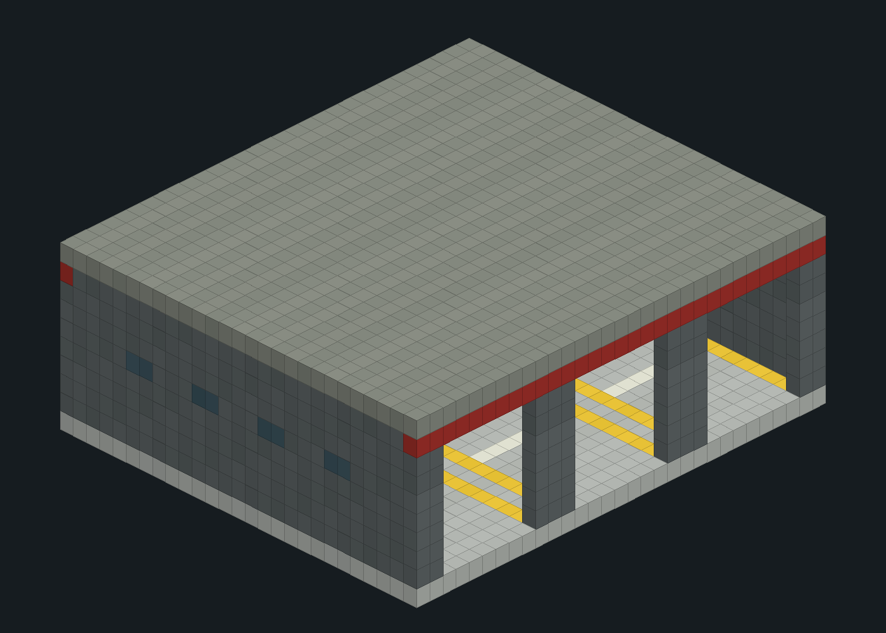

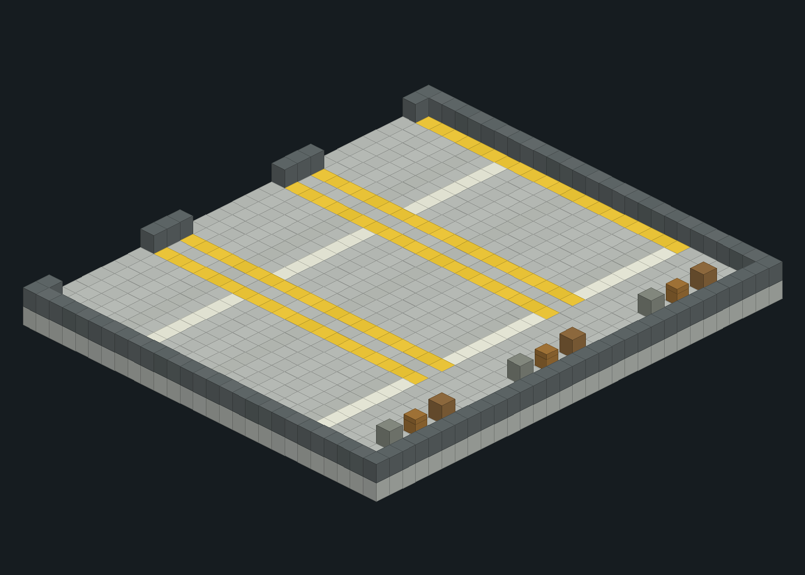

每车库卡车/APC/坦克各一个一次性原生槽。UNISSUED→RESERVED→ISSUED；真实毁坏记LOST，未知/卸载/开走/被抢或重启不重开。卡车需1名、APC/坦克各需2名原有空闲真实军人步行到位，不生成人员，不改变原16/20驻军名额。首次派发仅给一次初始弹药，后续箱料不刷新，旧FuelTicks不参与玩法。当前自动原生车辆默认加载预算12辆；旧24车压力记录只作历史。路径规划继续使用加载区块和预算，未知道路安全停，不强载追击。

当前源码实现使用原有空闲真实军人搬运同一实际ItemEntity内的有限弹药/维修件；无军人则不自动转移。低主弹≤20%或HP<35%时，原生无玩家车辆临时返回同维度、已加载、核心有效且有匹配库存的车库；原任务/目标不被RETURN改写，恢复阈值后继续原任务。取消、死亡或卸载应保留/在当地释放同一实物，不远程退款或重造。以上描述是本次源码契约，运行GREEN及真实两进程持久化必须由root的本轮实际证据确认，不能从旧M6.0 PASS推断。

车库自动取料要求同维度同阵营、核心有效、已加载、完整车身和炮管在对应维修位内停稳、箱内有匹配实物。原生槽的定时服务还要求无玩家归属、无真人乘员、当前驻地匹配。`return` 仅为已有原生出处或驻地关联的无玩家归属车寻找并登记可用驻地；普通命令新车没有这些关联时只返车队出发点，不能拿它验证原生自动后勤。玩家底盘车/抢得的车使用持物手动补给和野外维修，AI不自动征用。

核心损毁挡新派发和该处维修；已有车辆保留原生归属与资源。return寻找同维度已加载、同阵营、有效有路且有匹配弹药/维修件的车库；失败停车，不加载远处地形或远程取料。临时停车/驻地不能改写原生槽。

## 重建与核对

以下留给根在最终冻结后执行；列出命令不代表已执行，也不替代游戏验收。模板包含本页交互事实和待填验收表，根刷新后仍须核对最新生产与实际回执：

```powershell
python -X utf8 tools/archive_military6_catalog.py --neo-root ../neoforge-military6 --forge-root ../forge-military6
python -X utf8 tools/archive_military6_catalog.py --neo-root ../neoforge-military6 --forge-root ../forge-military6 --verify
```

生成工具只读生产文件并写独立M6资料；不运行Git/Gradle/服务器，不联网，不修改资源或存档。`--verify`仅核对快照、当前源与PNG哈希，不代表游戏测试通过。生产还在修改时索引会过时；原导出时的核查结果不能证明最终源一致。旧M5源快照与外观证据保持历史。

## 验证证据入口

最终自动验证、性能观察与发行回执见[根实施记录](../verification/MILITARY6_VEHICLES_20261026_ZH.md)最末节及[玩家指南](../MILITARY6_PLAYER_TEST_ZH.md)。本生成器只导出资料，不重新判定游戏或发行PASS；下表说明应核对的真实证据和范围。

| 验收项 | 证据入口 | 核对内容 |
| --- | --- | --- |
| 双端完整自动验证 | 根记录最终冻结表 | 最终JUnit、M6 GameTest及M6上M5完整回归的实际发现数、结果、日志与版本 |
| 普通军人/军官召唤 | 最终完整载具GameTest及本页历史定向日志 | 半旧Military字段不补发，已有HandItems不复制；历史定向结果不外推全量通过 |
| 同产物两进程保存与旧M5副本 | 根记录及各进程实际JSON | 不同PID、同档prepare/verify、UUID/HP/有限油弹/枪组件/身份/槽不增发 |
| 3/12/24压力 | 根记录六档实测表 | 实际硬件、每档车辆/步兵持续移动、tick p50/p95、规划预算和库存边界；24车有尖峰，不承诺20TPS或客户端FPS |
| 双端CPU捕获与真人体验 | 双端canonical捕获已完成；GL/真人体验待验收 | 最终坐姿回执各端8场景9主图，另2诊断图；CPU图不代替GL或真人驾驶 |
| 资料冻结与最终交付 | 根记录及包外SHA256/交付回执 | 冻结后刷新快照/核查，最终JAR/资料包路径、SHA256及独立验收结果 |
