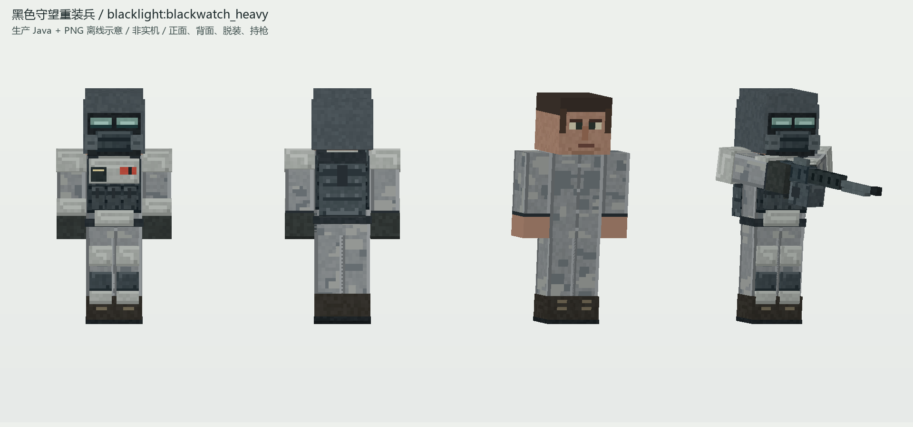

# 黑色守望重装兵

`blacklight:blackwatch_heavy`；blackwatch；出生role `trooper`，默认rank `private`。

| 项目 | 当前值 |
| --- | --- |
| health | 60.0 |
| armor | 10.0 |
| npc_effective_bullet_damage | 2.2 |
| movement_speed | 0.24 |
| knockback_resistance | 0.4 |
| aim_ticks | 12 |
| cycle_ticks | 76 |
| burst_shot_ages | [12,20,28] |
| burst_end_ticks | 29 |
| registered_width | 0.6 |
| registered_height | 1.95 |
| initial_weapon | military_machine_gun |
| initial_magazine | 60 |
| initial_reserve | 180 |
| npc_scale | 0.44000000000000006 |

生产几何：`src/main/java/com/codex/blacklight/client/model/BlackwatchModel.java`；纹理：`src/main/resources/assets/blacklight/textures/entity/blackwatch_soldier_layered.png`。正面、背面、脱装、持枪均离线渲染，不是实机截图。

[完整结构数据](../data/soldiers.json)；[军衔/编制/弹药/命令规则](../兵种与编制.md)。实体与资源原文及SHA在[来源清单](../data/source-manifest.json)。
