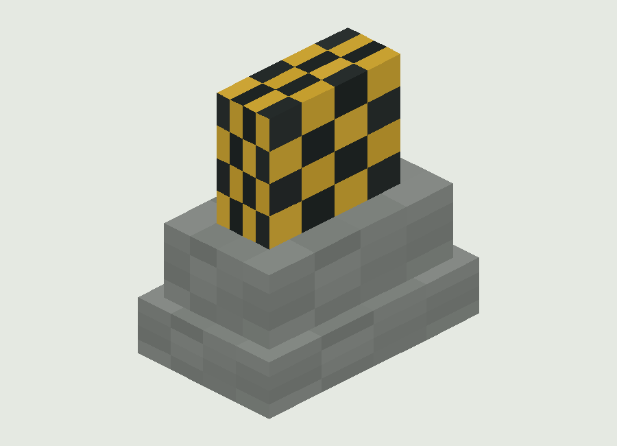
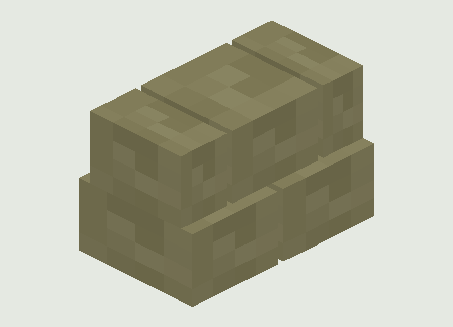
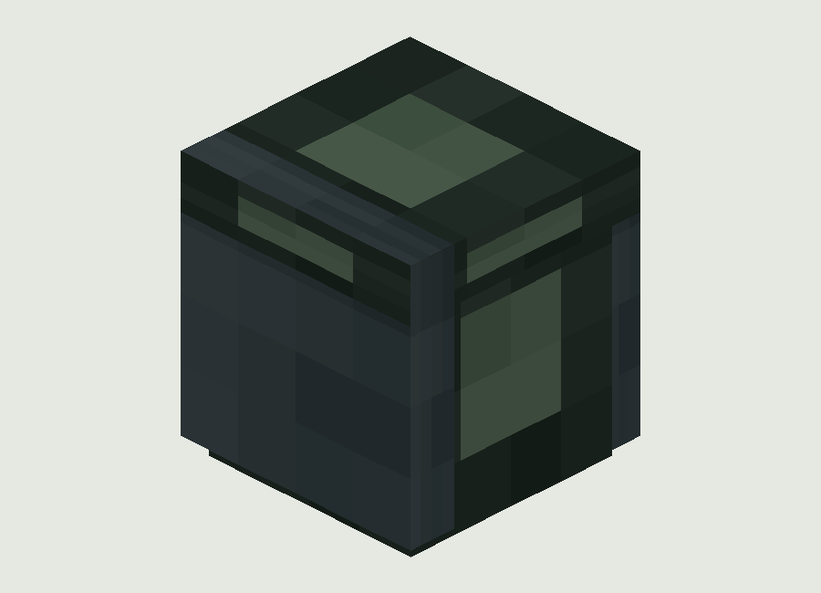
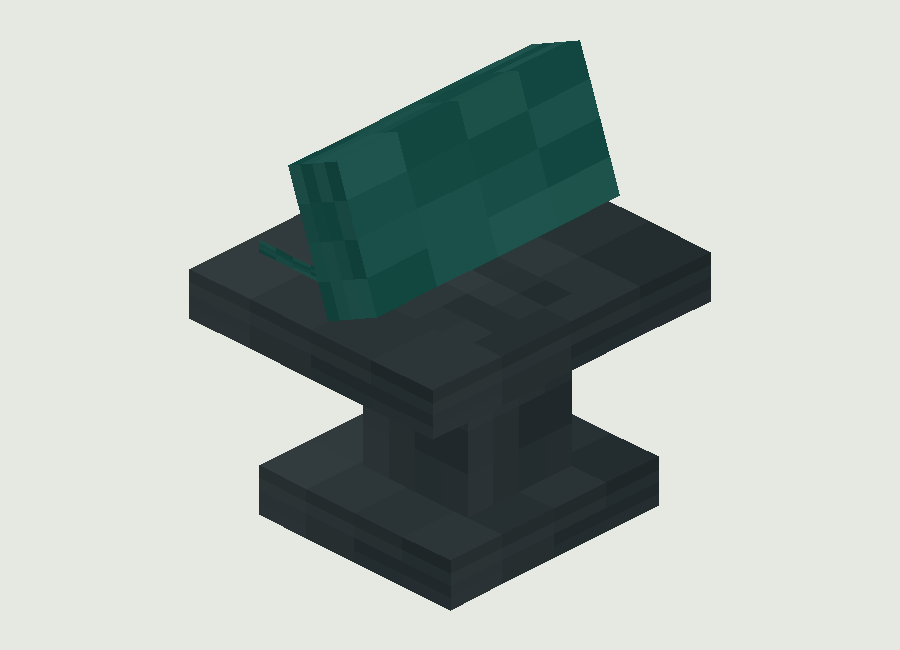
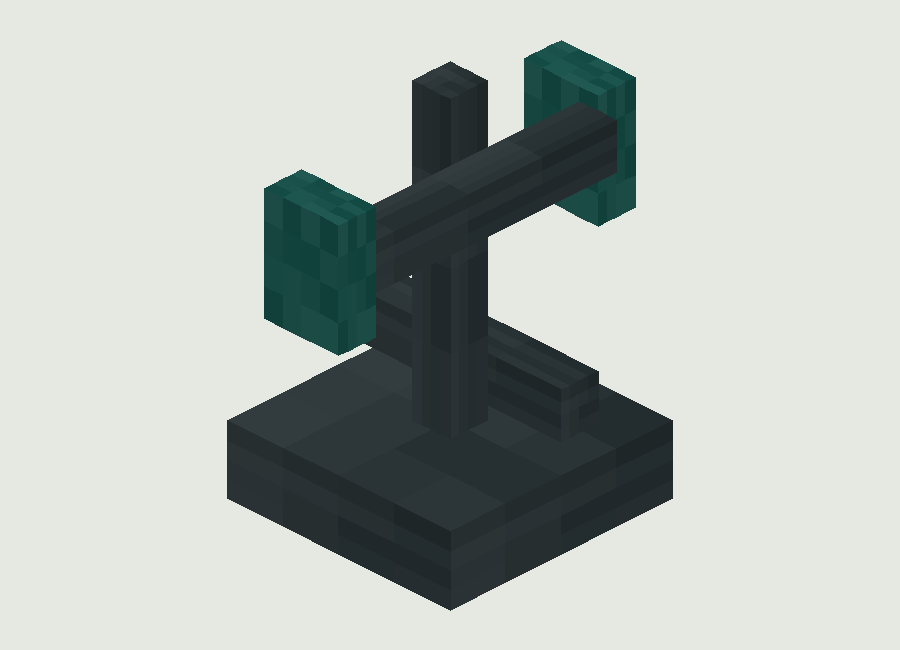
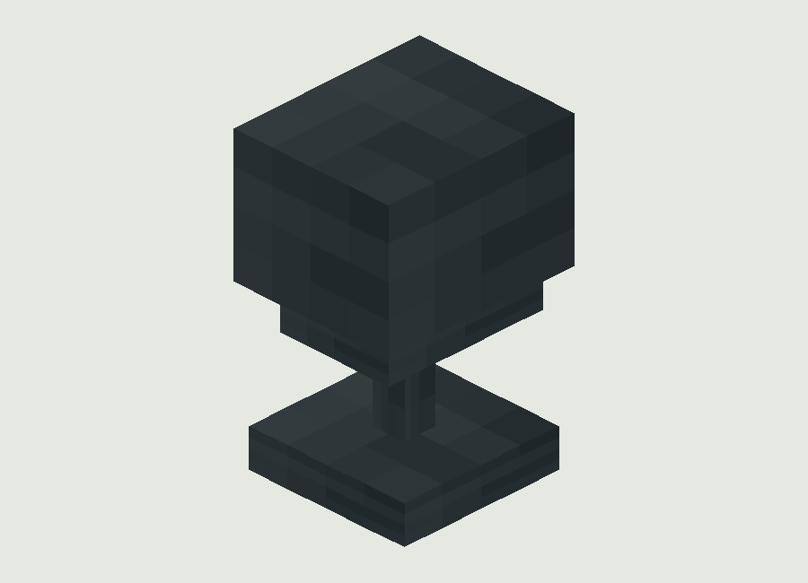

# 六种军事场景块

| ID | 中文 | 光级 | 北向碰撞盒0..16 | 用途 |
| --- | --- | --- | --- | --- |
| blacklight:field_barrier | 军用混凝土路障 | 0 | [0.0,0.0,3.0,16.0,14.0,13.0] | 碰撞/掩体/装饰 |
| blacklight:sandbag_cover | 沙袋掩体 | 0 | [0.0,0.0,3.0,16.0,9.0,13.0] | 碰撞/掩体/装饰 |
| blacklight:military_crate | 军用装饰箱（无库存） | 0 | [0.0,0.0,0.0,16.0,15.0,16.0] | 碰撞/掩体/装饰 |
| blacklight:command_terminal | 装饰指挥终端 | 4 | [0.0,0.0,1.0,16.0,16.0,15.0] | 固定光照 |
| blacklight:communications_antenna | 通信天线 | 0 | [6.0,0.0,6.0,10.0,16.0,10.0] | 碰撞/掩体/装饰 |
| blacklight:military_searchlight | 军用探照灯 | 12 | [2.0,0.0,3.0,14.0,16.0,13.0] | 固定光照 |

共同硬度2.5、爆炸抗性6、金属声音、noOcclusion；朝向随摆放方向取反，东西向交换X/Z盒子。源 getShape 供默认碰撞形状使用，没有额外beam或交通AI。军用箱没有Container库存，指挥终端没有Blacknet/任务功能，天线没有网络通信，探照灯只发固定光级12，终端光级4；物资实际存在原版箱。

## 军用混凝土路障

模型 `src/main/resources/assets/blacklight/models/block/field_barrier.json`。实际JSON立方体与纹理采样离线示意，非实机。

## 沙袋掩体

模型 `src/main/resources/assets/blacklight/models/block/sandbag_cover.json`。实际JSON立方体与纹理采样离线示意，非实机。

## 军用装饰箱（无库存）

模型 `src/main/resources/assets/blacklight/models/block/military_crate.json`。实际JSON立方体与纹理采样离线示意，非实机。

## 装饰指挥终端

模型 `src/main/resources/assets/blacklight/models/block/command_terminal.json`。实际JSON立方体与纹理采样离线示意，非实机。

## 通信天线

模型 `src/main/resources/assets/blacklight/models/block/communications_antenna.json`。实际JSON立方体与纹理采样离线示意，非实机。

## 军用探照灯

模型 `src/main/resources/assets/blacklight/models/block/military_searchlight.json`。实际JSON立方体与纹理采样离线示意，非实机。

原文见 [MilitaryFacilityBlocks.java](sources/neoforge/src/main/java/com/codex/blacklight/registry/MilitaryFacilityBlocks.java)，模型/方块状态/贴图原文列在来源manifest。
