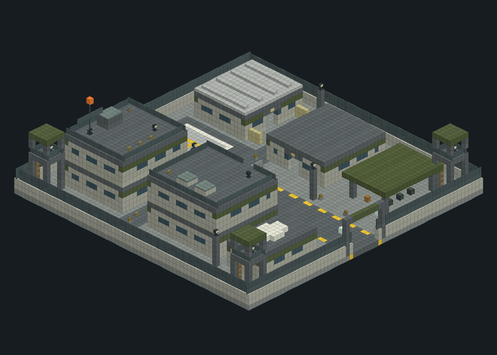
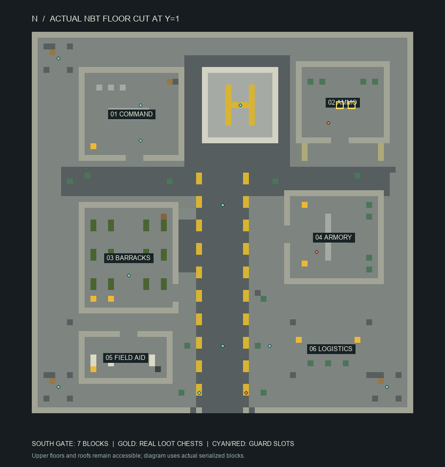
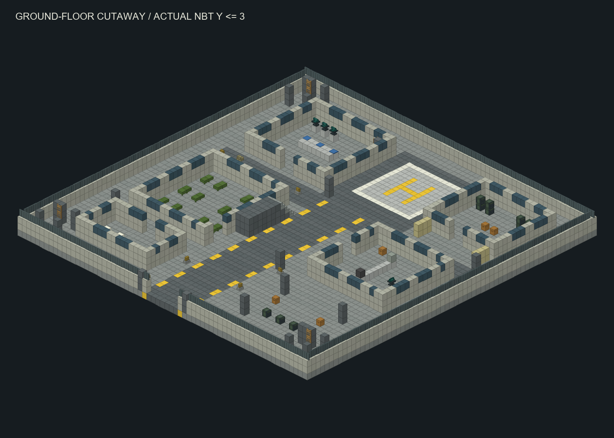

# large_military_base

| 字段 | 值 |
| --- | --- |
| size | [65,18,65] |
| data_version | 3955 |
| serialized_blocks | 76050 |
| non_air_blocks | 10163 |
| palette_size | 48 |
| embedded_entity_count | 0 |
| runtime_slots | 16 |
| source | src/main/resources/data/blacklight/structure/large_military_base.nbt |
| sha256 | 90c1715fa57bd839bdfbcde72341d5c9ac1d95b74084b398ea4d628a43c38943 |



按实际NBT块生成，原版材质近似，不渲染实体/箱中物资，非实机截图。

入口局部坐标 `[32, 1, 64]`，入口宽 `7`；弹药箱局部坐标 `[[52, 1, 12], [54, 1, 12]]`。所有坐标是模板局部坐标，旋转/放置地面由服务端转换。

## 模块原文

```json
[
  {
    "name": "command",
    "bounds": [
      8,
      0,
      6,
      25,
      10,
      21
    ],
    "entry": [
      17,
      1,
      19
    ],
    "floors": 2
  },
  {
    "name": "ammunition",
    "bounds": [
      45,
      0,
      5,
      60,
      5,
      18
    ],
    "entry": [
      52,
      1,
      16
    ],
    "floors": 1
  },
  {
    "name": "barracks",
    "bounds": [
      8,
      0,
      29,
      24,
      10,
      47
    ],
    "entry": [
      22,
      1,
      44
    ],
    "floors": 2
  },
  {
    "name": "armory",
    "bounds": [
      43,
      0,
      27,
      59,
      5,
      42
    ],
    "entry": [
      45,
      1,
      34
    ],
    "floors": 1
  },
  {
    "name": "medical",
    "bounds": [
      8,
      0,
      51,
      23,
      5,
      59
    ],
    "entry": [
      16,
      1,
      53
    ],
    "floors": 1
  },
  {
    "name": "logistics_canopy",
    "bounds": [
      43,
      0,
      48,
      58,
      5,
      59
    ],
    "entry": [
      50,
      1,
      51
    ],
    "floors": 1
  }
]
```

每个模块的bounds、entry、floors保留原始数据；字段若不存在就不补造。完整原文见[data/structures.json](../data/structures.json)。

## 运行槽有效身份

| 槽 | 原岗位 | 局部x,y,z | heavy | 有效角色 | 注册ID | 军衔 | 枪 | 可重定位哨卡 |
| --- | --- | --- | --- | --- | --- | --- | --- | --- |
| 0 | entry | [28,1,61] | False | team_leader | blacklight:military_team_leader | sergeant | military_rifle | True |
| 1 | entry | [36,1,61] | True | trooper | blacklight:military_heavy | corporal | military_machine_gun | True |
| 2 | motor_yard | [32,1,53] | False | trooper | blacklight:military_soldier | private | military_rifle | False |
| 3 | central_lane | [32,1,29] | False | trooper | blacklight:military_soldier | private | military_rifle | False |
| 4 | tower_northwest | [4,8,4] | False | trooper | blacklight:military_soldier | private | military_rifle | False |
| 5 | tower_southeast | [60,8,60] | False | trooper | blacklight:military_soldier | private | military_rifle | False |
| 6 | tower_southwest | [4,8,60] | False | trooper | blacklight:military_soldier | private | military_rifle | False |
| 7 | command | [18,1,18] | False | officer | blacklight:military_officer | lieutenant | military_carbine | False |
| 8 | operations | [18,6,18] | False | commander | blacklight:military_commander | major | military_carbine | False |
| 9 | command_roof | [18,11,12] | False | trooper | blacklight:military_soldier | private | military_rifle | False |
| 10 | ammunition | [50,1,15] | True | trooper | blacklight:military_heavy | corporal | military_machine_gun | False |
| 11 | barracks | [16,1,41] | False | trooper | blacklight:military_soldier | private | military_rifle | False |
| 12 | barracks_upper | [16,6,41] | False | trooper | blacklight:military_soldier | private | military_rifle | False |
| 13 | armory | [48,1,37] | True | trooper | blacklight:military_heavy | corporal | military_machine_gun | False |
| 14 | landing_pad | [35,1,12] | False | trooper | blacklight:military_soldier | private | military_rifle | False |
| 15 | logistics | [40,1,53] | False | trooper | blacklight:military_soldier | private | military_rifle | False |





这些补充图复制自已有制作预览，独立来源hash见preview-manifest；本次实际NBT新渲染图在页首。

## 真实箱原始库存与LootTable

| 局部pos | 方块 | NBT原文 |
| --- | --- | --- |
| [10,1,19] | minecraft:chest | {"id":"minecraft:chest","LootTable":"blacklight:chests/base_supplies"} |
| [10,1,45] | minecraft:chest | {"id":"minecraft:chest","LootTable":"blacklight:chests/base_supplies"} |
| [10,1,57] | minecraft:chest | {"id":"minecraft:chest","LootTable":"blacklight:chests/base_medical"} |
| [10,6,19] | minecraft:chest | {"id":"minecraft:chest","LootTable":"blacklight:chests/base_supplies"} |
| [10,6,45] | minecraft:chest | {"id":"minecraft:chest","LootTable":"blacklight:chests/base_supplies"} |
| [13,1,45] | minecraft:chest | {"id":"minecraft:chest","LootTable":"blacklight:chests/base_supplies"} |
| [13,6,45] | minecraft:chest | {"id":"minecraft:chest","LootTable":"blacklight:chests/base_supplies"} |
| [45,1,52] | minecraft:chest | {"id":"minecraft:chest","LootTable":"blacklight:chests/base_supplies"} |
| [46,1,29] | minecraft:chest | {"id":"minecraft:chest","LootTable":"blacklight:chests/base_armory"} |
| [46,1,39] | minecraft:chest | {"id":"minecraft:chest","LootTable":"blacklight:chests/base_armory"} |
| [52,1,12] | minecraft:chest | {"id":"minecraft:chest","LootTable":"blacklight:chests/base_ammunition"} |
| [54,1,12] | minecraft:chest | {"id":"minecraft:chest","LootTable":"blacklight:chests/base_ammunition"} |
| [55,1,52] | minecraft:chest | {"id":"minecraft:chest","LootTable":"blacklight:chests/base_supplies"} |

LootTable是延迟战利品表引用，不是已开箱随机结果；Items是模板固定物品。配方/loot原文分别在 [recipes](../data/recipes.json)、[loot_tables](../data/loot_tables.json)，原文件快照保留JSON。

## NBT嵌入实体

NBT没有嵌入实体。大型基地的驻军由运行槽服务发放，详见上文，不能由此断言没有人员。

[解析JSON（含palette/块计数/箱与实体原文）](../data/nbt/large_military_base.json)；[规则总览](../建筑与生成.md)。
