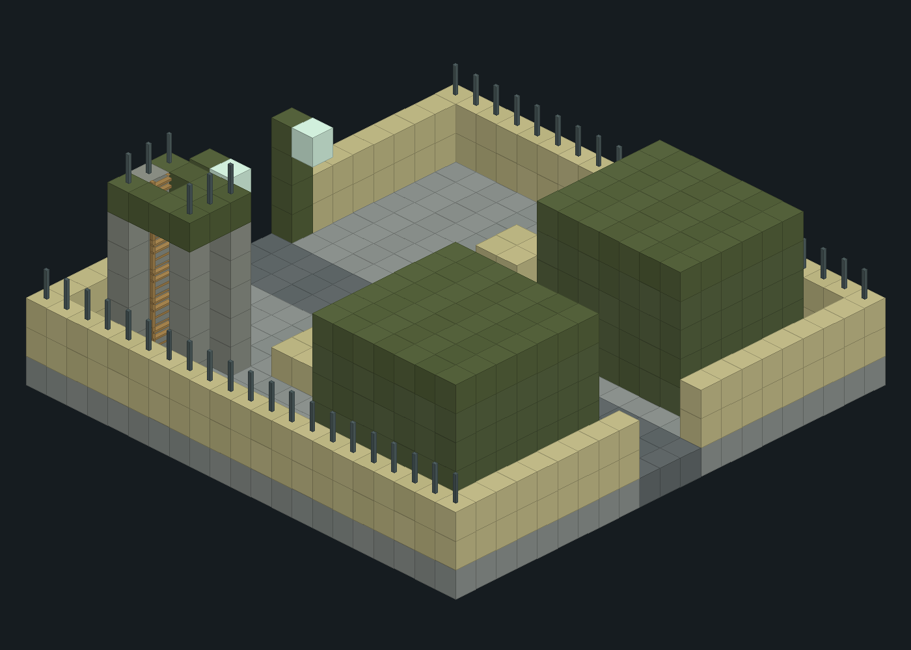

# military_camp

| 字段 | 值 |
| --- | --- |
| size | [21,9,21] |
| data_version | 3955 |
| serialized_blocks | 3969 |
| non_air_blocks | 976 |
| palette_size | 16 |
| embedded_entity_count | 8 |
| runtime_slots | 0 |
| source | src/main/resources/data/blacklight/structure/military_camp.nbt |
| sha256 | c8b4cef8815da20fc91511a12951f60125943006140adbbdf7a635a2ef430ad9 |

按实际NBT块生成，原版材质近似，不渲染实体/箱中物资，非实机截图。

## 真实箱原始库存与LootTable

| 局部pos | 方块 | NBT原文 |
| --- | --- | --- |
| [6,1,17] | minecraft:chest | {"id":"minecraft:chest","LootTable":"blacklight:chests/blackwatch_technology"} |
| [16,1,17] | minecraft:chest | {"id":"minecraft:chest","LootTable":"blacklight:chests/blackwatch_supplies"} |

LootTable是延迟战利品表引用，不是已开箱随机结果；Items是模板固定物品。配方/loot原文分别在 [recipes](../data/recipes.json)、[loot_tables](../data/loot_tables.json)，原文件快照保留JSON。

## NBT嵌入实体

| ID | 位置 | NBT完整原文 |
| --- | --- | --- |
| blacklight:military_soldier | [6.5,1.0,5.5] | {"id":"blacklight:military_soldier","PersistenceRequired":1,"Rotation":[180.0,0.0],"MilitaryRank":"sergeant","MilitaryDeployment":"military_camp","MilitaryDeploymentCapacity":8,"MilitaryDeploymentX":4.0,"MilitaryDeploymentY":0.0,"MilitaryDeploymentZ":5.0} |
| blacklight:military_soldier | [14.5,1.0,5.5] | {"id":"blacklight:military_soldier","PersistenceRequired":1,"Rotation":[180.0,0.0],"MilitaryRank":"private","MilitaryDeployment":"military_camp","MilitaryDeploymentCapacity":8,"MilitaryDeploymentX":-4.0,"MilitaryDeploymentY":0.0,"MilitaryDeploymentZ":5.0} |
| blacklight:military_soldier | [10.5,1.0,10.5] | {"id":"blacklight:military_soldier","PersistenceRequired":1,"Rotation":[180.0,0.0],"MilitaryRank":"private","MilitaryDeployment":"military_camp","MilitaryDeploymentCapacity":8,"MilitaryDeploymentX":0.0,"MilitaryDeploymentY":0.0,"MilitaryDeploymentZ":0.0} |
| blacklight:military_soldier | [6.5,1.0,16.5] | {"id":"blacklight:military_soldier","PersistenceRequired":1,"Rotation":[180.0,0.0],"MilitaryRank":"private","MilitaryDeployment":"military_camp","MilitaryDeploymentCapacity":8,"MilitaryDeploymentX":4.0,"MilitaryDeploymentY":0.0,"MilitaryDeploymentZ":-6.0} |
| blacklight:military_heavy | [14.5,1.0,16.5] | {"id":"blacklight:military_heavy","PersistenceRequired":1,"Rotation":[180.0,0.0],"MilitaryRank":"corporal","MilitaryDeployment":"military_camp","MilitaryDeploymentCapacity":8,"MilitaryDeploymentX":-4.0,"MilitaryDeploymentY":0.0,"MilitaryDeploymentZ":-6.0} |
| blacklight:military_soldier | [17.5,1.0,8.5] | {"id":"blacklight:military_soldier","PersistenceRequired":1,"Rotation":[180.0,0.0],"MilitaryRank":"private","MilitaryDeployment":"military_camp","MilitaryDeploymentCapacity":8,"MilitaryDeploymentX":-7.0,"MilitaryDeploymentY":0.0,"MilitaryDeploymentZ":2.0} |
| blacklight:military_soldier | [3.5,7.0,4.5] | {"id":"blacklight:military_soldier","PersistenceRequired":1,"Rotation":[180.0,0.0],"MilitaryRank":"private","MilitaryDeployment":"military_camp","MilitaryDeploymentCapacity":8,"MilitaryDeploymentX":7.0,"MilitaryDeploymentY":-6.0,"MilitaryDeploymentZ":6.0} |
| blacklight:military_soldier | [10.5,1.0,17.5] | {"id":"blacklight:military_soldier","PersistenceRequired":1,"Rotation":[180.0,0.0],"MilitaryRank":"private","MilitaryDeployment":"military_camp","MilitaryDeploymentCapacity":8,"MilitaryDeploymentX":0.0,"MilitaryDeploymentY":0.0,"MilitaryDeploymentZ":-7.0} |

[解析JSON（含palette/块计数/箱与实体原文）](../data/nbt/military_camp.json)；[规则总览](../建筑与生成.md)。
