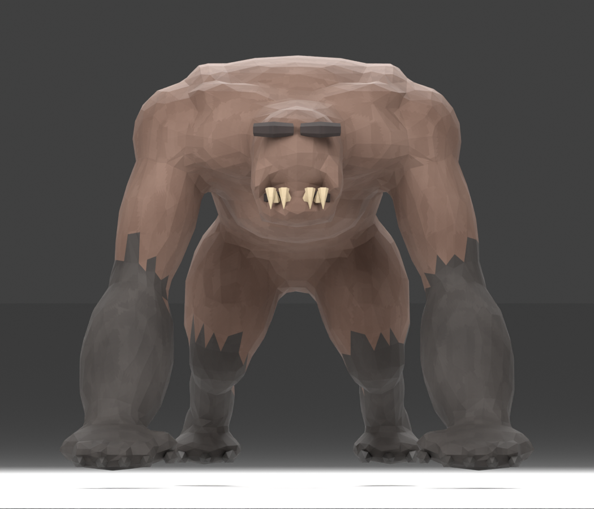
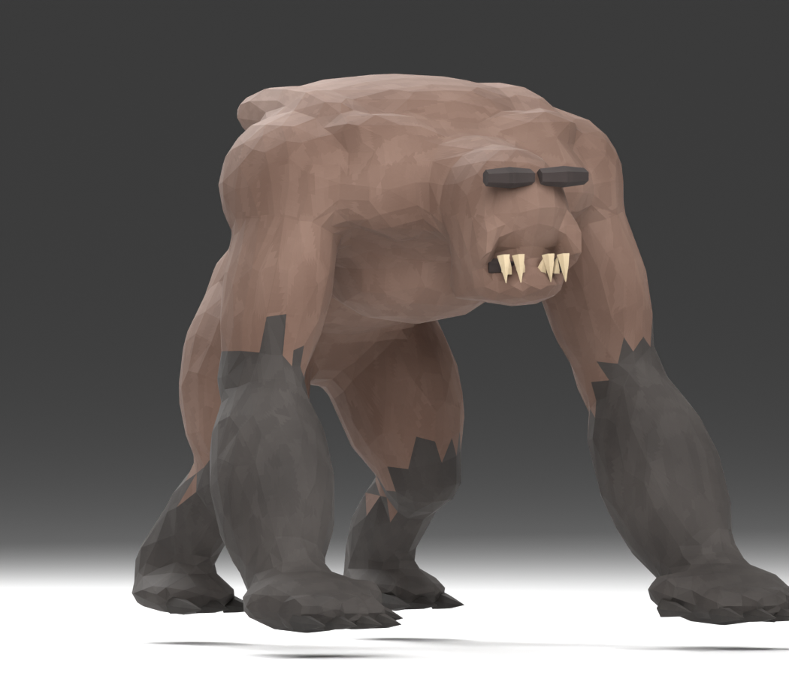
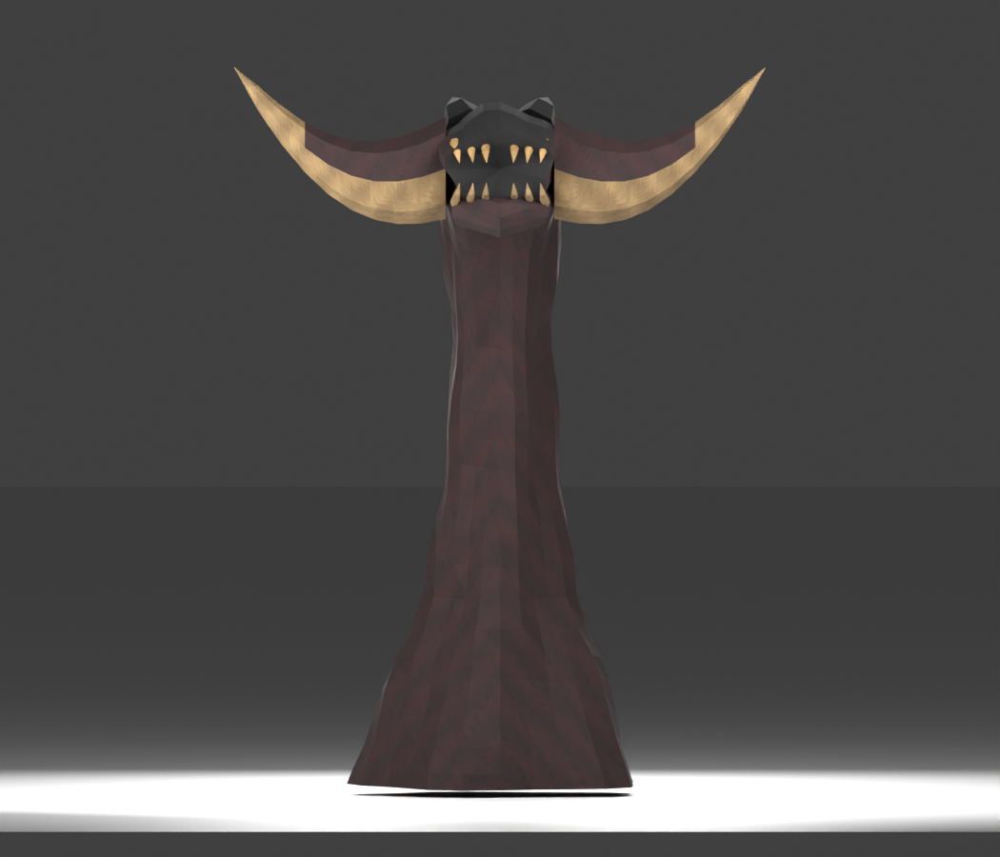
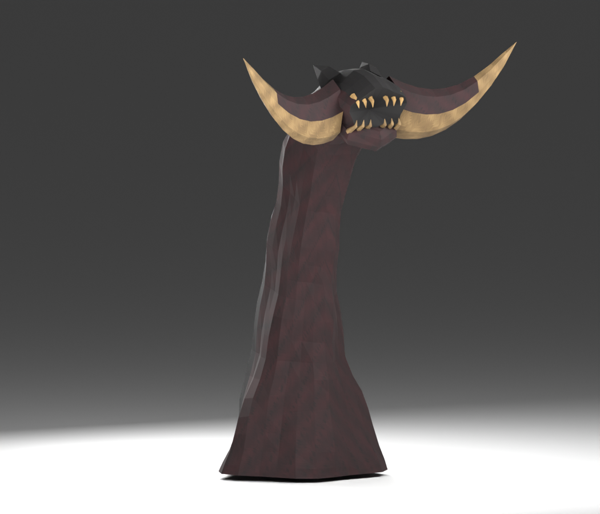

# 感染生物与巨型单位概览

这部分为现有生物制作索引，记录已核对基础属性和源码入口，不重写全部玩家进化/攻击系统。未单独登记的护甲/属性不填0，未产出可靠外观图明确待补。

| ID | 名称 | 基础HP | 攻击属性 | 速度 | 抗击退 | 注册宽×高 | 说明 |
| --- | --- | --- | --- | --- | --- | --- | --- |
| blacklight:infected_host | 黑光感染体 | 30.0 | 5.0 | 0.3 | 0.0 | 0.9×1.2 | 宿主数据可重设属性/尺度；这些是空宿主初始属性，非所有宿主固定值 |
| blacklight:blacklight_stalker | 黑光潜猎者 | 24.0 | 5.0 | 0.34 | 0.1 | 0.9×1.1 | STALKER 分支 |
| blacklight:blacklight_spitter | 黑光喷吐者 | 28.0 | 5.0 | 0.24 | 0.1 | 0.8×2.0 | SPITTER 分支；ATTACK_DAMAGE并非唾液伤害 |
| blacklight:blacklight_brute | 黑光重甲兽 | 80.0 | 10.0 | 0.24 | 0.7 | 1.3×2.5 | BRUTE 分支 |
| blacklight:blacklight_hunter | 黑光猎杀者 · 重爪 | 96.0 | 14.0 | 0.32 | 0.65 | 1.05×2.35 | HunterBalance 基础值；动作/难度与防御再缩放 |
| blacklight:blacklight_hive | 黑光蜂巢 | 160.0 | 未单独登记 | 0.0 | 1.0 | 4.0×3.5 | 常规伤害受 HiveDefense 芯片伤害/间隔限制；有限增援波 |
| blacklight:blacklight_hydra | 九头蛇 | 180.0 | 14.0 | 0.0 | 1.0 | 2.4×5.0 | 固定炮台式海德拉；动作命中另读实体源码 |
| blacklight:biomass_husk | 黑光外壳 | 40.0 | 未单独登记 | 0.0 | 1.0 | 0.6×1.8 | 生物质残骸实体，非持枪兵种 |

[creatures.json](data/creatures.json)保留当前attributes方法原文，数值是基础值；Hunter动作倍率、感染伤害预算和难度、宿主物种数据、HiveDefense会再改变伤害/生命行为。感染宿主infected_host会保存来源物种、躯体和成长字段；0.9×1.2是注册默认值，实际dimensions按宿主/尺度重算，不能用它代表巨型体型。

## 原生资源入口

| ID | 真实资源路径 | 外观选择 |
| --- | --- | --- |
| blacklight:infected_host | 由渲染器选择来源物种/玩家皮肤 | 按宿主来源物种、作者mesh与形变选择外观 |
| blacklight:blacklight_stalker | ["src/main/resources/assets/blacklight/geo/blacklight_stalker.geo.json","src/main/resources/assets/blacklight/animations/blacklight_stalker.animation.json","src/main/resources/assets/blacklight/textures/entity/infected_species.png"] | 见具体资源路径；有geo骨架不代表最终只有geo表面，hunter/hydra另绘connected网格 |
| blacklight:blacklight_spitter | ["src/main/resources/assets/blacklight/geo/blacklight_spitter.geo.json","src/main/resources/assets/blacklight/animations/blacklight_spitter.animation.json","src/main/resources/assets/blacklight/textures/entity/infected_species.png"] | 见具体资源路径；有geo骨架不代表最终只有geo表面，hunter/hydra另绘connected网格 |
| blacklight:blacklight_brute | ["src/main/resources/assets/blacklight/geo/blacklight_brute.geo.json","src/main/resources/assets/blacklight/animations/blacklight_brute.animation.json","src/main/resources/assets/blacklight/textures/entity/infected_species.png"] | 见具体资源路径；有geo骨架不代表最终只有geo表面，hunter/hydra另绘connected网格 |
| blacklight:blacklight_hunter | ["src/main/resources/assets/blacklight/geo/blacklight_hunter_authored.geo.json","src/main/resources/assets/blacklight/animations/blacklight_hunter.animation.json","src/main/resources/assets/blacklight/models/hunter_connected.json","src/main/resources/assets/blacklight/textures/entity/hunter_connected.png","src/main/resources/assets/blacklight/textures/entity/hunter_authored.png"] | 见具体资源路径；有geo骨架不代表最终只有geo表面，hunter/hydra另绘connected网格 |
| blacklight:blacklight_hive | ["src/main/resources/assets/blacklight/geo/blacklight_hive.geo.json","src/main/resources/assets/blacklight/animations/blacklight_hive.animation.json","src/main/resources/assets/blacklight/textures/entity/infected_species.png"] | 见具体资源路径；有geo骨架不代表最终只有geo表面，hunter/hydra另绘connected网格 |
| blacklight:blacklight_hydra | ["src/main/resources/assets/blacklight/geo/blacklight_hydra.geo.json","src/main/resources/assets/blacklight/animations/blacklight_hydra.animation.json","src/main/resources/assets/blacklight/models/hydra_connected.json","src/main/resources/assets/blacklight/textures/entity/hydra_connected.png","src/main/resources/assets/blacklight/textures/entity/hydra_authored.png"] | 见具体资源路径；有geo骨架不代表最终只有geo表面，hunter/hydra另绘connected网格 |
| blacklight:biomass_husk | 由渲染器选择来源物种/玩家皮肤 | 使用所有者/默认玩家皮肤并由残骸渲染器处理 |

这些模型/纹理/动画及相应模型、渲染源码均进入两端sources快照，SHA由manifest索引。猎手/海德拉还使用connected网格，不把geo骨架误写成最终完整表面。

这些是已有作者预览，不是本轮实机通过截图。宿主/潜伏者/喷吐者/暴徒/蜂巢/残骸没有在本次重绘外观，资源仍在生产assets/blacklight的geo、textures/entity、animations中，详查源码模型选择；本档案不以相似图冒充。

## 巨型宿主资料档

| 来源物种 | family | 物理宽×高 | 标称视觉宽×深×高 | HP | 攻击属性 | 速度 | 实际作者视觉bounds |
| --- | --- | --- | --- | --- | --- | --- | --- |
| minecraft:warden | ground | 6.0×30.0 | [34.5,19.08,36.0] | 700.0 | 10.0 | 0.27 | [-17.61,0.0,-9.55,16.92,36.01,9.56] |
| minecraft:iron_golem | ground | 6.0×26.0 | [32.18,19.23,30.0] | 500.0 | 9.0 | 0.25 | [-17.1,0.0,-10.07,15.11,30.01,9.19] |
| minecraft:wither | air | 6.0×32.0 | [30.38,13.4,40.0] | 800.0 | 8.0 | 0.3 | [-15.22,0.0,-5.38,15.2,40.01,8.05] |
| minecraft:ender_dragon | air | 12.0×22.0 | [112.0,104.68,37.75] | 1000.0 | 10.0 | 0.32 | [-56.02,0.0,-42.84,56.02,37.77,61.88] |

| 来源物种 | 实际mesh资源路径 |
| --- | --- |
| minecraft:warden | src/main/resources/assets/blacklight/infected_models/warden.json |
| minecraft:iron_golem | src/main/resources/assets/blacklight/infected_models/iron_golem.json |
| minecraft:wither | src/main/resources/assets/blacklight/infected_models/wither.json |
| minecraft:ender_dragon | src/main/resources/assets/blacklight/infected_models/ender_dragon.json |

这四项是 `blacklight:infected_host` 的 InfectedBossProfile，不是四个新的注册实体ID。物理locomotion碰撞、各身体part命中盒与完整视觉bounds分开：视觉bounds用于高度/边界检查，不直接当成地形碰撞。visualWidth/Depth/Height是作者标称尺寸，实际不对称手爪/尾巴由localVisualBounds精确边界定义。巨型体bodyScale=1；紧凑体根据宿主Height/BaseBodyScale/成长进度缩放，不能给所有感染warden写死30格物理高。

巨型/紧凑判定、18000tick成长、保存迁移见 BlacklightInfectedHost.java；精确身体part数据在 [InfectedBossProfile.java](sources/neoforge/src/main/java/com/codex/blacklight/entity/InfectedBossProfile.java)。本次未新增这些巨型单位实机外观图，待补；不把军事实体图套用。

## 程序型 colossal_hive

它不是第八个NBT：`ColossalHiveLayout` 在代码里生成。RADIUS=56，MIN_Y=-10，MAX_Y=64；CHAMBER_CLEAR_RADIUS=23、CHAMBER_CLEAR_HEIGHT=42；核心局部(28,1,8)，4个营养点(-26,1,0)、(26,1,0)、(0,1,-26)、(0,1,26)。KEEP表示不改原地形，不应把113×75×113计算范围称为填满的方块建筑。

来源：[ColossalHiveLayout](sources/neoforge/src/main/java/com/codex/blacklight/world/ColossalHiveLayout.java)、ColossalHivePiece/Structure与worldgen/structure_set/colossal_hives.json。生成布局与实体蜂巢 `blacklight_hive` 是不同概念。本次没有制作该程序建筑的新离线图或实机图，缺图明确保留。旧玩家能力、宿主全物种纹理考据与原版生物属性继承不在本次完整归档范围。
