# 八枪七弹

这里是项目原创玩法平衡，不是真实枪械性能或原作枪械型号考据。damage为玩家基础值；NPC默认实际枪伤读[兵种档](兵种与编制.md)，不能直接照抄此列。range与radius单位方块，容量单位发，cooldown/reload单位tick。

| 物品ID | 弹种 | 容量 | 冷却tick | 装填tick | 玩家基础伤害 | 射程 | 类别 | 半径 |
| --- | --- | --- | --- | --- | --- | --- | --- | --- |
| military_rifle | rifle_round | 30 | 4 | 40 | 4.0 | 64.0 | BULLET | 0.0 |
| military_carbine | rifle_round | 24 | 3 | 32 | 3.5 | 48.0 | BULLET | 0.0 |
| military_machine_gun | machine_gun_round | 60 | 3 | 65 | 5.0 | 72.0 | BULLET | 0.0 |
| grenade_launcher | grenade_round | 6 | 14 | 55 | 12.0 | 40.0 | GRENADE | 3.0 |
| rocket_launcher | rocket_round | 1 | 22 | 65 | 20.0 | 80.0 | ROCKET | 4.0 |
| missile_launcher | missile_round | 1 | 28 | 75 | 22.0 | 96.0 | MISSILE | 4.0 |
| thermobaric_launcher | thermobaric_round | 1 | 25 | 70 | 24.0 | 48.0 | THERMOBARIC | 5.0 |
| infection_launcher | infection_round | 1 | 25 | 60 | 0.0 | 40.0 | INFECTION | 3.0 |

子弹为射线命中，非BULLET类型生成OrdnanceProjectile。感染弹基础damage=0不等于没有感染效果；爆炸/感染/阵营保护/防御行为原文读 FirearmsCombat 与 OrdnanceProjectile，数值表不声称等同最终扣血。玩家右键/装填输入和服务端状态见 FirearmItem/FirearmsClient。

## 长步枪 / military_rifle

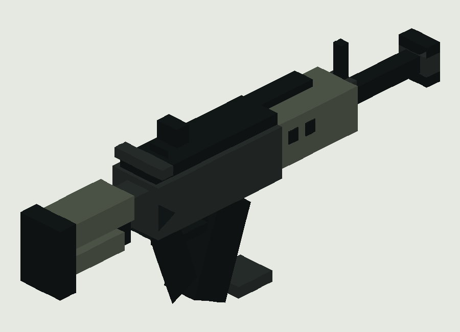

原文：[src/main/resources/data/blacklight/recipe/military_rifle.json](sources/neoforge/src/main/resources/data/blacklight/recipe/military_rifle.json)；SHA-256 `b804427e7a9d457b18ac8afdffad8140fbb54ee78d36207e5e5e33604191d983`。

```json
{
  "type": "minecraft:crafting_shaped",
  "pattern": [
    "III",
    " CR",
    " SI"
  ],
  "key": {
    "I": {
      "item": "minecraft:iron_ingot"
    },
    "C": {
      "item": "blacklight:military_circuit"
    },
    "R": {
      "item": "blacklight:rifle_round"
    },
    "S": {
      "item": "minecraft:stick"
    }
  },
  "result": {
    "id": "blacklight:military_rifle",
    "count": 1
  }
}
```

## 紧凑卡宾枪 / military_carbine

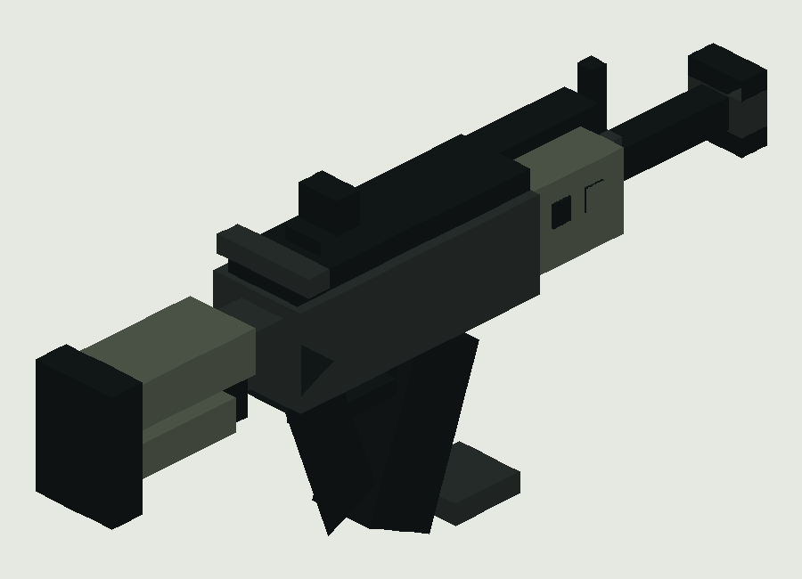

原文：[src/main/resources/data/blacklight/recipe/military_carbine.json](sources/neoforge/src/main/resources/data/blacklight/recipe/military_carbine.json)；SHA-256 `37ea501a12cd798d4222f666a38a04178927cd0b7e6310ef5ad1bdbc26a54473`。

```json
{
  "type": "minecraft:crafting_shaped",
  "pattern": [
    " II",
    " CR",
    " SI"
  ],
  "key": {
    "I": {
      "item": "minecraft:iron_ingot"
    },
    "C": {
      "item": "blacklight:military_circuit"
    },
    "R": {
      "item": "blacklight:rifle_round"
    },
    "S": {
      "item": "minecraft:stick"
    }
  },
  "result": {
    "id": "blacklight:military_carbine",
    "count": 1
  }
}
```

## 班用机枪 / military_machine_gun

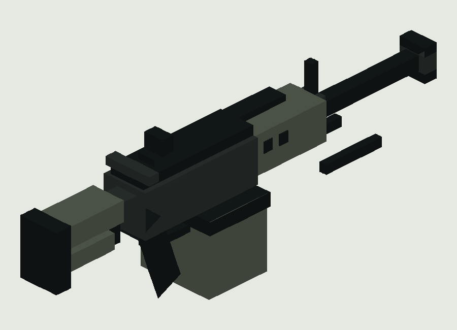

原文：[src/main/resources/data/blacklight/recipe/military_machine_gun.json](sources/neoforge/src/main/resources/data/blacklight/recipe/military_machine_gun.json)；SHA-256 `c64325aef5c066ad33c38e85a4bbe845468ffba09f8b7812d05d9f5f9231c96d`。

```json
{
  "type": "minecraft:crafting_shaped",
  "pattern": [
    "III",
    " CR",
    " SI"
  ],
  "key": {
    "I": {
      "item": "minecraft:iron_ingot"
    },
    "C": {
      "item": "blacklight:military_circuit"
    },
    "R": {
      "item": "blacklight:machine_gun_round"
    },
    "S": {
      "item": "minecraft:stick"
    }
  },
  "result": {
    "id": "blacklight:military_machine_gun",
    "count": 1
  }
}
```

## 榴弹发射器 / grenade_launcher

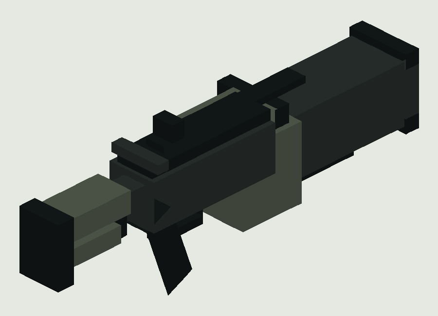

原文：[src/main/resources/data/blacklight/recipe/grenade_launcher.json](sources/neoforge/src/main/resources/data/blacklight/recipe/grenade_launcher.json)；SHA-256 `a403bf2a685a0c65ba6cf05edacc8dd11b8c527f3367194f3ced2eed702e126c`。

```json
{
  "type": "minecraft:crafting_shaped",
  "pattern": [
    "III",
    " CR",
    " SI"
  ],
  "key": {
    "I": {
      "item": "minecraft:iron_ingot"
    },
    "C": {
      "item": "blacklight:military_circuit"
    },
    "R": {
      "item": "blacklight:grenade_round"
    },
    "S": {
      "item": "minecraft:stick"
    }
  },
  "result": {
    "id": "blacklight:grenade_launcher",
    "count": 1
  }
}
```

## 火箭发射器 / rocket_launcher

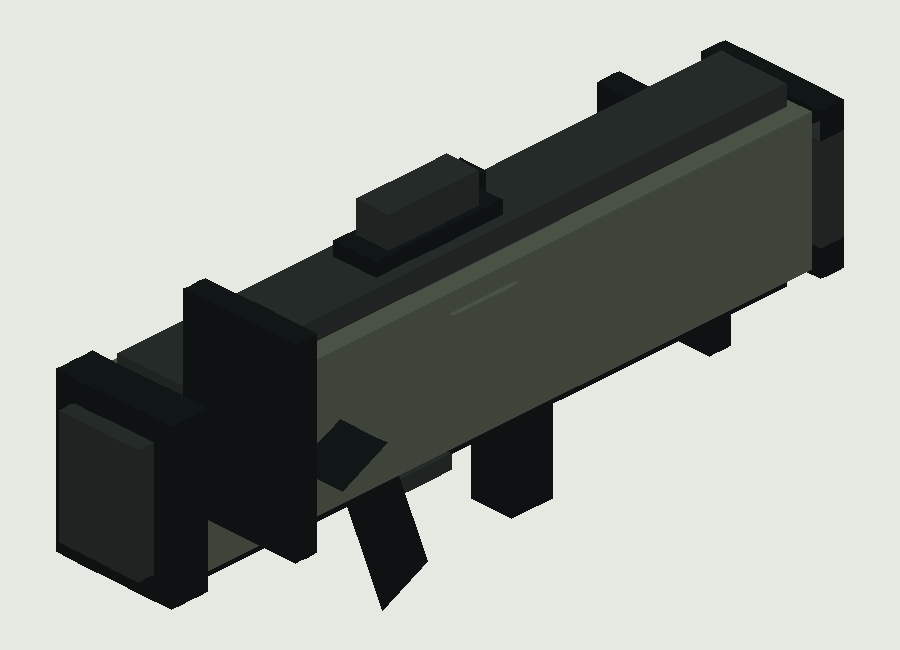

原文：[src/main/resources/data/blacklight/recipe/rocket_launcher.json](sources/neoforge/src/main/resources/data/blacklight/recipe/rocket_launcher.json)；SHA-256 `152c626c4bac850717cc74a0e75be9b7f55ff8b4d9a6e611c5f38b1ece6906a2`。

```json
{
  "type": "minecraft:crafting_shaped",
  "pattern": [
    "III",
    " CR",
    " SI"
  ],
  "key": {
    "I": {
      "item": "minecraft:iron_ingot"
    },
    "C": {
      "item": "blacklight:military_circuit"
    },
    "R": {
      "item": "blacklight:rocket_round"
    },
    "S": {
      "item": "minecraft:stick"
    }
  },
  "result": {
    "id": "blacklight:rocket_launcher",
    "count": 1
  }
}
```

## 导弹发射器 / missile_launcher

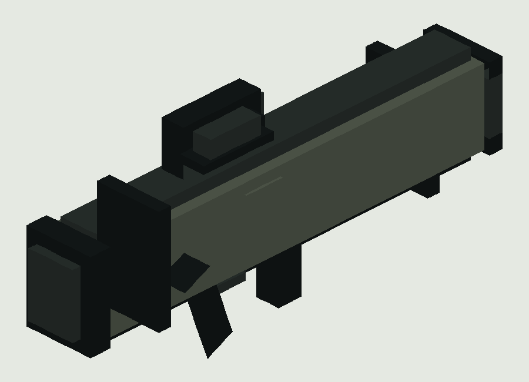

原文：[src/main/resources/data/blacklight/recipe/missile_launcher.json](sources/neoforge/src/main/resources/data/blacklight/recipe/missile_launcher.json)；SHA-256 `df23448187321c684ee96bcad9c63458e922fd694a7aac93f7f68f92906a0a85`。

```json
{
  "type": "minecraft:crafting_shaped",
  "pattern": [
    "III",
    " CR",
    " SI"
  ],
  "key": {
    "I": {
      "item": "minecraft:iron_ingot"
    },
    "C": {
      "item": "blacklight:military_circuit"
    },
    "R": {
      "item": "blacklight:missile_round"
    },
    "S": {
      "item": "minecraft:stick"
    }
  },
  "result": {
    "id": "blacklight:missile_launcher",
    "count": 1
  }
}
```

## 温压榴弹发射器 / thermobaric_launcher


原文：[src/main/resources/data/blacklight/recipe/thermobaric_launcher.json](sources/neoforge/src/main/resources/data/blacklight/recipe/thermobaric_launcher.json)；SHA-256 `bc24146081be3103ed04341572f14d9894ff49081583ae93eae301c2b3976903`。

```json
{
  "type": "minecraft:crafting_shaped",
  "pattern": [
    "III",
    " CR",
    " SI"
  ],
  "key": {
    "I": {
      "item": "minecraft:iron_ingot"
    },
    "C": {
      "item": "blacklight:military_circuit"
    },
    "R": {
      "item": "blacklight:thermobaric_round"
    },
    "S": {
      "item": "minecraft:stick"
    }
  },
  "result": {
    "id": "blacklight:thermobaric_launcher",
    "count": 1
  }
}
```

## 感染榴弹发射器 / infection_launcher

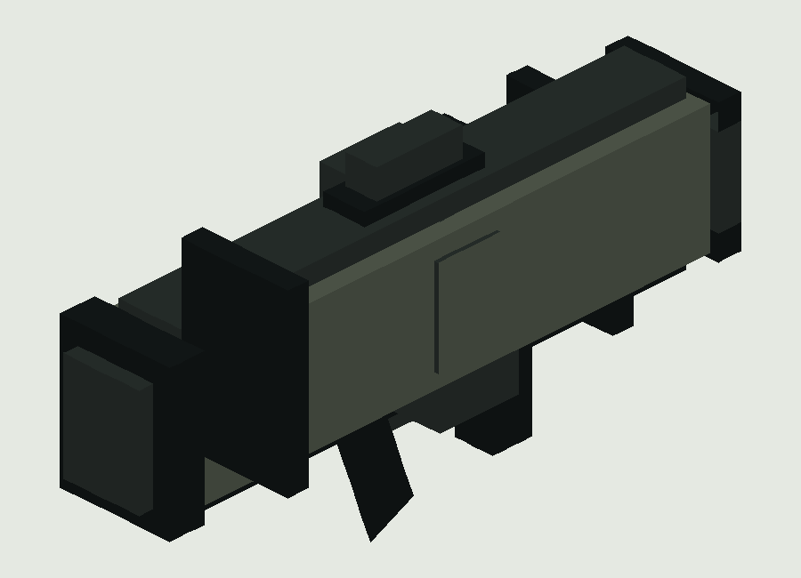

原文：[src/main/resources/data/blacklight/recipe/infection_launcher.json](sources/neoforge/src/main/resources/data/blacklight/recipe/infection_launcher.json)；SHA-256 `75f9385995b07bb31cd166a40fd8f6b1eff0d2997a42222126da1e5882ed01cc`。

```json
{
  "type": "minecraft:crafting_shaped",
  "pattern": [
    "III",
    " CR",
    " SI"
  ],
  "key": {
    "I": {
      "item": "minecraft:iron_ingot"
    },
    "C": {
      "item": "blacklight:military_circuit"
    },
    "R": {
      "item": "blacklight:infection_round"
    },
    "S": {
      "item": "minecraft:stick"
    }
  },
  "result": {
    "id": "blacklight:infection_launcher",
    "count": 1
  }
}
```


## 七种弹药

| ID | 中文 | 使用武器 |
| --- | --- | --- |
| rifle_round | 步枪弹 | ["military_rifle","military_carbine"] |
| machine_gun_round | 机枪弹 | ["military_machine_gun"] |
| grenade_round | 破片榴弹 | ["grenade_launcher"] |
| rocket_round | 火箭弹 | ["rocket_launcher"] |
| missile_round | 导弹 | ["missile_launcher"] |
| thermobaric_round | 温压榴弹 | ["thermobaric_launcher"] |
| infection_round | 感染榴弹 | ["infection_launcher"] |

### 步枪弹 / rifle_round

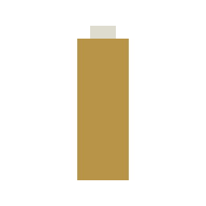

原文：[src/main/resources/data/blacklight/recipe/rifle_round.json](sources/neoforge/src/main/resources/data/blacklight/recipe/rifle_round.json)；SHA-256 `95c64f0ac63c510b41775bf127ba9e34afaca4e26ec0762e46fe9a415947bc78`。

```json
{
  "type": "minecraft:crafting_shapeless",
  "ingredients": [
    {
      "item": "minecraft:iron_ingot"
    },
    {
      "item": "minecraft:gunpowder"
    }
  ],
  "result": {
    "id": "blacklight:rifle_round",
    "count": 16
  }
}
```


### 机枪弹 / machine_gun_round

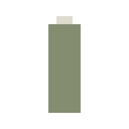

原文：[src/main/resources/data/blacklight/recipe/machine_gun_round.json](sources/neoforge/src/main/resources/data/blacklight/recipe/machine_gun_round.json)；SHA-256 `d0dbd1676fb2cde3483d64ac67242c6c3cf55d2ff88e57698b2ed396cdd9176c`。

```json
{
  "type": "minecraft:crafting_shapeless",
  "ingredients": [
    {
      "item": "minecraft:iron_ingot"
    },
    {
      "item": "minecraft:gunpowder"
    }
  ],
  "result": {
    "id": "blacklight:machine_gun_round",
    "count": 16
  }
}
```


### 破片榴弹 / grenade_round


原文：[src/main/resources/data/blacklight/recipe/grenade_round.json](sources/neoforge/src/main/resources/data/blacklight/recipe/grenade_round.json)；SHA-256 `7b227b2224e36c6df62b17819e35a2180d7f3cdc1837c475a37666ea450a4eba`。

```json
{
  "type": "minecraft:crafting_shapeless",
  "ingredients": [
    {
      "item": "minecraft:iron_ingot"
    },
    {
      "item": "minecraft:gunpowder"
    }
  ],
  "result": {
    "id": "blacklight:grenade_round",
    "count": 2
  }
}
```


### 火箭弹 / rocket_round

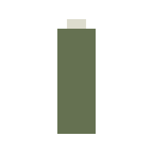

原文：[src/main/resources/data/blacklight/recipe/rocket_round.json](sources/neoforge/src/main/resources/data/blacklight/recipe/rocket_round.json)；SHA-256 `1b17e681bd1b228968990a3b5dee684376d4d2e2f467a1fd8fd098ca608b1ca1`。

```json
{
  "type": "minecraft:crafting_shapeless",
  "ingredients": [
    {
      "item": "minecraft:iron_ingot"
    },
    {
      "item": "minecraft:gunpowder"
    }
  ],
  "result": {
    "id": "blacklight:rocket_round",
    "count": 2
  }
}
```


### 导弹 / missile_round

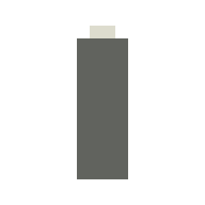

原文：[src/main/resources/data/blacklight/recipe/missile_round.json](sources/neoforge/src/main/resources/data/blacklight/recipe/missile_round.json)；SHA-256 `16741d1833f2a8874ded02db83724b1a9dc86d9117b5e283c580e9579ff9ac20`。

```json
{
  "type": "minecraft:crafting_shapeless",
  "ingredients": [
    {
      "item": "minecraft:iron_ingot"
    },
    {
      "item": "minecraft:gunpowder"
    }
  ],
  "result": {
    "id": "blacklight:missile_round",
    "count": 2
  }
}
```


### 温压榴弹 / thermobaric_round

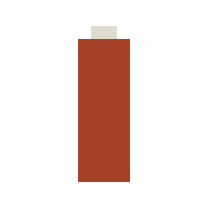

原文：[src/main/resources/data/blacklight/recipe/thermobaric_round.json](sources/neoforge/src/main/resources/data/blacklight/recipe/thermobaric_round.json)；SHA-256 `b14b4ccf82e1147c013069751fe99a97ad562272c73921060ceffca0722d8f25`。

```json
{
  "type": "minecraft:crafting_shapeless",
  "ingredients": [
    {
      "item": "minecraft:iron_ingot"
    },
    {
      "item": "minecraft:gunpowder"
    },
    {
      "item": "minecraft:blaze_powder"
    }
  ],
  "result": {
    "id": "blacklight:thermobaric_round",
    "count": 2
  }
}
```


### 感染榴弹 / infection_round


原文：[src/main/resources/data/blacklight/recipe/infection_round.json](sources/neoforge/src/main/resources/data/blacklight/recipe/infection_round.json)；SHA-256 `334701a6fc85c7a12d447b439c6d555f9f5c78b8816480d7bd5c09f09b6d8fc1`。

```json
{
  "type": "minecraft:crafting_shapeless",
  "ingredients": [
    {
      "item": "minecraft:iron_ingot"
    },
    {
      "item": "minecraft:gunpowder"
    },
    {
      "item": "blacklight:blacklight_sample"
    }
  ],
  "result": {
    "id": "blacklight:infection_round",
    "count": 2
  }
}
```


所有枪模图是实际生产JSON的立方体/纹理采样几何示意，不含第一人称display、透视、动画、动态后坐或GL光影。炮口、枪线视觉和命中射线分别由运行源码管理；静态图不能代替左右手实机验证。枪物品最多堆叠1；弹药按普通 Item注册，未单独定义stacksTo。七弹均有独立物品和配方。

配方两端原文全集见[recipes.json](data/recipes.json)，包括 Neo的result.id 与 Forge的result.item 差异；loot原文全集见[loot_tables.json](data/loot_tables.json)。不把装饰军用箱当库存。
